<p align="center">
  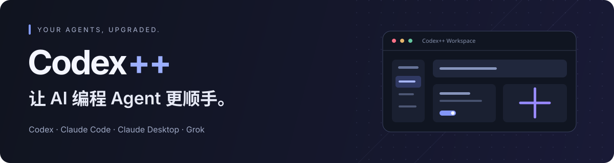
</p>

<p align="center">
  <strong>给你的 AI 编程 Agent 加一点「++」。</strong><br>
  万物皆拓展：在 Codex 对话里说一句，就能造一个拓展。内置本地网关，让 50 多个 Agent 共用一份供应商池。
</p>

<p align="center">
  <a href="https://github.com/BigPizzaV3/CodexPlusPlus/releases"></a>
  <a href="https://github.com/BigPizzaV3/CodexPlusPlus/stargazers"></a>
  <a href="LICENSE"></a>
  
  
</p>

<p align="center">
  <a href="https://github.com/BigPizzaV3/CodexPlusPlus/releases"><strong>下载最新版 ↗</strong></a> &nbsp; · &nbsp;
  <a href="#快速上手">快速上手</a> &nbsp; · &nbsp;
  <a href="#功能一览">功能一览</a> &nbsp; · &nbsp;
  <a href="https://github.com/BigPizzaV3/CodexPlusPlus/issues">反馈问题</a> &nbsp; · &nbsp;
  <a href="README_EN.md">English</a>
</p>

<p align="center">
  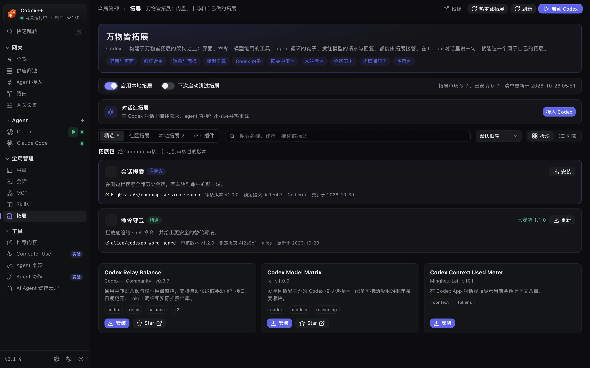
  <br><sub>精选、社区、本地拓展和 dsh 插件都在一页：装别人的，也管自己做的。</sub>
</p>

Codex++ 是 AI 编程 Agent 的统一管理应用，构建于万物皆拓展的架构之上：界面、命令、模型能用的工具、agent 循环的钩子、发往模型的请求与回复，都能由拓展接管。不想写代码？在 Codex 对话里说一句「把发送按钮改成狗头」，agent 就会写出拓展、热重载并截图确认。

它还内置一个本地网关：Codex、Claude Code、Gemini CLI、OpenCode、Zed 等 50 多个 Agent 共用一份供应商池，按模型名选供应商，Key 冷却或供应商熔断时自动换上游，ChatGPT、GitHub Copilot、Cursor 等订阅也能登录进池。原来的直连模式（官方登录、官方 + API、纯 API、聚合供应商）完整保留，Codex 在「经网关」和「直连」之间一键切换。

此外还有会话管理、Codex 界面增强、Claude Desktop 增强版、跨 Agent 的 Computer Use 与子 Agent 协作。管理器是一个桌面程序的样子：侧栏切 Agent 和页面，顶部页签切分页，齿轮进设置目录；只用 Codex 或只想要增强功能，可以切换使用模式把用不到的页面藏起来。双击打开管理界面，再从界面启动各个应用；它不修改任何官方应用的安装文件。

## 交流与支持

遇到问题请通过 [GitHub Issues](https://github.com/BigPizzaV3/CodexPlusPlus/issues) 提交，附上系统、Codex++ 版本、复现步骤与已脱敏的日志。欢迎分享拓展、主题和使用经验。

<p align="center">
  <a href="https://qm.qq.com/q/5h3pxpxg7S">QQ 交流 4 群 · 1127858981</a> &nbsp; · &nbsp;
  <a href="https://t.me/CodexPlusPlus">Telegram 频道</a> &nbsp; · &nbsp;
  <a href="https://linux.do">LINUX DO</a>
</p>

## 感谢赞助商

感谢以下赞助商对项目的支持。服务范围、价格与活动以各平台官网说明为准。

<p align="center">
  <a href="https://jojocode.com/">
    
  </a>
</p>

<p align="center">
  <a href="https://jojocode.com/"><strong>JOJO Code</strong></a><br>
  JOJO Code 提供稳定、价格合理的 API 中转服务，支持 GPT-6.1、GPT-6、Fable 5.1、Claude Opus 5.5 等模型与图像能力，适合日常开发、团队协作和长期项目工作流。
</p>

<table>
  <tr>
    <th width="180">🏆 赞助商 🏆</th>
    <th>介绍</th>
  </tr>
  <tr>
    <td align="center">
      <a href="https://jojocode.com/">
        
      </a>
    </td>
    <td><a href="https://jojocode.com/"><strong>JOJO Code</strong></a><br>JOJO Code 提供稳定、价格合理的 API 中转服务，支持 GPT-6.1、GPT-6、Fable 5.1、Claude Opus 5.5 等模型与图像能力，适合日常开发、团队协作和长期项目工作流。</td>
  </tr>
  <tr>
    <td align="center">
      <a href="https://apikey.fun/register?aff=CODEX">
        
      </a>
    </td>
    <td><a href="https://apikey.fun/register?aff=CODEX"><strong>APIKEY.FUN</strong></a><br>感谢 APIKEY.FUN 赞助了本项目！APIKEY.FUN 是一家致力于提供开放、稳定、高性价比的全球主流大模型的 AI 中转站。平台支持 Claude、OpenAI、Gemini 等热门模型的 API 中转服务，价格低至官方原价的 7%。通过专属链接<a href="https://apikey.fun/register?aff=CODEX">注册 APIKEY</a>，可享受最高充值永久 95 折优惠。</td>
  </tr>
  <tr>
    <td align="center">
      <a href="https://runapi.host/register?aff=AWJq">
        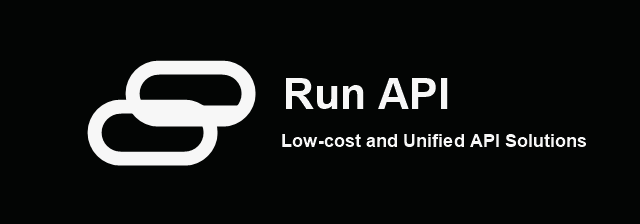
      </a>
    </td>
    <td><a href="https://runapi.host/register?aff=AWJq"><strong>RunAPI</strong></a><br>RunAPI 是高效稳定的 API 聚合平台，一个 API Key 即可访问 OpenAI、Claude、Gemini、DeepSeek、Grok 等 150+ 主流模型，低至 1 折，兼容 Claude Code、OpenClaw 等工具。</td>
  </tr>
  <tr>
    <td align="center">
      <a href="https://api.fenno.ai/s/ZZM7">
        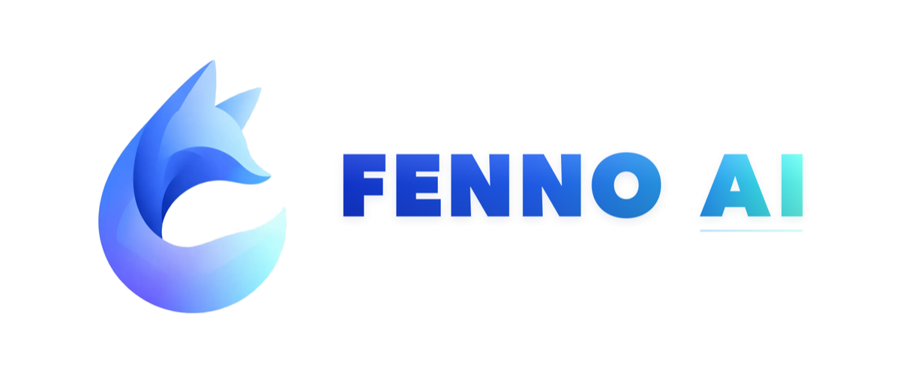
      </a>
    </td>
    <td><a href="https://api.fenno.ai/s/ZZM7"><strong>FennoAI</strong></a><br>FennoAI 是一家稳定、高效的 API 中转服务商，目前主要提供 Codex 中转服务，兼容 OpenAI 及 Anthropic 协议，可灵活接入 Codex、Claude Code、OpenCode 等主流编程工具，稳定支撑千亿 Token/日的企业级调用需求，支持国内及海外主体公对公结算、开票。通过<a href="https://api.fenno.ai/s/ZZM7">专属链接</a>购买订阅，仅需 1.99 美元即可获得价值 50 美元的 Coding Plan 额度；邀请好友购买最高可获得 20% 返佣。</td>
  </tr>
  <tr>
    <td align="center">
      <a href="https://cn.hb-api.online/register?aff=8KA2ZKWNHND8">
        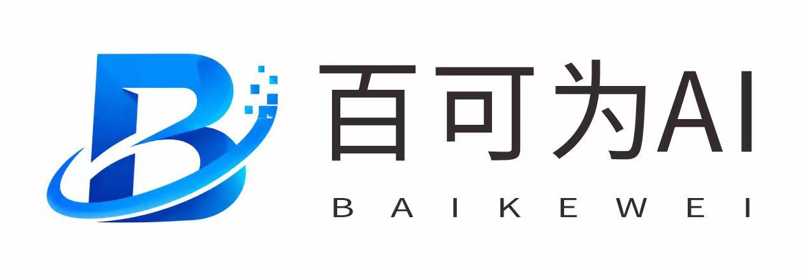
      </a>
    </td>
    <td><a href="https://cn.hb-api.online/register?aff=8KA2ZKWNHND8"><strong>百可为AI</strong></a><br>百可为AI 是面向开发者、团队和 AI 工具用户的一站式大模型 API 服务平台，支持 Claude、OpenAI、Gemini、Codex 等主流模型能力接入。平台提供稳定中转、灵活计费、用量统计、余额管理和多场景 API 调用能力，适合 Claude Code、Codex、AI 生图、自动化脚本和各类智能应用长期使用。新用户注册可领取免费额度，开发者可快速接入、即开即用，让 AI 能力更稳定、更高效、更省心。</td>
  </tr>
  <tr>
    <td align="center">
      <a href="https://s.qiniu.com/7zUJri">
        
      </a>
    </td>
    <td><a href="https://s.qiniu.com/7zUJri"><strong>七牛云</strong></a><br>感谢七牛云 AI 赞助本项目！七牛云 AI 是七牛云（02567.HK）旗下企业级大模型 MaaS 平台，可一站式调用全球 150 多个主流模型，兼容全球主流模型厂商协议，覆盖文本、图像、音频、视频、文件处理等全模态能力，服务超过 169 万企业及开发者用户。企业用户可免费领取 1200 万 Token，邀请好友最高可获得百亿 Token。</td>
  </tr>
  <tr>
    <td align="center">
      <a href="https://agent.tokenmy.ai">
        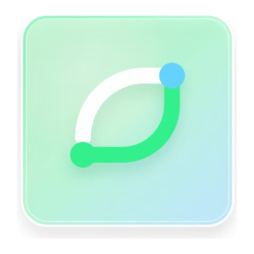
      </a>
    </td>
    <td><a href="https://agent.tokenmy.ai"><strong>TokenMy</strong></a><br>感谢 TokenMy 赞助本项目！TokenMy 是面向开发者与团队的统一 AI 模型 API 网关，汇聚 OpenAI、Anthropic、Google、DeepSeek、字节跳动、Suno 等厂商的模型，覆盖 GPT、Claude、Gemini 等对话模型，GPT Image 生图模型，Seedance、Veo 视频模型及 Suno 音乐生成模型。一个 API Key 即可接入多类 AI 能力，配合按量计费、用量监控与账单查询，满足智能体开发、多模态应用与影音内容创作需求。欢迎<a href="https://agent.tokenmy.ai">注册使用</a>，也可申请成为 TokenMy 代理或推广大使，携手拓展 AI 应用市场，享受推广佣金与合作激励。</td>
  </tr>
  <tr>
    <td align="center">
      <a href="https://apinebula.ai/ref/IiCBg1nu">
        
      </a>
    </td>
    <td><a href="https://apinebula.ai/ref/IiCBg1nu"><strong>APINEBULA</strong></a><br>感谢 APINEBULA 赞助本项目！APINEBULA 是银河录像局旗下的企业级 AI 聚合平台，背靠大平台资源，面向开发者、团队与企业用户提供稳定、高性价比的大模型 API 接入服务。平台聚合 Claude、GPT、Gemini 等主流满血模型，一个接口接入全球顶尖 AI 大模型，各大模型价格低至 1 折起，支持企业级高并发、正式合同、对公打款与开票服务，适合 AI 编程、Agent 开发、业务系统集成等多种场景！<a href="https://apinebula.ai/ref/IiCBg1nu">使用此链接注册</a>并在充值时填写「PLUSPLUS」优惠码可享九折优惠！</td>
  </tr>
  <tr>
    <td align="center">
      <a href="https://dzhsmartai.com/register?promo=CODEXPLUSPLUS">
        
      </a>
    </td>
    <td><a href="https://dzhsmartai.com/register?promo=CODEXPLUSPLUS"><strong>ccccccAPI</strong></a><br>感谢 ccccccAPI 赞助本项目！ccccccAPI 量贩式中转站 —— 实惠 Token，一站式接入。ccccccAPI 是一家专注服务开发者与企业的 AI API 中转站，主打「量贩式」定价：ChatGPT、Claude、Kimi、Grok、Gemini 等主流模型基本全覆盖，一个 API Key、一套兼容 OpenAI 的接口，改一行 base_url 就能自由切换，不用再分别注册、分别充值。目标很朴素：让更多人用上实惠的 Token——用 ccccccAPI，不烧钱、不烧心。通过<a href="https://dzhsmartai.com/register?promo=CODEXPLUSPLUS">此链接注册</a>，即得 1 美元使用额度。</td>
  </tr>
</table>

想支持项目或展示品牌？[联系维护者](mailto:1727532@qq.com)。

## 功能一览

| Agent | Codex++ 能做什么 |
| --- | --- |
| **Codex 桌面版** | 经网关或直连接入供应商、协议转换、请求避震、会话管理、界面增强、多开、拓展与桌宠 |
| **Claude Code** | 经网关接入任意协议的供应商（Anthropic 请求在网关里转成 Chat / Responses）、接入 Computer Use |
| **Claude Desktop** | 增强版（中文界面、语音输入、Computer Use）、接入 Computer Use |
| **Grok CLI** | 经网关接入供应商池，可用 SuperGrok 订阅 |
| **Gemini CLI、OpenCode、Zed、VS Code 等 50+ Agent** | 经网关接入供应商池，Anthropic / Chat / Responses / Gemini 协议互转 |
| **DeepSeek Harness 等** | 接入 Computer Use、在 Codex 对话中作为子 Agent 调用；dsh 插件可导入 Codex |

<table>
  <tr>
    <td width="50%" valign="top"><strong>🧩 万物皆拓展 · 新</strong><br>界面、命令、模型工具、钩子、网关请求都能由拓展接管。</td>
    <td width="50%" valign="top"><strong>💬 对话造拓展 · 新</strong><br>在 Codex 对话里说需求，agent 写出拓展并热重载。</td>
  </tr>
  <tr>
    <td valign="top"><strong>🛍️ 精选、社区与一键发布 · 新</strong><br>审核过的精选拓展、GitHub 社区拓展，自己的一键发布。</td>
    <td valign="top"><strong>🔁 导入 dsh 插件 · 新</strong><br>工具插件经托管 MCP 在 Codex 里运行。</td>
  </tr>
  <tr>
    <td width="50%" valign="top"><strong>🌐 本地网关</strong><br>50 多个 Agent 共用一份供应商池，按模型名路由，出错自动换下一家。</td>
    <td width="50%" valign="top"><strong>🔀 路由与模型组 · 新</strong><br>依次、轮换、按权重、额度优先、速度优先，可按会话固定。</td>
  </tr>
  <tr>
    <td valign="top"><strong>🔑 多 Key 与订阅登录 · 新</strong><br>多 Key 轮换与冷却；ChatGPT、Copilot、SuperGrok 登录进池并显示额度。</td>
    <td valign="top"><strong>📊 用量与请求日志 · 新</strong><br>费用、token、缓存命中，按 Agent、供应商、模型拆开看。</td>
  </tr>
  <tr>
    <td valign="top"><strong>🔌 直连模式照旧</strong><br>官方登录、官方 + API、纯 API、故障转移与模型聚合。</td>
    <td valign="top"><strong>🧠 每个模型，各有空间</strong><br>按模型设置上下文窗口、价格与思考等级。</td>
  </tr>
  <tr>
    <td valign="top"><strong>🖱️ Computer Use 共享</strong><br>把 Codex 的桌面与浏览器控制接给其他 Agent。</td>
    <td valign="top"><strong>🤝 子 Agent 协作</strong><br>在 Codex 对话里委派 DeepSeek、Claude Code，可排队并发。</td>
  </tr>
  <tr>
    <td valign="top"><strong>💬 会话管理</strong><br>Codex、Claude Code、Claude Desktop、Grok 的会话放在一起；删除撤销、导出、<a href="docs/turn-rewind.md">轮次回退</a>。</td>
    <td valign="top"><strong>🧵 Codex 多开</strong><br>每个供应商一个隔离实例。</td>
  </tr>
  <tr>
    <td valign="top"><strong>✨ 输入与阅读</strong><br>语音输入、输入预测、粘贴修复、下一步建议、打字特效。</td>
    <td valign="top"><strong>📈 用量状态栏</strong><br>输出吞吐、缓存命中与上下文占用。</td>
  </tr>
  <tr>
    <td valign="top"><strong>⚡ API Key 原生 Fast</strong><br>纯 API Key 也能用 Standard / Fast 控件。</td>
    <td valign="top"><strong>🧰 MCP、Skills 与插件市场</strong><br>MCP、Skills 按 Agent 启用；Codex 插件市场可装可卸。</td>
  </tr>
  <tr>
    <td valign="top"><strong>🖥️ 托盘快捷面板</strong><br>点托盘图标就能换模型、看用量和最近请求。</td>
    <td valign="top"><strong>📱 微信连接</strong><br>扫码连接本机 Codex。</td>
  </tr>
  <tr>
    <td valign="top"><strong>🐳 Agent 桌宠</strong><br>点一下会压扁、带音效，图片随心换。</td>
    <td valign="top"><strong>🧹 缓存清理与皮肤</strong><br>清理 Codex、Claude 缓存；社区主题与自定义图片。</td>
  </tr>
  <tr>
    <td valign="top"><strong>🔁 网关 / 直连一键切换 · 新</strong><br>Codex 的「连接方式」二选一，切换后从 Codex++ 重启生效。</td>
    <td valign="top"><strong>⬇️ 后台更新 · 新</strong><br>发现新版本先在后台下好安装包，侧栏提示，点「安装」才安装。</td>
  </tr>
</table>

所有增强都能单独开关；关闭增强总开关后，供应商与启动管理照常可用。

## 看看它能做什么

### 万物皆拓展：说一句话，拓展就写好了

在管理器「拓展」页点「接入 Codex」，新开一个 Codex 对话直接说需求。agent 能查看 Codex 自己的页面结构，写出拓展包、热重载，再截图确认效果；拓展只写在你自己的拓展目录里，写入走 Codex 的工具审批。

<p align="center">
  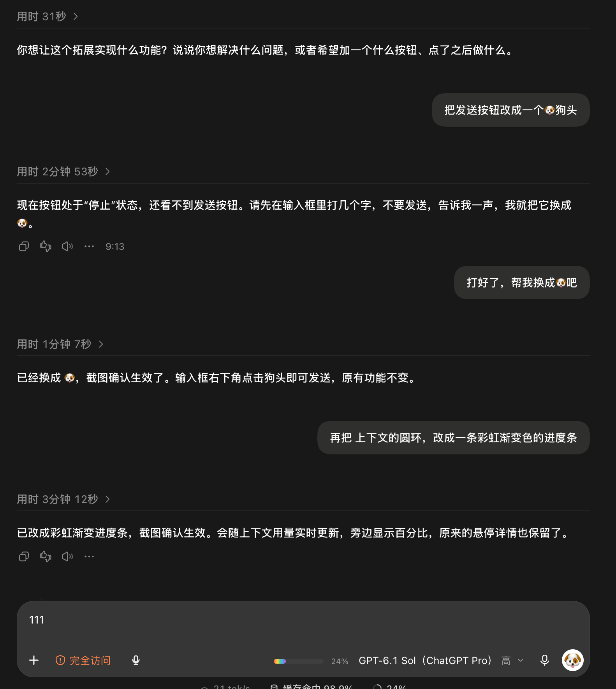
  <br><sub>实测：两句话，发送按钮换成狗头，上下文圆环换成彩虹进度条。</sub>
</p>

拓展是一个带 `codexpp.json` 的文件夹，能做的不止改界面：

| 能力 | 说明 |
| --- | --- |
| 界面插槽与页面 | 输入框上方、对话区、侧栏、标题栏插槽；页面、菜单项、会话行操作 |
| 斜杠命令与输入区按钮 | 输入 `/` 时提示拓展命令并可补全；发送按钮旁加图标按钮 |
| 消息操作与侧边面板 | 每条消息下加按钮或内容；右侧面板 |
| 给模型加工具 | 清单里声明工具，经 Codex++ 拓展 MCP 提供给模型 |
| Codex 钩子与工具管道 | 工具前后、回合结束等钩子；执行前改参数、代为执行、改写结果 |
| 网关中间件 | 请求发往上游前改写、响应流改写、失败重试 |
| 常驻后台与服务 | 后台进程；拓展间按名字提供和调用服务，可跨进程 |
| 会话、配置与多语言 | 只读查询与订阅会话；配置项自动生成设置表单 |

完整接口见 [拓展开发指南](EXTENSIONS.md)。

<table>
  <tr>
    <td width="50%" valign="top"><strong>精选与官方拓展</strong><br>经 Codex++ 审核，安装锁定到审核过的提交。<br></td>
    <td width="50%" valign="top"><strong>社区拓展</strong><br>GitHub 上打了 <code>codexpp-extension</code> 标签的仓库；装前列出全部能力，装完默认不启用。<br>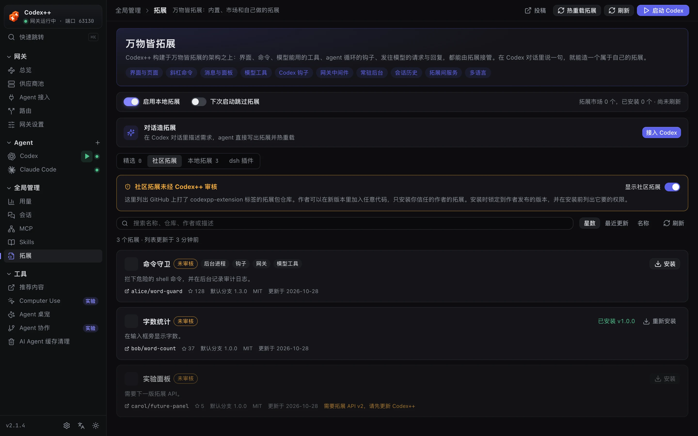</td>
  </tr>
  <tr>
    <td valign="top"><strong>导入 dsh 插件</strong><br>工具插件经托管 MCP 在 Codex 里运行，提示词与事件转成网关 instructions 与 Codex 钩子。<br>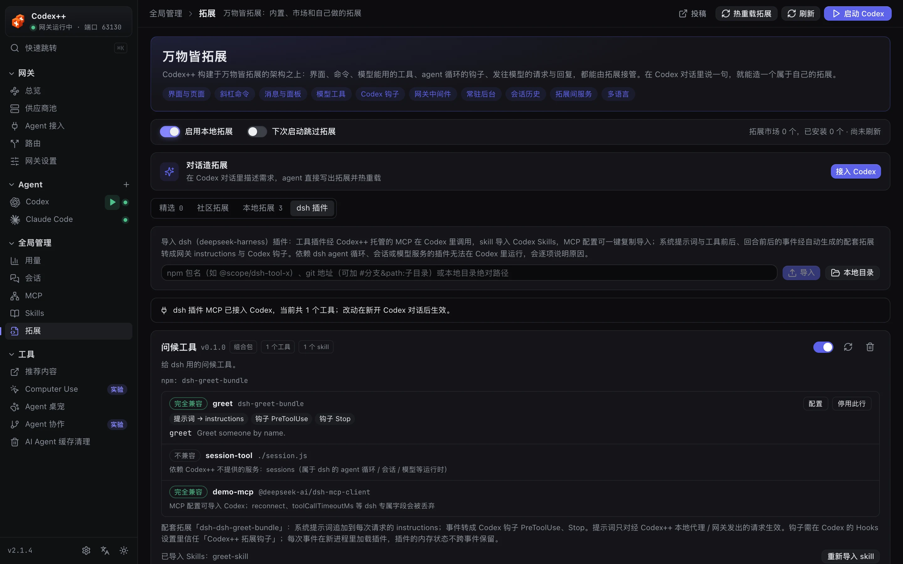</td>
    <td valign="top"><strong>一键发布</strong><br>在本地拓展那一行点「发布」：检查清单、密钥与体积后建仓库、打 tag、传 release、加 topic，每一步都显示进度。不读、不存你的 GitHub token。</td>
  </tr>
</table>

### 网关总览：50 多个 Agent，一份供应商池

<p align="center">
  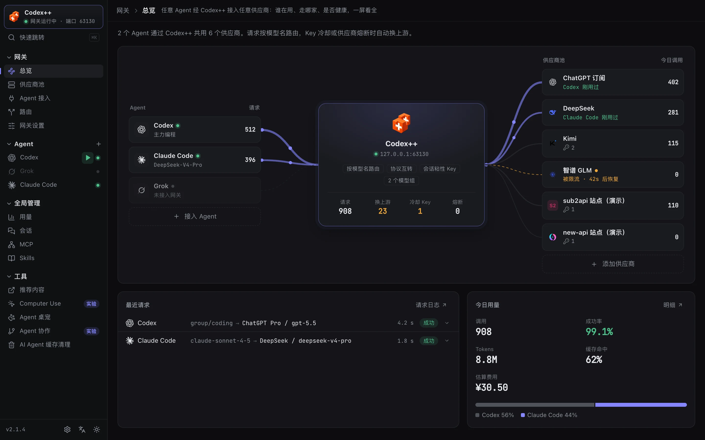
</p>

### 供应商池：加一次，所有 Agent 都能用

添加供应商时自动拉模型列表、按公开价格表填价格；中转站（sub2api / new-api）自动识别倍率与余额，订阅账号显示剩余额度。每家可以按模型设置价格、上下文窗口、思考等级和独立代理。

<p align="center">
  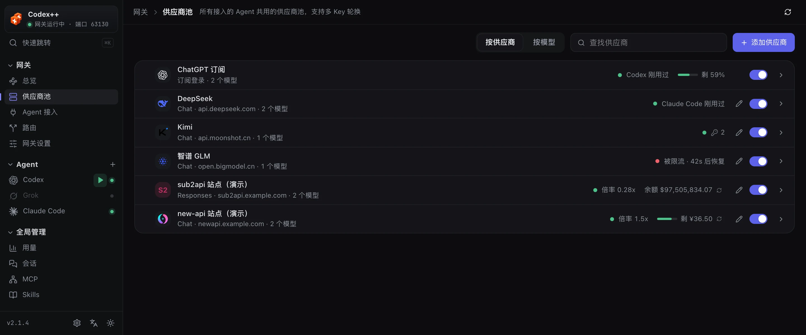
</p>

### 路由：多家都有的模型，怎么分由你定

裸模型名发给池里提供它的供应商，`<供应商>/<模型>` 只发给那一家，`group/<组>` 走自建的组。多家都有的模型自动成组；组可选依次、轮换、按权重、额度优先、速度优先或手动，出错按顺序换下一家。

<p align="center">
  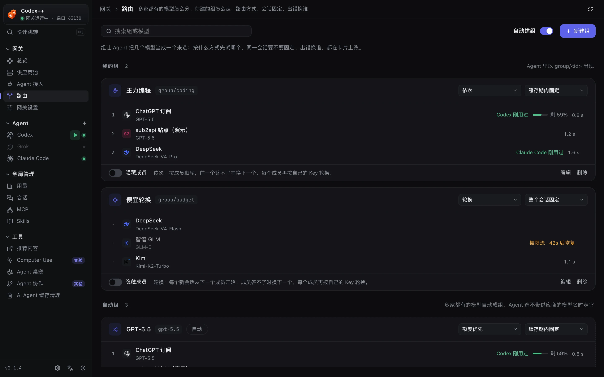
</p>

### Agent 接入：开关一拨就接上

给 Agent 打开开关就经网关接入，选它默认用哪个模型；Claude Code 还能分别指定 opus / sonnet / haiku 用哪个模型。接入前会存档 Agent 的配置文件，断开时只还原网关改过的那几项。

<p align="center">
  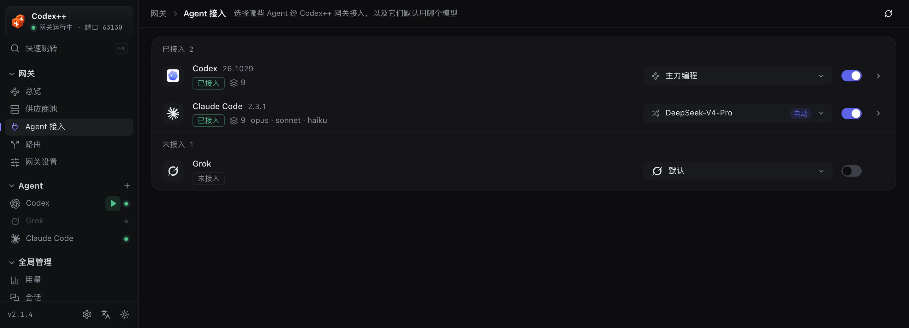
</p>

### 用量与请求日志

「统计」按天看费用、token、缓存与调用，按 Agent、供应商或模型拆开；「请求」列出每条请求的状态、自动重试、首字耗时、token、缓存与估算费用，失败的直接显示原因。

<p align="center">
  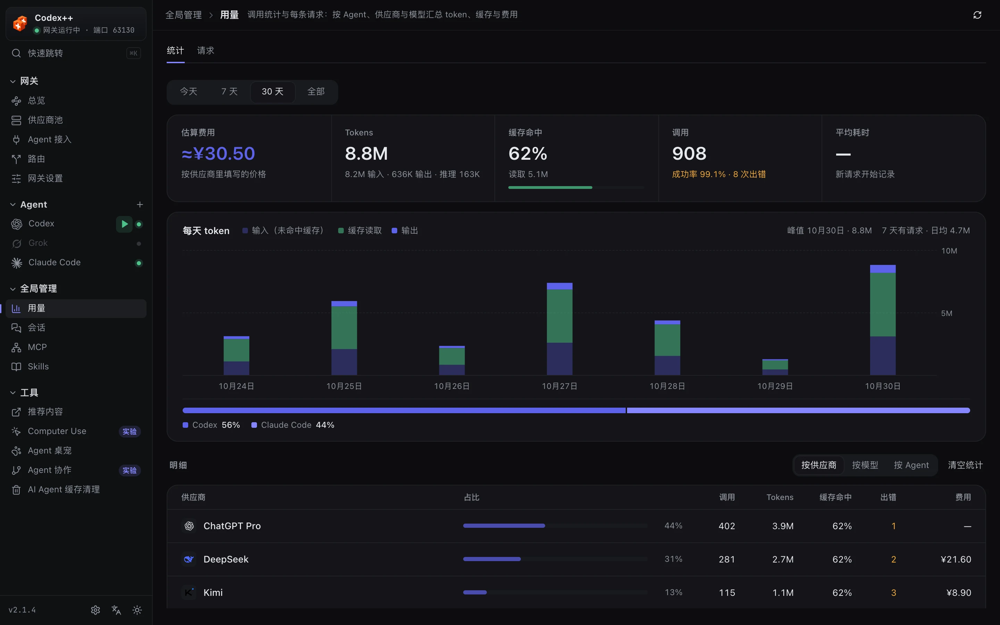
</p>

<p align="center">
  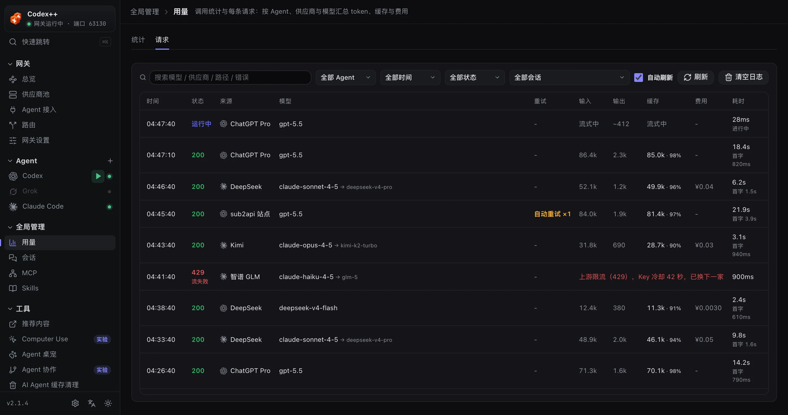
</p>

<p align="center">
  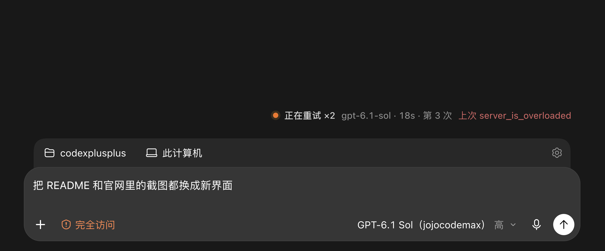
</p>

### Computer Use：把 Codex 的桌面控制借给其他 Agent

给客户端点「接入」，重启后就能在 Claude Code、Claude Desktop、DeepSeek Harness 等里操作桌面和浏览器。目前仅支持 macOS。

<p align="center">
  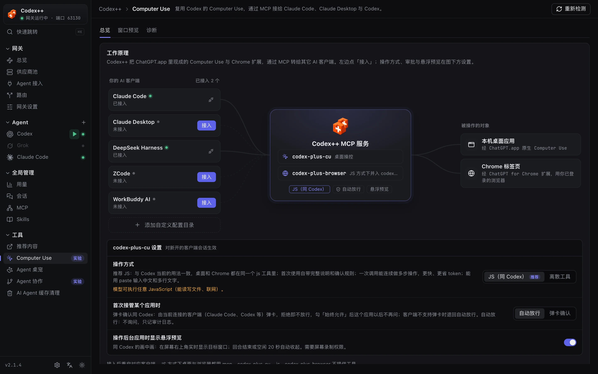
</p>

### Codex 增强、Claude 增强版、会话与缓存清理

<table>
  <tr>
    <td width="50%" valign="top"><strong>Codex 增强</strong><br>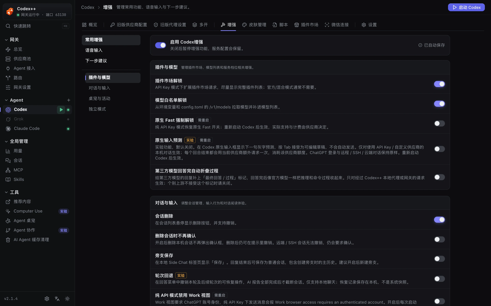</td>
    <td width="50%" valign="top"><strong>Claude 增强版</strong><br>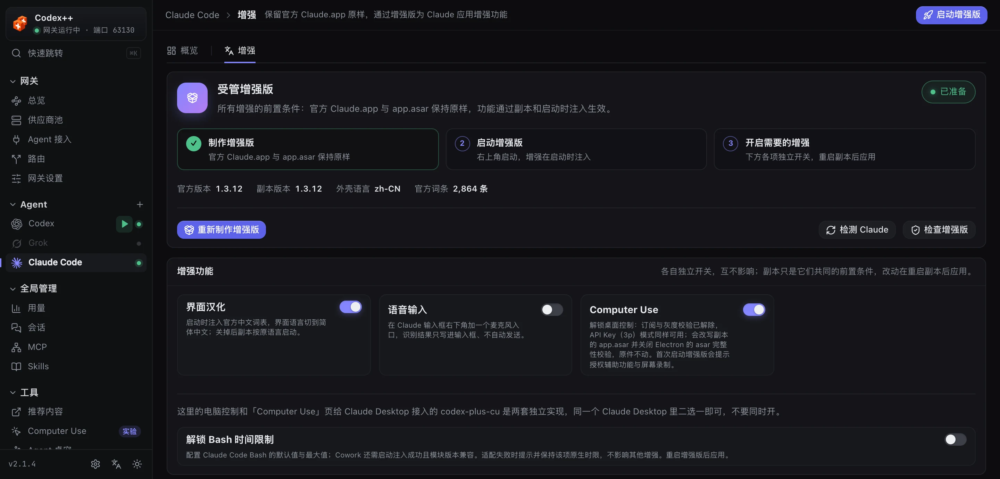</td>
  </tr>
  <tr>
    <td valign="top"><strong>会话</strong><br>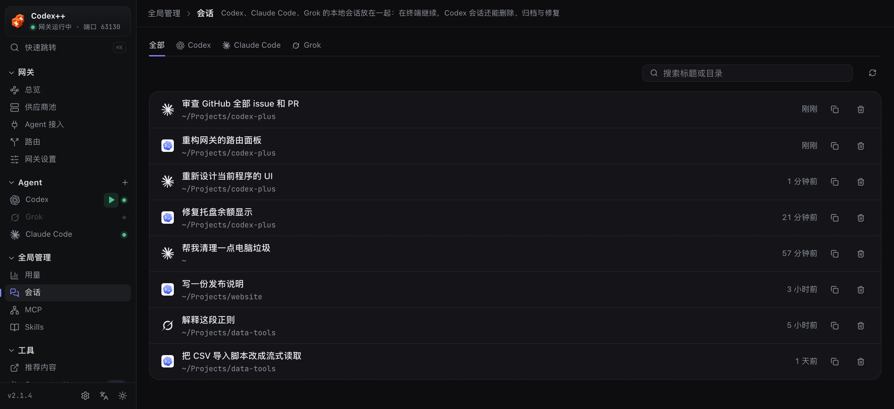</td>
    <td valign="top"><strong>AI Agent 缓存清理</strong><br>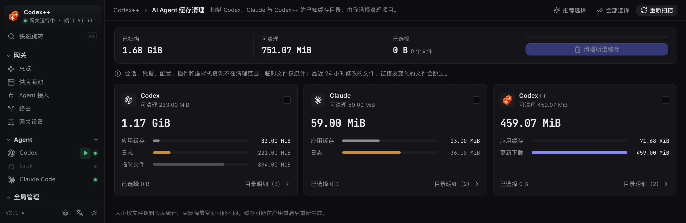</td>
  </tr>
</table>

### 用量状态栏

<p align="center">
  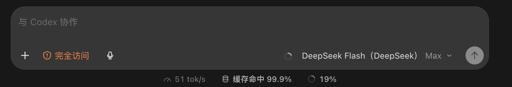
</p>

### Codex 多开

每个供应商身份一个隔离的 Codex 实例，配置、会话和用户数据目录互不干扰，可单独重启或结束。

<p align="center">
  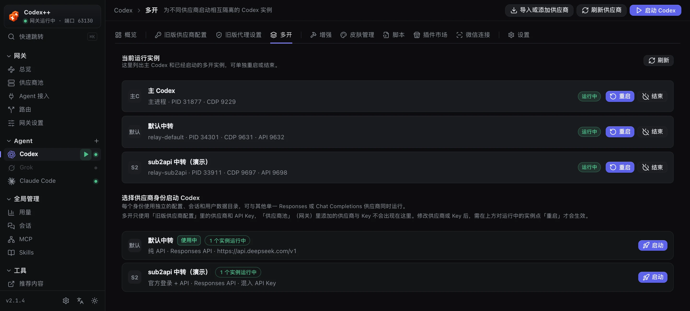
</p>

### 在 Codex 对话里，直接请其他 Agent 帮忙

对 Codex 说「让 DeepSeek 实现这个功能」，结果回到当前对话；同一 Agent 可以并发执行多个任务，超出上限自动排队。配置见 [子 Agent 协作指南](docs/agent-collaboration.md)。

<p align="center">
  
</p>

### 模型选择器按供应商分组

<p align="center">
  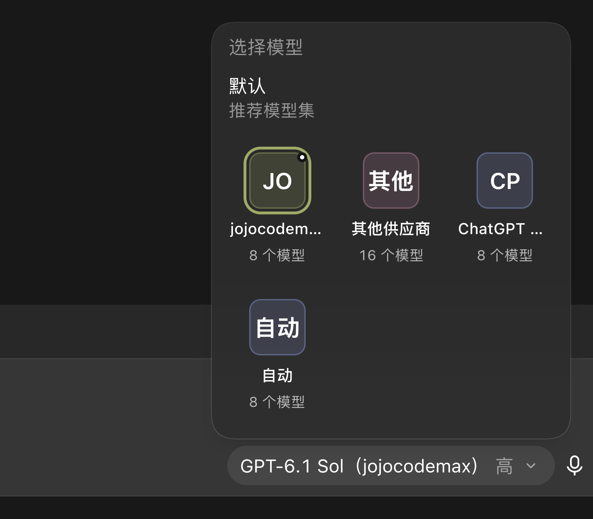
</p>

### Codex 里的拓展页

不离开 Codex 也能浏览、安装和启停拓展。

<p align="center">
  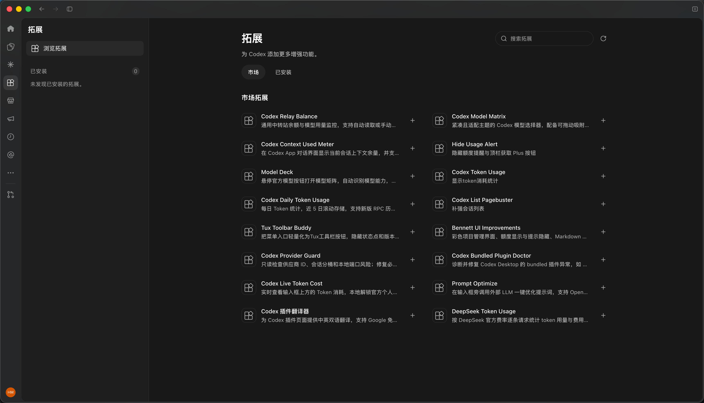
</p>

### 认真工作，也可以有点趣味

<p>
  <strong>光标打字特效</strong><br>
  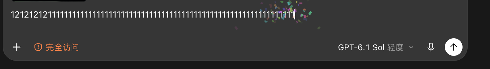
</p>

**Agent 桌宠**：在 Codex 里放一只可拖动的桌宠，点击会压扁并播放音效；图片可从内置图库（Fluent Emoji，运行时联网拉取）挑选，也可填自己的 https 图片地址，音效可导入自定义音频。桌宠类型也可以选「大肥鱼（DeepSeek 鲸鱼）」，即原版用量挂件：余额、价格 / 用量统计、泡泡编辑器与音效。在「万物皆拓展 → 本地拓展」里桌宠那一行点「设置」开启，目前支持 Codex，说明见 [Agent 桌宠](docs/agent-pet.md) 与 [大肥鱼](docs/whale-widget.md)。

**鲸鱼功能来源与鸣谢：**原始功能、完整界面引擎、鲸鱼角色及内置音效/动图来自 [MeteorNOX/DeepSeek-Balance-Whale-Widget](https://github.com/MeteorNOX/DeepSeek-Balance-Whale-Widget)，本项目将其适配为 Codex++ 内置功能；Codex 桌面版技术路线另参考 [Yang-huai406/Codex-Whale-Public](https://github.com/Yang-huai406/Codex-Whale-Public)。原始代码与素材声明见随项目保留的 [LICENSE](assets/inject/upstream/whale-widget/LICENSE) 和 [PROVENANCE.md](assets/inject/upstream/whale-widget/PROVENANCE.md)，素材不重新声明为本项目原创。

<details>
  <summary><strong>纯 API Key 如何开启原生 Fast</strong></summary>

1. 打开「Codex → 内置拓展」，开启顶部的「启用内置拓展」总开关与「原生 Fast 强制解锁」（默认关闭）。
2. 直连模式在「Codex → 连接与供应商」中为该模型设置「Fast（priority）支持」并保存；网关模式下模型组里每个成员都支持 Fast 时，选这个组也能开 Fast。
3. 从 Codex++ 重启 Codex，在模型菜单中选择 **⚡ Fast**。

实际可用性与计费由供应商决定。

</details>

## 快速上手

**1. 下载安装包**：前往 [GitHub Releases](https://github.com/BigPizzaV3/CodexPlusPlus/releases)。

| 你的设备 | 安装包 |
| --- | --- |
| Windows · x64 | `CodexPlusPlus-*-windows-x64-setup.exe` |
| macOS · Apple Silicon / Intel | `CodexPlusPlus-*-macos-universal.dmg` |

**2. 添加供应商**：打开「网关 → 供应商池」，点「添加供应商」：填 API Key、登录 ChatGPT / GitHub Copilot / SuperGrok 订阅，或从直连模式、OpenCode 一次导入多家。添加时自动拉模型列表并填好价格。

**3. 接入 Agent**：打开「网关 → Agent 接入」，给要用的 Agent 打开开关并选默认模型。Claude Code、Grok 接入后照常在终端里用。

**4. 启动 Codex**：点 Codex 页右上角的「启动 Codex」或侧栏 Codex 行的启动按钮。依赖注入的设置（大部分增强、Fast 解锁等）改完后需从 Codex++ 重启 Codex 才生效。

不想用网关？直连模式照旧：在「Codex → 连接与供应商」顶部把「连接方式」切到「直连」，选供应商后启动即可。完整步骤见官网 [使用教程](https://codexpp.cc/guide.html)。

<details>
  <summary><strong>从旧版 macOS 升级</strong></summary>

新发布的 DMG 会保留一个隐藏的兼容壳，让 v1.7.x 的旧更新器可以自动替换两个旧 app；更新后首次启动会自动将兼容壳移到 `~/.codex-session-delete/legacy-migrations`，Applications 中只保留 Codex++。v1.5/v1.6 的旧版本只会打开 DMG，请把其中可见的 **Codex++.app** 拖入「应用程序」替换一次；新版启动时同样会自动归档旧的 **Codex++ 管理工具.app**。原有配置与会话数据继续沿用。

</details>

## 网关与直连

| 模式 | 适用场景 |
| --- | --- |
| **网关（推荐）** | Codex、Claude Code、Grok 共用一份供应商池；按模型名路由、多 Key 轮换、出错换下一家。只在 Codex++ 运行时可用。 |
| **直连 · 官方登录** | 使用 ChatGPT / Codex 官方账号。 |
| **直连 · 官方登录 + API** | 保留官方登录与插件入口，模型请求走兼容 API（不消耗官方额度）。 |
| **直连 · 纯 API** | 自定义 Base URL / Key，无需官方账号。 |
| **直连 · 聚合供应商** | **故障转移**：多个供应商之间失败切换与轮转。**模型聚合**：带 `cpx-供应商ID/模型名` 前缀的模型固定发往对应成员。 |

Codex 用哪种，在「Codex → 连接与供应商」顶部的「连接方式」里一键切换；直连供应商也能一键加进网关的供应商池。

网关里的模型名有三种写法：

| 写法 | 发往 |
| --- | --- |
| `deepseek-v4-pro` | 池里提供这个模型的供应商；多家都有时自动成组，出错按顺序换下一家 |
| `deepseek/deepseek-v4-pro` | 只发给这一家 |
| `group/coding` | 自建的模型组，按组的路由方式选成员 |

上下文窗口按模型设置：网关在供应商详情里按模型填（可按公开资料一键填），路由时请求比某家窗口还长，这家排到最后再试；直连模式在模型列表里加窗口后缀：

```text
deepseek-v4-pro[1M]
your-model[200K]
another-model[128000]
```

API Key 只保存在本机，界面里只显示打码后的样子；提交反馈前请隐藏密钥与认证信息。

## 常见问题

<details>
  <summary><strong>装别人的拓展安全吗？</strong></summary>

精选与官方拓展经 Codex++ 审核，安装锁定到审核过的那次提交。社区拓展未经审核，作者可以在新版本里加入任意代码：安装前会列出它声明的全部能力（后台进程、钩子、网关中间件、模型工具、路由、页面脚本），装完默认不启用，请只安装你信任的作者的拓展。

</details>

<details>
  <summary><strong>启动后，为什么没有 Codex++ 菜单？</strong></summary>

增强脚本只挂载到从 **Codex++** 启动的官方应用上。自己从程序坞或开始菜单打开的 Codex，侧栏 Codex 行会提示「未挂载」，这时它的按钮变成「重启并挂载」，点一下即可。仍然没有时，到「设置 → Codex」（含安装维护）和「设置 → 日志与诊断」检查应用路径、启动状态和诊断日志。macOS 上也可以在「设置 → Codex」里打开「自动接管官方 App」，自己双击启动官方 App 时由 Codex++ 接管。

</details>

<details>
  <summary><strong>切换供应商后，请求为什么失败？</strong></summary>

网关模式先在供应商池详情里点「测试」：选模型（和 Key）发一条短请求，会显示状态码、首字耗时和上游错误原文；「用量 → 请求」里失败的请求也会直接显示原因。直连模式在供应商详情中运行模型测试或 Provider Doctor，确认协议、Base URL、Key 与模型匹配；纯 API 和官方登录 + API 使用不同的认证位置，不要手工复制两种模式的 `auth.json`。

</details>

<details>
  <summary><strong>退出 Codex++ 后，Agent 为什么连不上？</strong></summary>

接入网关的 Agent 一直指着本机网关，网关只在 Codex++ 运行时可用，再打开 Codex++ 就恢复。想在退出后用回直连，可在「设置 → 网关」里打开「退出 Codex++ 时恢复直连」（默认关闭）；安装更新前总会先切回直连。

</details>

<details>
  <summary><strong>Computer Use 接入后，客户端里为什么没有工具？</strong></summary>

接入后需要重启对应客户端才会加载工具；Claude Desktop 退出时会重写自己的配置，建议先完全退出再接入。仍然没有时，在「Computer Use」页的「高级」卡里核对客户端实际读取的配置目录，必要时登记自定义路径；并确认已在系统设置里给 ChatGPT 授予辅助功能与屏幕录制权限。

</details>

<details>
  <summary><strong>增强功能可以关闭吗？官方应用更新后还能用吗？</strong></summary>

可以分别关闭，也可以关闭增强总开关。Codex++ 依赖官方桌面应用的页面结构、CDP 和本地数据格式；官方应用更新后，部分功能可能需要跟随适配。修改供应商配置或会话数据前，请保留备份。

</details>

<details>
  <summary><strong>配置、会话和日志存在哪里？</strong></summary>

设置了 `CODEX_HOME` 时，Codex 主目录以该变量为准；否则使用 `~/.codex`。

| 数据 | 位置 |
| --- | --- |
| Codex 配置与登录状态 | `~/.codex/config.toml`、`~/.codex/auth.json` |
| 本地数据库 | 优先 `~/.codex/sqlite/*.db`，旧版回退 `~/.codex/state_5.sqlite` |
| Codex++ 状态与日志 | `~/.codex-session-delete/` |
| Provider 同步备份 | `~/.codex/backups_state/provider-sync` |

</details>

## 一起把「++」做得更好

欢迎修复问题、完善文档、开发拓展，或分享你的使用建议。感谢每一位贡献者，也感谢帮助定位问题、测试版本和支持项目的人。

<p align="center">
  <a href="https://github.com/BigPizzaV3/CodexPlusPlus/graphs/contributors">
    
  </a>
  <br><sub>代码贡献者头像由 <a href="https://contrib.rocks">contrib.rocks</a> 生成，点击查看贡献记录。</sub>
</p>

<details>
  <summary><strong>开发与本地检查</strong></summary>

前端位于 `apps/codex-plus-manager`，核心 Rust 库位于 `crates/codex-plus-core`，数据层位于 `crates/codex-plus-data`，界面注入脚本位于 `assets/inject`。

```bash
# 前端检查（先在 apps/codex-plus-manager 安装项目依赖）
cd apps/codex-plus-manager
npm ci
npm run check
npm run vite:build

# Rust 检查（回到仓库根目录）
cd ../..
cargo fmt --all -- --check
cargo test
cargo build --release
```

修改 renderer 注入分片后，运行 `node scripts/assemble-renderer-inject.mjs` 重新组装产物。

</details>

## Star History

如果 Codex++ 对你有帮助，欢迎 [点一颗 Star](https://github.com/BigPizzaV3/CodexPlusPlus)。

<p align="center">
  <a href="https://www.star-history.com/#BigPizzaV3/CodexPlusPlus&amp;Date">
    <picture>
      <source media="(prefers-color-scheme: dark)" srcset="https://api.star-history.com/svg?repos=BigPizzaV3/CodexPlusPlus&amp;type=Date&amp;theme=dark">
      <source media="(prefers-color-scheme: light)" srcset="https://api.star-history.com/svg?repos=BigPizzaV3/CodexPlusPlus&amp;type=Date">
      
    </picture>
  </a>
  <br><sub>曲线由 <a href="https://www.star-history.com">Star History</a> 提供；在线图表与贡献者头像依赖第三方服务加载。</sub>
</p>

---

<p align="center">
  <br>
  <strong>Codex++</strong> · 让 AI 编程 Agent 更顺手。<br>
  <sub>Copyright © 2026 BigPizzaV3 · <a href="LICENSE">AGPL-3.0-only</a></sub>
</p>

CodexPlusPlus 的修改与分发、通过网络提供修改后版本的源代码义务，以 [GNU AGPL v3.0](LICENSE) 为准。许可证覆盖本项目自身代码，第三方素材遵循各自声明；不授予 OpenAI、ChatGPT、Codex、Anthropic、Claude、xAI、Grok 等商标或应用资源的权利。
