# Codex++

<p align="center">
  
</p>

<p align="center">
  <a href="README.md">中文</a> | English
</p>

<p align="center">
  
  
  
  
  
</p>

Codex++ is a unified manager for AI coding agents, built on an everything-is-an-extension architecture: UI, commands, tools for the model, agent-loop hooks, and the requests and replies sent to models can all be taken over by extensions. No code required: say “turn the send button into a dog” in a Codex chat and the agent writes the extension, hot-reloads it, and confirms with a screenshot.

It also ships a local gateway: Codex, Claude Code, Gemini CLI, OpenCode, Zed, and 50+ other agents share one provider pool, requests are routed by model name, and traffic moves to the next provider automatically when a key cools down or a provider trips. ChatGPT, GitHub Copilot, Cursor, and other subscriptions can be signed in to the pool as well. The original direct mode (official login, official login + API, pure API, aggregate providers) is fully preserved, and Codex switches between **Via gateway** and **Direct** with one click.

There is also session management, Codex UI enhancements, an enhanced Claude Desktop copy, Computer Use sharing across agents, and sub-agent collaboration. The manager looks like a desktop app: the sidebar picks the agent and page, tabs along the top switch sub-pages, and the gear opens a settings directory. If you only use Codex, or only want the enhancements, a usage mode hides the pages you don't need. Double-click to open its window and launch each app from there. It never modifies any official app's installation files.

<p align="center">
  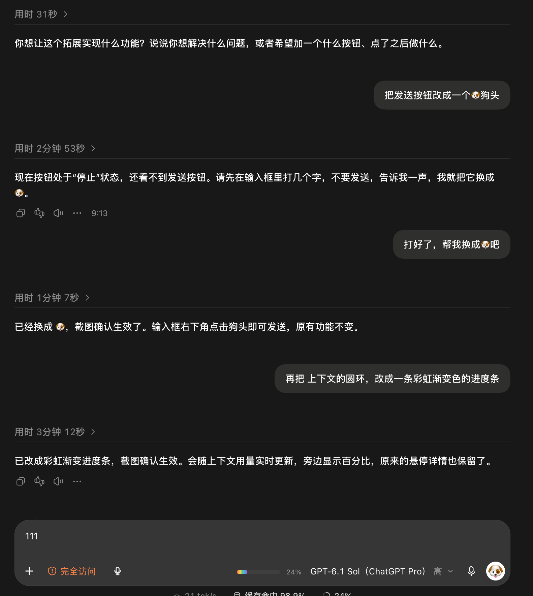
  <br><sub>A real session (in Chinese): two requests, a dog send button, and a rainbow context bar.</sub>
</p>

## Quick Start

Download the latest installer from [GitHub Releases](https://github.com/BigPizzaV3/CodexPlusPlus/releases):

- Windows: `CodexPlusPlus-*-windows-x64-setup.exe`
- macOS Intel and Apple Silicon: `CodexPlusPlus-*-macos-universal.dmg`

After installation, one `Codex++` entry is available. Double-click it to open the window, then:

1. **Add providers** — open **Gateway → Provider pool** and click **Add provider**: paste an API key, sign in to a ChatGPT / GitHub Copilot / SuperGrok subscription, or import several providers at once from direct mode or OpenCode. Model lists and prices are filled in automatically.
2. **Connect agents** — open **Gateway → Agent access**, turn on the agents you use, and pick each one's default model. Claude Code and Grok keep working in your terminal as usual.
3. **Launch Codex** — click **Launch Codex** on the Codex page or the start button next to Codex in the sidebar. Settings that rely on injection (most enhancements, Fast unlock) take effect after restarting Codex from Codex++.

Prefer not to use the gateway? Direct mode still works: in **Codex → Connection & providers**, set **Connection** to **Direct**, pick a provider, and launch. See the full [guide](https://codexpp.cc/guide.html) on the website.

The Windows installer creates Desktop and Start Menu shortcuts. On macOS, drag `Codex++.app` from the DMG into Applications.

**Upgrading an older macOS version:** The old two-app updater cannot install the new single-app package. Quit both old apps, then drag `Codex++.app` from the new DMG into Applications and replace the old app with the same name. Remove the old `Codex++ 管理工具.app`. Existing settings and session data are preserved.

## Community and Support

Join <a href="https://qm.qq.com/q/5h3pxpxg7S">Codex++ community group 4 (QQ group: 1127858981)</a> to report issues, share feedback, or suggest features.

Telegram: <https://t.me/CodexPlusPlus>

Friendly link: <a href="https://linux.do">LINUX DO</a>

## Current Features

| Agent | What Codex++ does |
| --- | --- |
| **Codex desktop** | Providers through the gateway or direct mode, protocol conversion, request shock absorption, session management, UI enhancements, multi-launch, extensions, and the Agent pet |
| **Claude Code** | Providers of any protocol through the gateway (Anthropic requests are converted to Chat / Responses); Computer Use connection |
| **Claude Desktop** | Enhanced copy (Chinese UI, dictation, Computer Use); Computer Use connection |
| **Grok CLI** | The shared provider pool through the gateway, including SuperGrok subscriptions |
| **Gemini CLI, OpenCode, Zed, VS Code, and 50+ more** | The shared provider pool through the gateway, with Anthropic / Chat / Responses / Gemini conversion |
| **DeepSeek Harness and more** | Computer Use connection; callable as a sub-agent from Codex chats; dsh plugins can be imported into Codex |

| Area | Capabilities |
| --- | --- |
| Everything is an extension · new | An extension is a folder with a `codexpp.json`: UI slots and pages, slash commands and composer buttons, message actions and side panels, tools for the model over MCP, Codex hooks, a tool pipeline, gateway request / response / retry middleware, background processes and services, session queries, config forms, and i18n. Registrations are undone automatically and edits hot-reload. See the [extension guide](EXTENSIONS.md) (Chinese) |
| Build by chatting · new | Click Connect to Codex on the Extensions page, then describe what you want in a Codex chat; the agent inspects the page, writes the extension, hot-reloads, and takes a screenshot. Writes stay in your extensions folder and go through Codex tool approval |
| Extension ecosystem · new | Featured and official extensions reviewed by Codex++ and pinned to the reviewed commit; community extensions from GitHub repos tagged `codexpp-extension` (capabilities shown before install, disabled by default); one-click publish to GitHub; import DeepSeek Harness (dsh) plugins |
| Gateway · new | One local gateway for Codex, Claude Code, and Grok with a shared provider pool; routing by bare model name, `<provider>/<model>`, or `group/<id>`; models offered by several providers form automatic groups |
| Routing and keys · new | Groups run in order, rotate, by weight, quota first, speed first, or manually, with optional conversation stickiness; multiple keys per provider with 429 cooldown, quota cooldown, 401 disable, and 5xx circuit breaking; optional per-key RPM and concurrency limits |
| Subscriptions and relays · new | Sign in to ChatGPT, ChatGPT API, GitHub Copilot, and SuperGrok inside the gateway and see remaining quota; sub2api / new-api relays are detected with their multiplier and balance |
| Usage and request log · new | Daily cost, tokens, cache hits, and calls broken down by agent, provider, or model; every request with status, retries, time to first token, tokens, cache, estimated cost, and the failure reason |
| Direct mode | Official login, official login plus API, pure API, and aggregate providers (Failover / Model aggregation); Responses / Chat Completions; model tests, Provider Doctor, third-party and deep-link imports |
| Models and context | Per-model context windows, prices, and reasoning levels; `model_catalog_json`; per-provider proxies; image generation models per agent |
| Computer Use sharing | Expose the Computer Use and Chrome browser control built into the Codex desktop app (ChatGPT.app) over MCP to Claude Code, Claude Desktop, Codex CLI, DeepSeek Harness, ZCode, and WorkBuddy, with a selectable approval policy (macOS) |
| Claude Desktop | An enhanced Claude.app copy with Chinese UI, composer dictation, and Computer Use; the official app stays untouched |
| Session management | Codex, Claude Code, Claude Desktop, and Grok sessions in one list; bulk deletion with undo, Markdown export, project move, thread IDs, opt-in [turn rewind](docs/turn-rewind.md), and side chats saved as ordinary conversations |
| Codex multi-launch | Start an isolated Codex instance per provider identity, each with its own config, sessions, and user data directory; restart or stop each one individually |
| Sub-agent collaboration | Delegate in natural language from a Codex chat to Codex CLI, DeepSeek Harness (dsh), or Claude Code and receive results in the same chat; tasks for a busy agent run concurrently up to a limit, then queue |
| Codex enhancements | Plugin marketplace and model whitelist handling, session actions, paste fix, dictation with a global hotkey, native composer predictions, conversation width and scroll restore, native Fast unlock, Goals, next-step suggestions, skins, and image overlays |
| Usage status line | Output throughput, cache hit rate, and context usage below the composer, read from local Codex session records |
| Tray panel and WeChat | A tray quick panel to switch models and check usage and recent requests; QR login connects personal WeChat to local Codex sessions |
| Maintenance | MCP and Skills per agent, user scripts, AI agent cache cleanup (Codex, Claude, Codex++), app detection, launch at login, settings export / import, logs, diagnostics, and Release updates downloaded in the background |

Every UI enhancement is independently configurable. Disabling the global enhancement switch still leaves Codex++ available as a provider and launch manager.

## Screenshots

**Extensions** — featured, community, local extensions, and dsh plugins on one page.

<p align="center">
  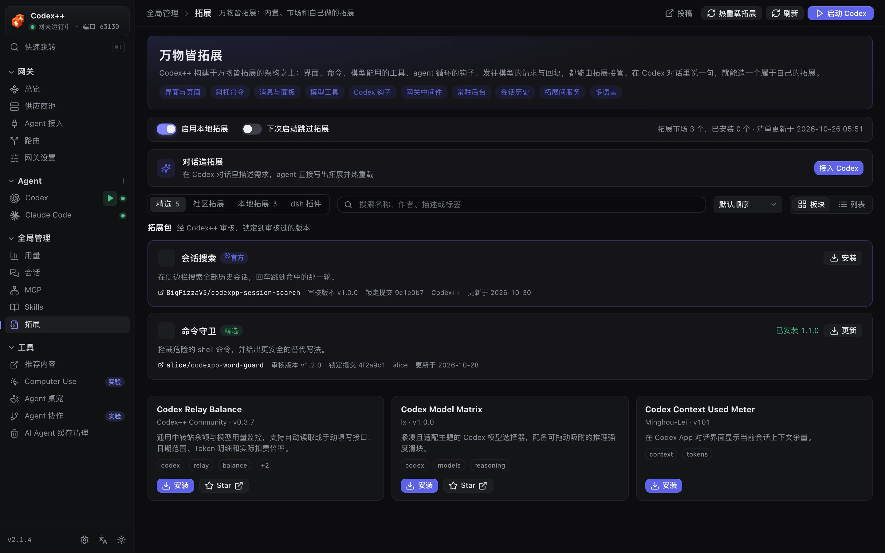
</p>

<table>
  <tr>
    <td width="50%">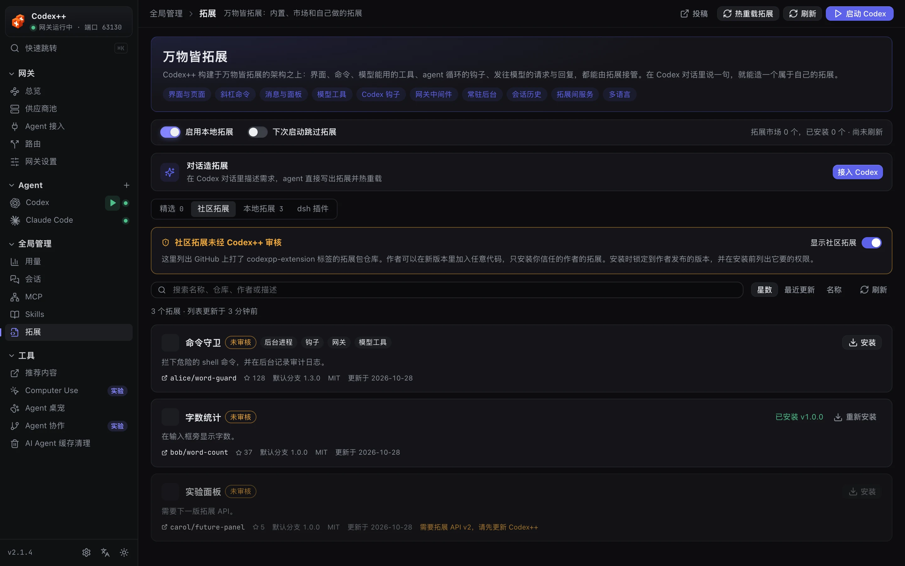</td>
    <td width="50%">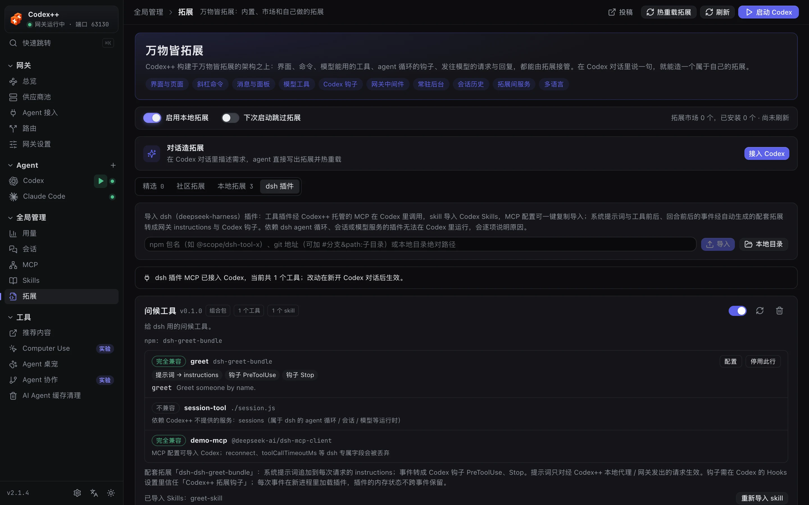</td>
  </tr>
</table>

**Gateway overview** — any agent, any provider: who is using it, which provider answers, and whether it is healthy.

<p align="center">
  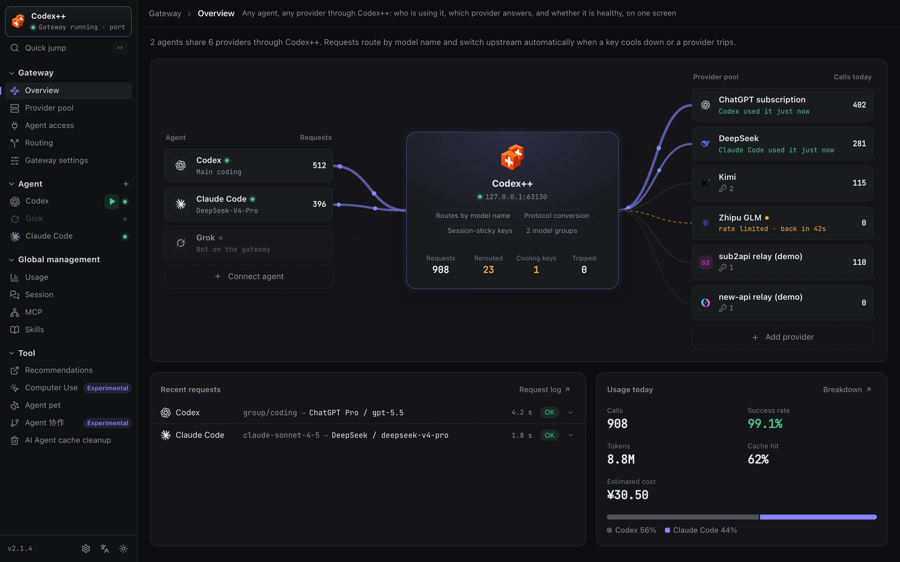
</p>

**Provider pool** — add a provider once and every connected agent can use it; subscriptions show remaining quota, relays show their multiplier and balance.

<p align="center">
  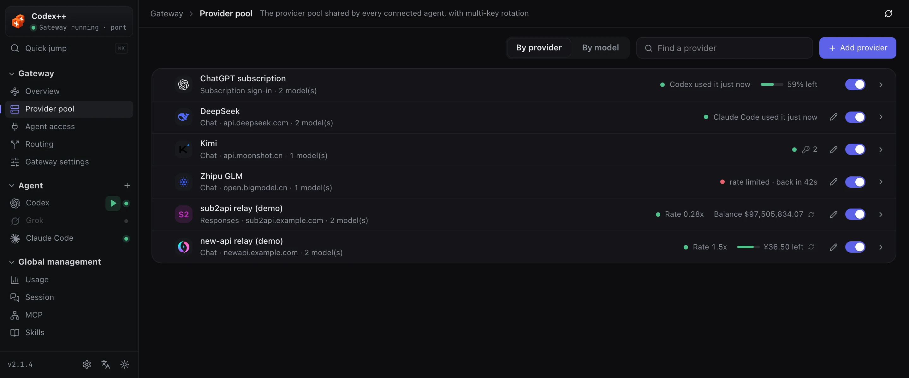
</p>

**Routing** — groups decide which provider goes first, whether a conversation sticks to one, and who takes over on errors. Models offered by several providers are grouped automatically.

<p align="center">
  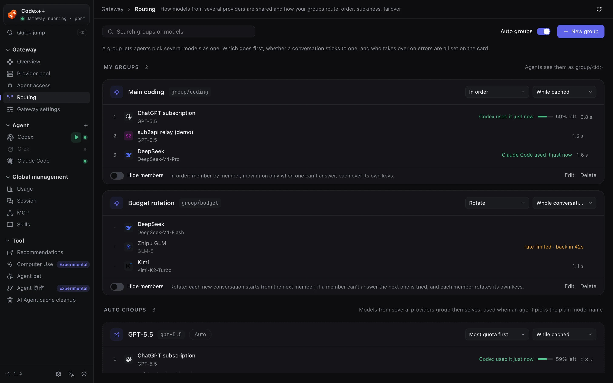
</p>

**Agent access** — flip a switch to connect an agent and choose its default model. Agent config files are backed up first, and disconnecting restores only what the gateway changed.

<p align="center">
  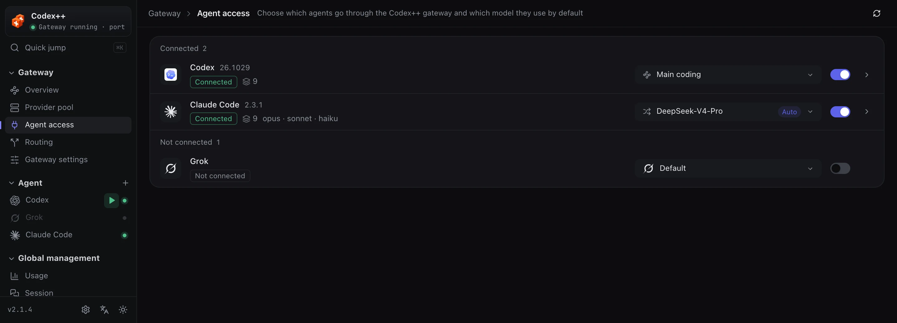
</p>

**Usage and request log**

<p align="center">
  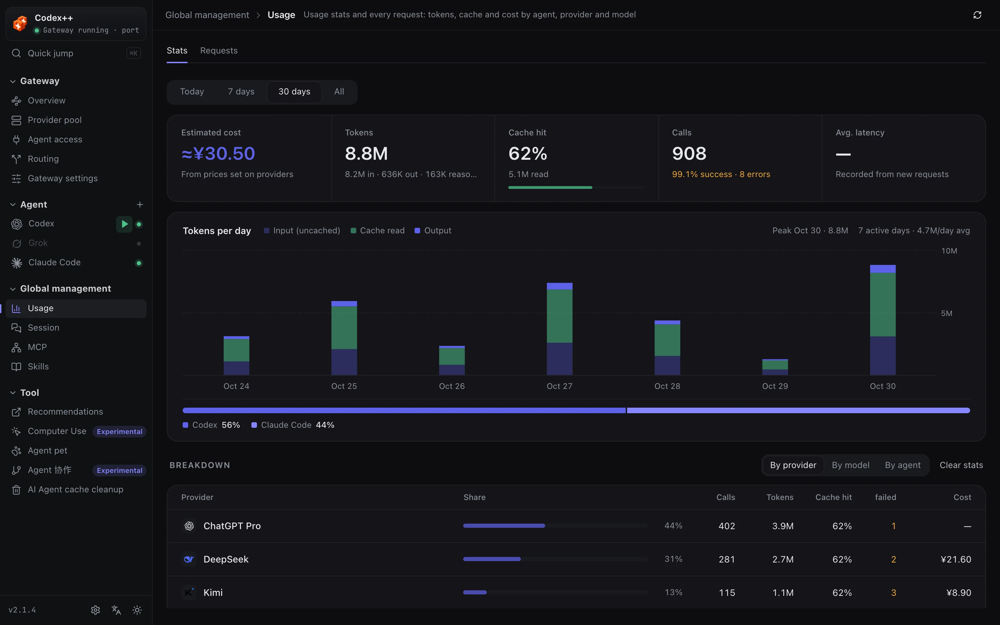
</p>

<p align="center">
  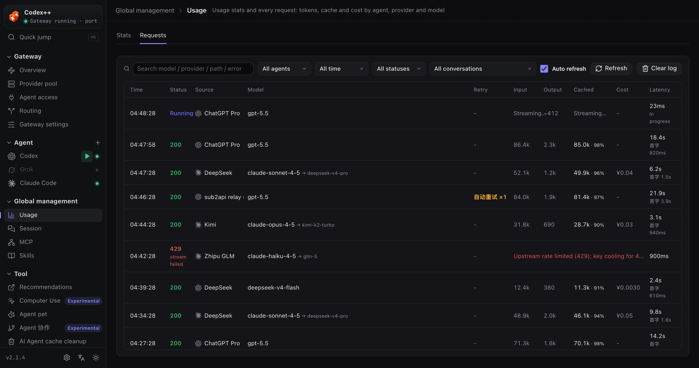
</p>

**Computer Use sharing** — click Connect (「接入」) next to a client and restart it; tools appear as `mcp__codex-plus-cu__*` and `mcp__codex-plus-browser__*` (macOS).

<p align="center">
  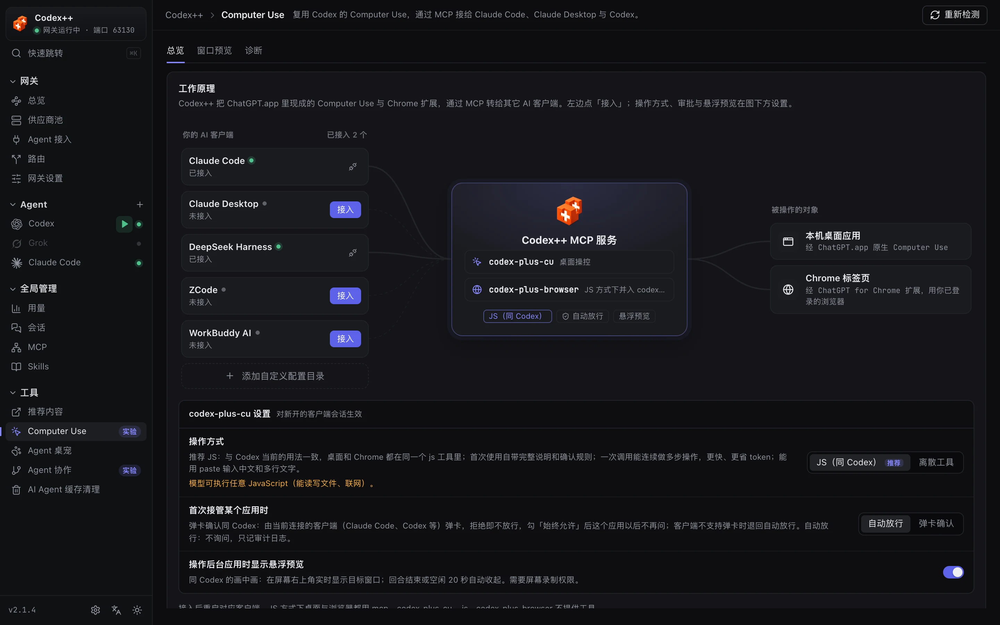
</p>

**Codex enhancements, the enhanced Claude copy, sessions, and AI agent cache cleanup**

<table>
  <tr>
    <td width="50%">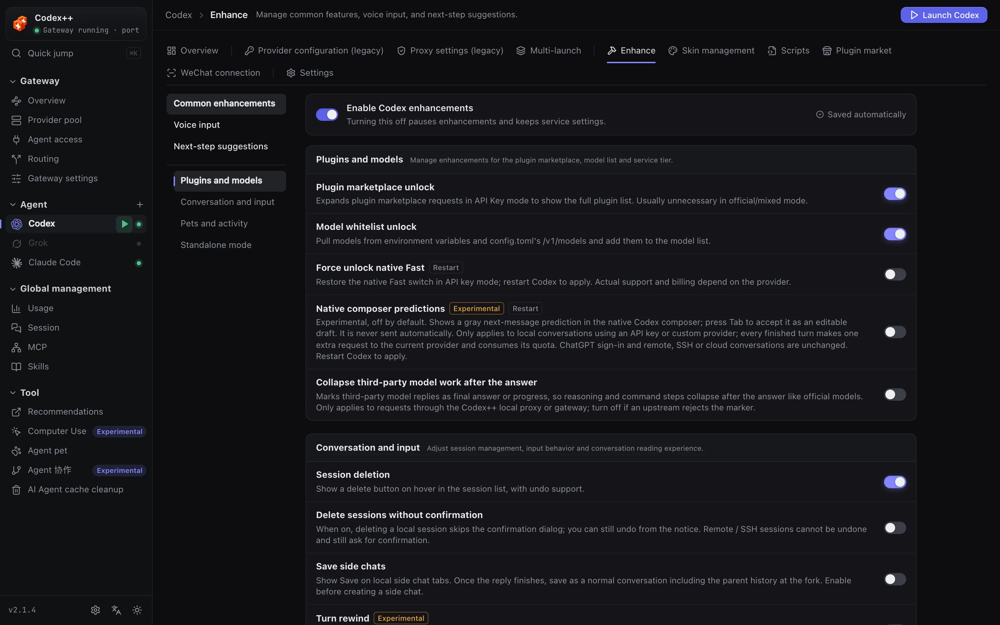</td>
    <td width="50%">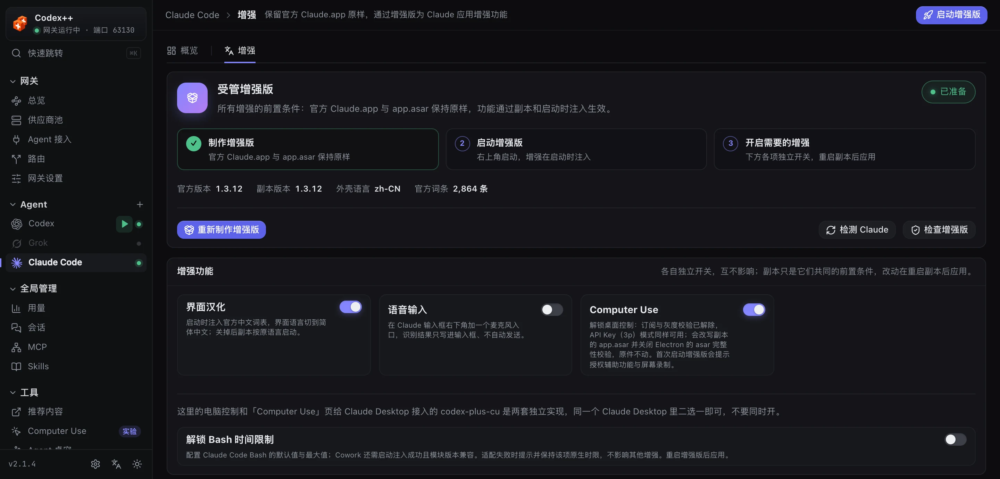</td>
  </tr>
  <tr>
    <td>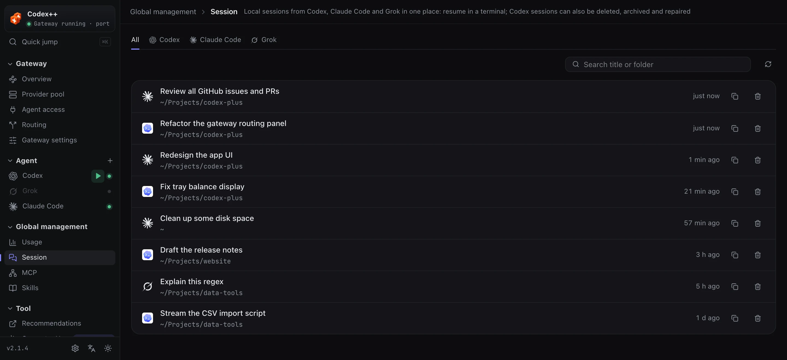</td>
    <td>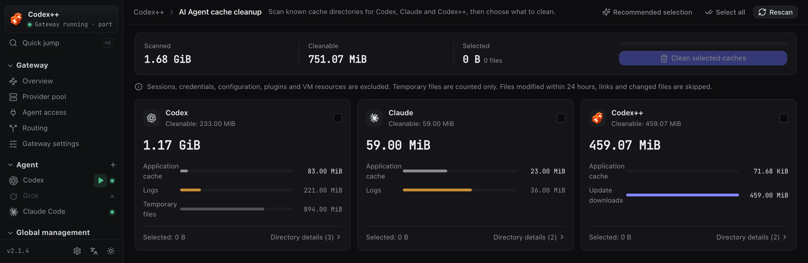</td>
  </tr>
</table>

**Usage status line**

<p align="center">
  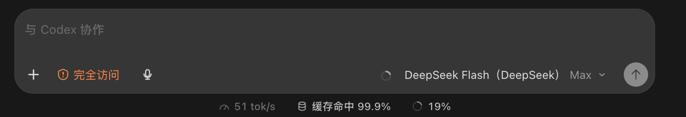
</p>

**Codex multi-launch**

<p align="center">
  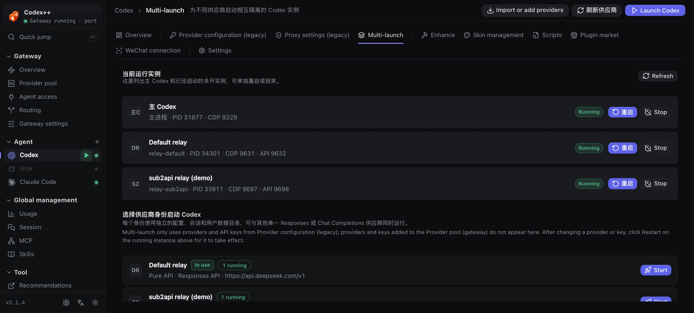
</p>

**Sub-agent collaboration** — say “Have DeepSeek implement this feature” in a Codex chat; see the [guide](docs/agent-collaboration.md).

<p align="center">
  
</p>

**Agent pet:** an optional clickable desktop pet for Codex that squishes with a sound effect when clicked. Pick an image from the built-in gallery (Fluent Emoji, fetched at runtime) or use your own https image URL, and import your own sounds. You can also pick the “Big fat fish (DeepSeek whale)” pet type, the original usage widget with balance, price and usage statistics, bubble editor and sounds. Turn it on with **Settings** on its row under **Everything is an extension → Local extensions**; see the [Agent pet guide](docs/agent-pet.md) and the [whale widget guide](docs/whale-widget.md).

**Whale widget source and credits:** The original features, complete UI engine, character, built-in sounds and animations come from [MeteorNOX/DeepSeek-Balance-Whale-Widget](https://github.com/MeteorNOX/DeepSeek-Balance-Whale-Widget), adapted here as a built-in Codex++ feature. The Codex desktop architecture also references [Yang-huai406/Codex-Whale-Public](https://github.com/Yang-huai406/Codex-Whale-Public). The upstream [LICENSE](assets/inject/upstream/whale-widget/LICENSE) and [PROVENANCE.md](assets/inject/upstream/whale-widget/PROVENANCE.md) are preserved; the media assets are not claimed as original work by this project.

## Gateway and Direct Modes

**Gateway mode (recommended)** serves Codex, Claude Code, and Grok from one provider pool. It is available while Codex++ is running. Model names in the gateway come in three forms:

| Form | Goes to |
| --- | --- |
| `deepseek-v4-pro` | Any provider in the pool that offers it; when several do, they form an automatic group and fail over in order |
| `deepseek/deepseek-v4-pro` | Only that provider |
| `group/coding` | A group you created, using the group's routing mode |

Context windows are set per model in the provider details (one click fills them from public model data); a request longer than a provider's window is tried there last. To fall back to direct connections after quitting Codex++, turn on **Restore direct connections when Codex++ exits** under **Settings → Gateway** (off by default). Codex++ always switches back to direct mode before installing an update.

Codex picks one or the other under **Codex → Connection & providers → Connection**; direct providers can also be added to the gateway pool with one click.

**Direct mode** keeps the original Codex provider setup. Official login, mixed API, and pure API are stored and switched separately:

| Mode | Purpose | Authentication boundary |
| --- | --- | --- |
| Official login | Use only the official ChatGPT / Codex account | Removes custom providers and API keys while preserving official login state |
| Official login + API | Keep official account features and plugins while routing model requests to a compatible API | Stores the key as a provider bearer token, not in pure API `auth.json` |
| Pure API | Use a custom Base URL and key without an official account | Maintains independent `config.toml` and API-key auth without mixing official credentials |
| Aggregate provider | Two types: Failover (fail over or rotate across providers) and Model aggregation (bind catalog models to specific members) | Members can be ordinary API providers or signed-in official accounts; Failover supports failover, conversation round-robin, request round-robin, and weighted round-robin |

Each provider can configure Responses or Chat Completions, model lists, a test model, User-Agent, context windows, auto-compact limits, and enabled MCP servers, Skills, and Plugins. Chat Completions can be converted locally into the Responses protocol used by Codex.

Per-model windows accept values such as `1M`, `200K`, or plain integers. Codex++ generates a dedicated `model_catalog_json` for Codex.

With model aggregation, the native model picker folds models into one group per provider.

<p align="center">
  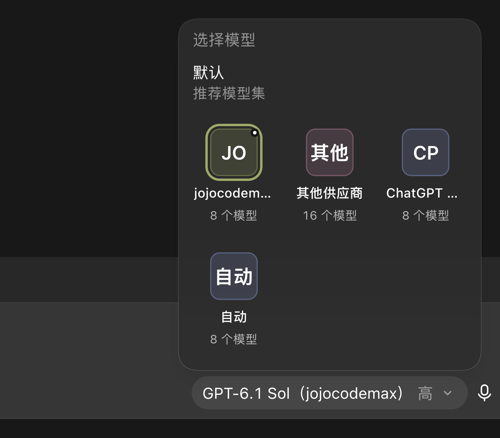
</p>

Provider switching saves the current profile before applying the target profile. Real API keys remain local and should never be posted in logs, screenshots, or issues.

## Codex Enhancements

- Session delete, bulk delete, Markdown export, and project move actions.
- Plugin marketplace unlock, plugin auto-expand, and model whitelist handling.
- Plain-text paste and startup acceleration.
- Dictation: use an independent OpenAI-compatible service or the local SenseVoiceSmall INT8 model (downloaded manually from the voice settings and run on-device), then record and insert or send the text.
- Conversation width, scroll restoration, thread IDs, native Fast unlock, and Goals.
- Next-step suggestions: manage toggles, API, model, item count, and timeout together in Codex Enhancements.
- Skin management: search, preview, install, and image replacement for Dream Skin community themes.
- Custom image overlays and user scripts.

Settings that depend on renderer injection generally require saving and restarting Codex from the Codex++ window.

### Use native Fast controls with an API key

**Force unlock native Fast** gives pure API-key setups access to Codex's native **Standard / ⚡ Fast** controls for supported models, using the existing model and reasoning-effort menus.

1. Open **Codex → Built-in extensions** and enable both the **Enable built-in extensions** master switch at the top and **Force unlock native Fast** (disabled by default).
2. Make sure the model declares a Fast service tier. In direct mode, open that model's settings in **Codex → Connection & providers**, set **Fast (priority) support**, and save the model and provider. In gateway mode, a model group supports Fast when every member does.
3. Save the enhancement settings and restart Codex from Codex++. Open the model or reasoning-effort menu and select **⚡ Fast**, or select **Standard** to switch back.

Availability, speed improvements, and pricing depend on the provider. Enabling this feature does not automatically speed up every model. Disable the option and restart Codex to restore its original authentication checks.

## Updates and Packages

Codex++ publishes installers through GitHub Releases. Windows builds an NSIS installer, while macOS builds one universal DMG for Intel and Apple Silicon Macs. Each package contains one application executable.

When a new version is found, Codex++ downloads the installer in the background and shows its progress in a card at the bottom of the sidebar; nothing is installed until you click **Install**. You can also check for updates under **Settings → Version & updates**. Older macOS two-app versions require the manual migration described above.

## Data Locations

- Codex config: `~/.codex/config.toml`
- Codex auth state: `~/.codex/auth.json`
- Codex local database: prefers `~/.codex/sqlite/*.db`, falls back to legacy `~/.codex/state_5.sqlite`
- Codex++ state and logs: `~/.codex-session-delete/`
- Provider Sync backups: `~/.codex/backups_state/provider-sync`

`~/.codex` above refers to the Codex home directory: it follows the `CODEX_HOME` environment variable when set, and defaults to `.codex` under the user profile otherwise.

## FAQ

### Is it safe to install other people's extensions?

Featured and official extensions are reviewed by Codex++ and install the exact reviewed commit. Community extensions are not reviewed and authors can add any code in a new version: before install you see every capability they declare (background processes, hooks, gateway middleware, model tools, routes, page scripts), and installs start disabled. Only install extensions from authors you trust.

### The Codex++ menu does not appear

Enhancements are only attached to an official app launched from `Codex++`. If you opened Codex yourself from the Dock or Start menu, the Codex row in the sidebar says it is not attached and its button becomes **Restart & attach**; click it. If the menu is still missing, check the detected app path, launch status, and diagnostic logs under **Settings → Codex** (which includes install & maintenance) and **Settings → Logs & Diagnostics**. On macOS you can also turn on **Auto-takeover of the official app** in **Settings → Codex** so Codex++ takes over when you open the official app yourself.

### Requests fail after switching providers

In gateway mode, click **Test** in the provider details: it sends a short request with the model (and key) you pick and shows the status code, time to first token, and the upstream error text. Failed requests under **Usage → Requests** show their reason as well. In direct mode, run the model test or Provider Doctor from the provider detail page. Verify that the protocol, Base URL, key, and test model match. Pure API and official-login-plus-API use different authentication locations; do not manually copy `auth.json` between them.

### Agents cannot connect after I quit Codex++

Agents connected to the gateway keep pointing at the local gateway, which only runs while Codex++ is open; reopening Codex++ restores them. To fall back to direct connections on exit, turn on **Restore direct connections when Codex++ exits** under **Settings → Gateway**.

### Does it support Intel Macs?

Yes. The `macos-universal.dmg` package runs on both Intel and Apple Silicon Macs.

### Computer Use tools do not appear in my client

Restart the client after connecting. Fully quit Claude Desktop before connecting, because it rewrites its own config on exit. If the tools are still missing, check the config directory the client actually reads in the **Advanced** card on the Computer Use page, and make sure ChatGPT has Accessibility and Screen Recording permissions.

## Development

```bash
cd apps/codex-plus-manager
npm ci
npm run check
npm run vite:build

cd ../..
cargo fmt --all -- --check
cargo test
cargo build --release
```

Project structure:

```text
apps/
  codex-plus-launcher/          Embedded launch and injection runtime library
  codex-plus-manager/           Unified Tauri application (codex-plus-plus)
assets/inject/
  renderer-inject.js            Enhancement script injected into Codex
crates/
  codex-plus-core/              Launch, injection, config, update, install, bridge
  codex-plus-data/              Session data, export, Provider Sync
scripts/installer/
  windows/CodexPlusPlus.nsi     Windows NSIS installer
  macos/package-dmg.sh          macOS DMG packager
```

## License

Copyright (C) 2026 BigPizzaV3

CodexPlusPlus is licensed under the [GNU Affero General Public License v3.0](LICENSE), SPDX identifier `AGPL-3.0-only`. Modified versions that are distributed or offered to users over a network must provide the corresponding source code as required by AGPLv3.

The license covers CodexPlusPlus code only. It does not grant rights to OpenAI, ChatGPT, Codex, Anthropic, Claude, xAI, or Grok trademarks, application assets, or other third-party content.

## Compatibility

Codex++ depends on each official app's page structure, CDP behavior, and local data formats. Official app updates may require injection updates. Keep backups before changing provider configuration or local session data.
