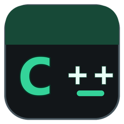
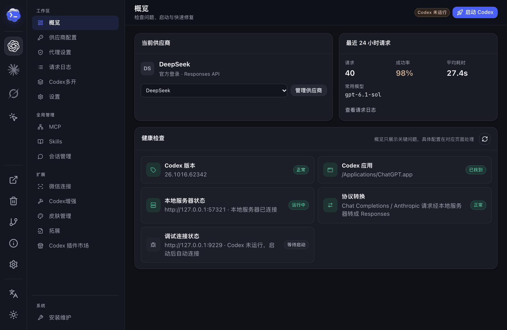
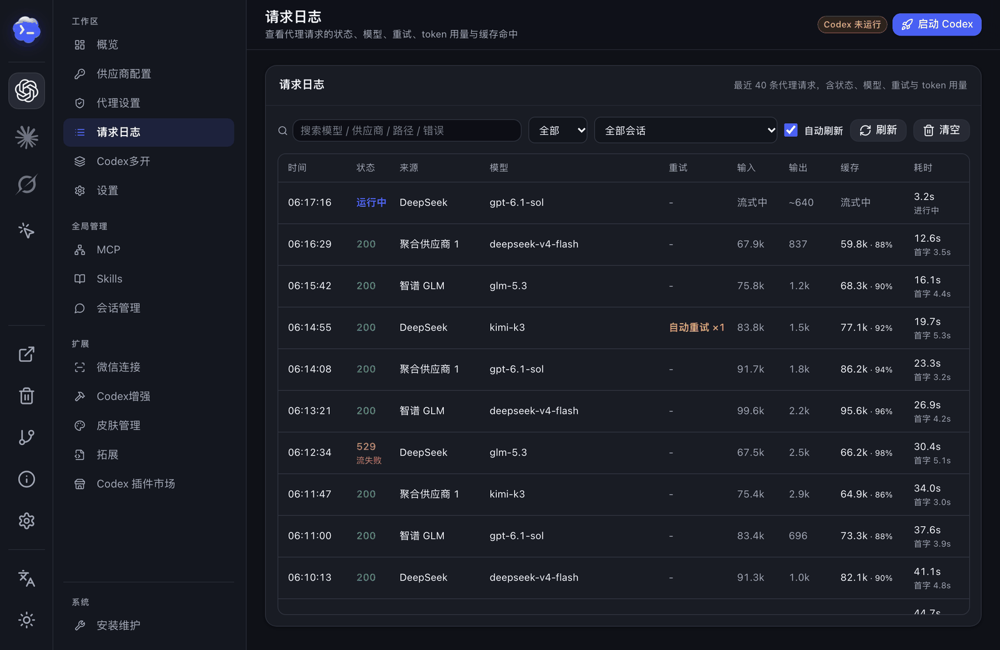
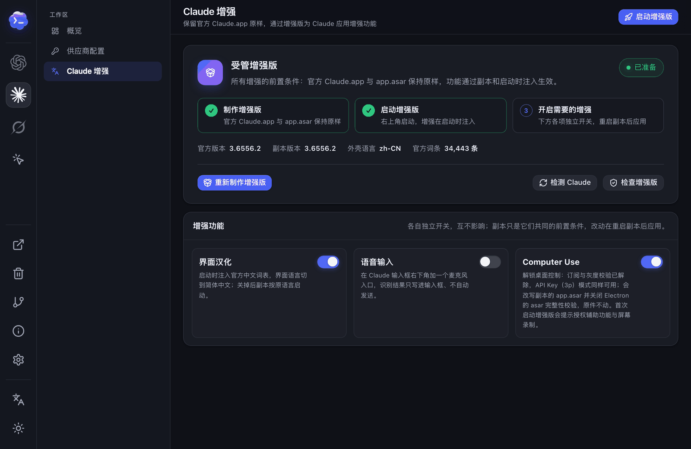
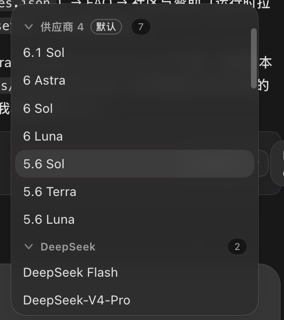

# Codex++

<p align="center">
  
</p>

<p align="center">
  <a href="README.md">中文</a> | English
</p>

<p align="center">
  
  
  
  
  
</p>

Codex++ is a unified manager for AI coding agents. It started with the OpenAI Codex / ChatGPT desktop app — provider switching, protocol conversion, session management, and UI enhancements — and now also manages Claude Code, Claude Desktop, and the Grok CLI, with Computer Use sharing and sub-agent collaboration across agents. Double-click to open its window and launch each app from there. It never modifies any official app's installation files.

## Quick Start

Download the latest installer from [GitHub Releases](https://github.com/BigPizzaV3/CodexPlusPlus/releases):

- Windows: `CodexPlusPlus-*-windows-x64-setup.exe`
- macOS Intel and Apple Silicon: `CodexPlusPlus-*-macos-universal.dmg`

After installation, one `Codex++` entry is available. Double-click it to open the window, verify the detected official app path, configure a provider and optional enhancements, then click **Launch** to start the official app with your saved configuration.

The Windows installer creates Desktop and Start Menu shortcuts. On macOS, drag `Codex++.app` from the DMG into Applications.

**Upgrading an older macOS version:** The old two-app updater cannot install the new single-app package. Quit both old apps, then drag `Codex++.app` from the new DMG into Applications and replace the old app with the same name. Remove the old `Codex++ 管理工具.app`. Existing settings and session data are preserved.

## Community and Support

Join <a href="https://qm.qq.com/q/5h3pxpxg7S">Codex++ community group 4 (QQ group: 1127858981)</a> to report issues, share feedback, or suggest features.

Telegram: <https://t.me/CodexPlusPlus>

Friendly link: <a href="https://linux.do">LINUX DO</a>

## Current Features

| Agent | What Codex++ does |
| --- | --- |
| **Codex desktop** | Provider switching and protocol conversion, request shock absorption, session management, UI enhancements, multi-launch, extensions, and the usage widget |
| **Claude Code** | One-click provider switching; Computer Use connection |
| **Claude Desktop** | Enhanced copy (Chinese UI, dictation, Computer Use); Computer Use connection |
| **Grok CLI** | Model and API endpoint configuration |
| **DeepSeek Harness and more** | Computer Use connection; callable as a sub-agent from Codex chats |

| Area | Capabilities |
| --- | --- |
| Provider configuration | Official login, official login plus API, pure API, and aggregate providers (Failover / Model aggregation); Responses / Chat Completions; model tests, model discovery, Provider Doctor, third-party and deep-link imports; optional auto-review model per provider |
| Models and context | Per-model context windows, auto-compact limits, `model_catalog_json`, model metadata import (models.json), and per-provider MCP, Skill, and Plugin selection |
| Computer Use sharing · new | Expose the Computer Use and Chrome browser control built into the Codex desktop app (ChatGPT.app) over MCP to Claude Code, Claude Desktop, Codex CLI, DeepSeek Harness, ZCode, and WorkBuddy, with a selectable approval policy (macOS) |
| Beyond Codex · new | Claude Code provider switching with imports from other tools; an enhanced Claude.app copy with Chinese UI, composer dictation, and Computer Use; Grok CLI model and endpoint management |
| Request shock absorption and request log | Back off and retry upstream overload errors at the proxy, optionally by HTTP status code; streaming or fully buffered mode; the always-on local proxy keeps running after Codex quits. The request log shows in-flight requests, time to first token, retry reasons, and token usage, filterable by conversation |
| Session management | Local session scanning, bulk deletion, Markdown export, token usage history, project move, thread IDs, opt-in [turn rewind](docs/turn-rewind.md), and side chats saved as ordinary conversations |
| Codex multi-launch | Start an isolated Codex instance per provider identity, each with its own config, sessions, and user data directory; restart or stop each one individually |
| Sub-agent collaboration | Delegate in natural language from a Codex chat to Codex CLI, DeepSeek Harness (dsh), or Claude Code and receive results in the same chat |
| Codex enhancements | Plugin marketplace and model whitelist handling, session actions, paste fix, dictation with a global hotkey, conversation width and scroll restore, native Fast unlock, Goals, next-step suggestions, skins, and image overlays |
| Usage status line | Live generation speed, cache hit rate, and context usage below the composer, read from local Codex session records |
| WeChat connection | QR login connects personal WeChat to local Codex sessions; each contact maps to a separate session, with an allowed-user list |
| Maintenance | User scripts, AI agent cache cleanup (Codex, Claude, Codex++), app detection, shortcuts, launch at login, settings export / import, logs, diagnostics, and Release updates |

Every UI enhancement is independently configurable. Disabling the global enhancement switch still leaves Codex++ available as a provider and launch manager.

## Screenshots

**Overview** — current provider, last 24 hours of requests, and health checks.

<p align="center">
  
</p>

**Computer Use sharing** — click Connect (「接入」) next to a client and restart it; tools appear as `mcp__codex-plus-cu__*` and `mcp__codex-plus-browser__*` (macOS).

<p align="center">
  
</p>

**Request log and automatic retries**

<p align="center">
  
</p>

**Claude Code, Claude enhancements, Grok, and AI agent cache cleanup**

<table>
  <tr>
    <td width="50%"></td>
    <td width="50%"></td>
  </tr>
  <tr>
    <td></td>
    <td></td>
  </tr>
</table>

**Usage status line**

<p align="center">
  
</p>

**Codex multi-launch**

<p align="center">
  
</p>

**Sub-agent collaboration** — say “Have DeepSeek implement this feature” in a Codex chat; see the [guide](docs/agent-collaboration.md).

<p align="center">
  
</p>

The optional usage widget lives under Codex Enhancements → General → Widgets and pets; see the [widget guide](docs/whale-widget.md).

**Whale widget source and credits:** The original features, complete UI engine, character, built-in sounds and animations come from [MeteorNOX/DeepSeek-Balance-Whale-Widget](https://github.com/MeteorNOX/DeepSeek-Balance-Whale-Widget), adapted here as a built-in Codex++ feature. The Codex desktop architecture also references [Yang-huai406/Codex-Whale-Public](https://github.com/Yang-huai406/Codex-Whale-Public). The upstream [LICENSE](assets/inject/upstream/whale-widget/LICENSE) and [PROVENANCE.md](assets/inject/upstream/whale-widget/PROVENANCE.md) are preserved; the media assets are not claimed as original work by this project.

## Codex Provider Modes

Official login, mixed API, and pure API are stored and switched separately:

| Mode | Purpose | Authentication boundary |
| --- | --- | --- |
| Official login | Use only the official ChatGPT / Codex account | Removes custom providers and API keys while preserving official login state |
| Official login + API | Keep official account features and plugins while routing model requests to a compatible API | Stores the key as a provider bearer token, not in pure API `auth.json` |
| Pure API | Use a custom Base URL and key without an official account | Maintains independent `config.toml` and API-key auth without mixing official credentials |
| Aggregate provider | Two types: Failover (fail over or rotate across providers) and Model aggregation (bind catalog models to specific members) | Members can be ordinary API providers or signed-in official accounts; Failover supports failover, conversation round-robin, request round-robin, and weighted round-robin |

Each provider can configure Responses or Chat Completions, model lists, a test model, User-Agent, context windows, auto-compact limits, and enabled MCP servers, Skills, and Plugins. Chat Completions can be converted locally into the Responses protocol used by Codex.

Per-model windows accept values such as `1M`, `200K`, or plain integers. Codex++ generates a dedicated `model_catalog_json` for Codex.

With model aggregation, the native model picker folds models into one group per provider.

<p align="center">
  
</p>

Provider switching saves the current profile before applying the target profile. Real API keys remain local and should never be posted in logs, screenshots, or issues.

## Codex Enhancements

- Session delete, bulk delete, Markdown export, and project move actions.
- Plugin marketplace unlock, plugin auto-expand, and model whitelist handling.
- Plain-text paste and startup acceleration.
- Dictation: use an independent OpenAI-compatible service or the local SenseVoiceSmall INT8 model (downloaded manually from the voice settings and run on-device), then record and insert or send the text.
- Conversation width, scroll restoration, thread IDs, native Fast unlock, and Goals.
- Next-step suggestions: manage toggles, API, model, item count, and timeout together in Codex Enhancements.
- Skin management: search, preview, install, and image replacement for Dream Skin community themes.
- Custom image overlays and user scripts.

Settings that depend on renderer injection generally require saving and restarting Codex from the Codex++ window.

### Use native Fast controls with an API key

**Force unlock native Fast** gives pure API-key setups access to Codex's native **Standard / ⚡ Fast** controls for supported models, using the existing model and reasoning-effort menus.

1. Open **Codex enhancements → Common enhancements** and enable both the enhancement master switch and **Force unlock native Fast** (disabled by default).
2. Make sure the model declares a Fast service tier. To configure it manually, open that model's settings in **Provider configuration**, set **Fast (priority) support**, and save the model and provider.
3. Save the enhancement settings and restart Codex from Codex++. Open the model or reasoning-effort menu and select **⚡ Fast**, or select **Standard** to switch back.

Availability, speed improvements, and pricing depend on the provider. Enabling this feature does not automatically speed up every model. Disable the option and restart Codex to restore its original authentication checks.

## Updates and Packages

Codex++ publishes installers through GitHub Releases. Windows builds an NSIS installer, while macOS builds one universal DMG for Intel and Apple Silicon Macs. Each package contains one application executable.

The About page can check and start updates. Older macOS two-app versions require the manual migration described above.

## Data Locations

- Codex config: `~/.codex/config.toml`
- Codex auth state: `~/.codex/auth.json`
- Codex local database: prefers `~/.codex/sqlite/*.db`, falls back to legacy `~/.codex/state_5.sqlite`
- Codex++ state and logs: `~/.codex-session-delete/`
- Provider Sync backups: `~/.codex/backups_state/provider-sync`

`~/.codex` above refers to the Codex home directory: it follows the `CODEX_HOME` environment variable when set, and defaults to `.codex` under the user profile otherwise.

## FAQ

### The Codex++ menu does not appear

Open `Codex++` and click **Launch** to start the official app. Check the detected app path, launch status, and diagnostic logs in the Maintenance and About pages.

### Requests fail after switching providers

Run the model test or Provider Doctor from the provider detail page. Verify that the protocol, Base URL, key, and test model match. Pure API and official-login-plus-API use different authentication locations; do not manually copy `auth.json` between them.

### Does it support Intel Macs?

Yes. The `macos-universal.dmg` package runs on both Intel and Apple Silicon Macs.

### Computer Use tools do not appear in my client

Restart the client after connecting. Fully quit Claude Desktop before connecting, because it rewrites its own config on exit. If the tools are still missing, check the config directory the client actually reads under **Config paths and custom directories** (「配置路径与自定义目录」) on the Computer Use page, and make sure ChatGPT has Accessibility and Screen Recording permissions.

## Development

```bash
cd apps/codex-plus-manager
npm ci
npm run check
npm run vite:build

cd ../..
cargo fmt --all -- --check
cargo test
cargo build --release
```

Project structure:

```text
apps/
  codex-plus-launcher/          Embedded launch and injection runtime library
  codex-plus-manager/           Unified Tauri application (codex-plus-plus)
assets/inject/
  renderer-inject.js            Enhancement script injected into Codex
crates/
  codex-plus-core/              Launch, injection, config, update, install, bridge
  codex-plus-data/              Session data, export, Provider Sync
scripts/installer/
  windows/CodexPlusPlus.nsi     Windows NSIS installer
  macos/package-dmg.sh          macOS DMG packager
```

## License

Copyright (C) 2026 BigPizzaV3

CodexPlusPlus is licensed under the [GNU Affero General Public License v3.0](LICENSE), SPDX identifier `AGPL-3.0-only`. Modified versions that are distributed or offered to users over a network must provide the corresponding source code as required by AGPLv3.

The license covers CodexPlusPlus code only. It does not grant rights to OpenAI, ChatGPT, Codex, Anthropic, Claude, xAI, or Grok trademarks, application assets, or other third-party content.

## Compatibility

Codex++ depends on each official app's page structure, CDP behavior, and local data formats. Official app updates may require injection updates. Keep backups before changing provider configuration or local session data.
