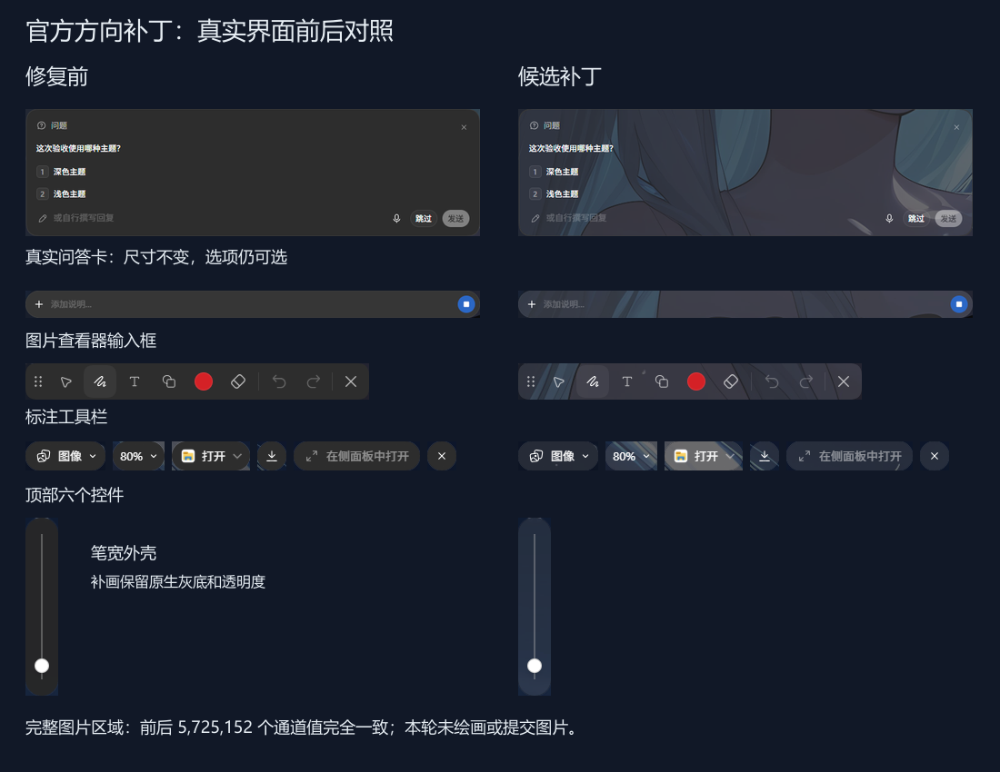

# 交互卡片与图片查看器背景验收

基线：`7d7832ed`，延续 #2903 的全局壁纸与原生表面局部补画机制。采集于 Windows Codex 26.1029，2026-11-06。

## 范围与证据

| 表面 | 验证方式 | 结论 |
| --- | --- | --- |
| 问答卡 | 真实界面前后截图、矩形、选择事件 | 背景连续；矩形相同；选项可选且发送按钮启用 |
| 查看器输入框、顶部六个控件、标注工具栏、笔宽外壳 | 真实界面九处前后采集 | 原生灰底上补画；控件矩形相同 |
| 查看器实际图片 | 稳定后完整图片区域比较 | 5,725,152 个颜色通道值全部相同 |
| 权限、计划确认、排队、提示、进度、图库等共享外壳 | 源码定位与浏览器夹具 | 覆盖相同选择器的原生背景、交互与媒体边界 |

真实截图来自首轮视觉验收；之后的生命周期修正另以可复现的浏览器用例验证。图片查看器输入框由原生组件迁移，补丁没有创建第二个编辑器或移动媒体节点。首次短等待抽样出现不一致，等待 600 ms 稳定后复查同位置三次及完整图片区域，结果一致。

## 自动回归与审查闭环

- 初始 17 项交互表面用例：基线 5 通过、12 失败，候选全部通过。
- 新增宿主标记、继承主题、输入框增长、过渡及动画结束用例：修正前 20 通过、8 失败，修正后全部通过。
- 预览动画性能用例：30 张卡片、12 帧原生缩略图动画；修正前 12 次全局查询、372 次样式读取，修正后要求二者均为零。
- 六组浏览器套件纳入 PR 的 `Image overlay regressions`，包含像素、点击和编辑、动态重挂载、缩放和滚动、清理、扫描工作量。测试使用每通道 1 的像素容差，不等同于真实应用 FPS 测量。
- Standards 复审：关闭预览 resize/动画调度及祖先标记发现问题；修正文档中失败用例清理检查的过度表述。
- Spec 复审：关闭预览几何、继承透明度资格与原生动画重复扫描问题。发现的问题均对应回归用例。

## CI 环境差异排查

首次 Windows Server CI 为 111 通过、1 失败：整帧对比在 480px / zoom 0.8 的 SVG 圆形边缘出现 12 个差异像素（最大通道差 18）。失败工件保留原生、参考和候选 PNG 以及坐标。使用 `--disable-gpu` 可在本地精确复现；未修改的基线 `7d7832ed` 与本次补丁的差异坐标和 RGB 完全相同。

CI 因此显式使用 Chromium 文档中的 ANGLE SwiftShader 驱动路径（`--use-gl=angle --use-angle=swiftshader`），保留全部 SVG、整帧比较和原来的容差。另将视频基线采集从固定等待改成等待 `requestVideoFrameCallback` 的首帧提交，避免慢速 runner 把尚未显示视频的空背景当成参考图。此处只改变测试启动与就绪判断，不改变应用渲染。

后续 runner 暴露视频颜色的偶发差异：在完全未安装背景图引擎时，重复提交同色 canvas 帧也能使视频从 I420 的 `[51,178,79]` 变为 BGRA 的 `[25,180,80]`（独立复现 11/12 次）。夹具首次获取 2D 上下文时改用 `willReadFrequently:true`，使源帧稳定为 CPU/RGB 路径（12/12 次一致），并额外断言原生视频像素与源 canvas 颜色相符、流仍在播放。没有放宽颜色容差，也没有将视频换成静态图片。

## 验收边界

- 修复后未重新触发真实权限审批、计划实施确认及所有队列业务分支；共享表面的夹具通过不代表全业务实机验收完成。
- 问答历史提交后重置行为不属于本次修复；只验证选择与按钮启用，未宣称提交消费流程已修复。
- 浅色实机、所有展开菜单、全部图片编辑操作与系统窗口控件没有全部覆盖。
- 两个原生伪元素都占用时仍保留原生内容并跳过补画；全局壁纸下额外非恒等祖先变换的既有堆叠限制未扩大处理。
- 保持原生背景和透明度；普通消息区与透明内层避免重复补画，扩展组件、嵌入浏览器页面及编辑器内容保持原有归属。

关闭背景图拓展或回退代码即可撤销，没有数据迁移或权限配置修改。
