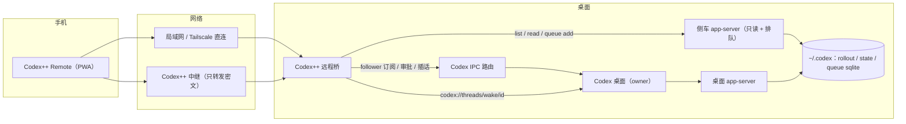

# 远程控制（手机操控 Codex 桌面）调研

- 日期：2026-11-15
- 对象：Codex 桌面 26.1106（本机运行中）/ 26.1111（官方最新，已解包），内置 CLI 0.167 / 0.169
- 方法：解包 `app.asar` 读主进程与页面代码；对 0.169 app-server 做隔离实测；对本机运行中的 Codex IPC 做只读探测（只注册客户端、做 owner 发现，不发任何写操作）

---

## 0. 结论

1. **官方 Remote Control 改不成走我们的服务器。** app-server 里写死了：必须 ChatGPT 登录（`API key auth is not supported`），
   中继地址只认 `chatgpt.com` / `chatgpt-staging.com` / `localhost`，并且要和 `account_id` 绑定的 enrollment。
   手机端是官方 ChatGPT App，我们也换不掉。纯 API / 网关用户用不了。
2. **自己做一套是可行的，而且官方已经把最难的部分留好了接口：**
   - 桌面主进程有一个本地 IPC 路由（`~/.codex/ipc/ipc.sock`，Windows 是 `\\.\pipe\codex-ipc`），
     提供完整的 **follower 协议**：跟随者可以订阅会话的实时状态，并让桌面代为发消息、插话、中断、
     **审批命令 / 文件改动 / 权限**、回答提问、管理排队。这是官方给 VS Code 插件、CLI 和多窗口协同用的。
   - 排队消息持久化在 `~/.codex/queue_1.sqlite`，多进程共享；`codex://threads/wake/<id>` 让桌面
     在后台接手并执行排队消息，**不切换窗口**。
3. **推荐架构：** Codex++ 起一个「远程桥」，对内接 Codex 的 IPC + 一个只做读和排队的侧车 app-server，
   对外给手机一个 PWA。网络上先做局域网 / Tailscale 直连，再做我们自己的中继（端到端加密）。
   所有真正的执行都发生在桌面自己的 app-server 里，桌面界面实时同步，不会出现两个进程同时写一个会话。

---

## 1. 官方 Remote Control 为什么借不了

二进制里的约束（0.169）：

| 约束 | 原文 |
|---|---|
| 必须 ChatGPT 登录 | `remote control requires ChatGPT authentication; API key auth is not supported` |
| 必须有账号 ID | `remote control enrollment is waiting for a ChatGPT account id` |
| 中继地址白名单 | `expected HTTPS URL for chatgpt.com or chatgpt-staging.com, or HTTP/HTTPS URL for localhost` |
| enrollment 绑定账号 | `enrollment account_id does not match expected account_id` |
| 配对码由服务端发 | `remoteControl/pairing/start` → `pairingCode / manualPairingCode / expiresAt` |

`localhost` 虽然放行，但要在本机伪造一整套 enrollment / 配对 / 分段信封协议，还得过 `account_id` 校验，
而手机端仍然只能是官方 App——投入大、随时被官方改协议打断，不值得。

**定位**：有 ChatGPT 账号且能直连官方的用户，继续用官方 Remote Control；我们的远程控制面向纯 API / 网关 / 国内用户。

---

## 2. 关键发现：Codex 桌面的 IPC follower 协议

### 2.1 传输

- 路径：macOS / Linux 为 `<CODEX_HOME>/ipc/ipc.sock`（过长时落到 `/tmp/codex-ipc-*` 的符号链接），
  权限 0600 且校验 uid；Windows 为命名管道 `\\.\pipe\codex-ipc`。
- 帧：`[u32 LE 长度][UTF-8 JSON]`，单帧上限 256 MiB。
- 消息类型：`request` / `response` / `broadcast` / `client-discovery-request` / `client-discovery-response`。
- 握手：`{type:"request", method:"initialize", sourceClientId:"initializing-client", params:{clientType}}`
  → `{result:{clientId}}`。**已在本机实测通过。**
- 路由：request 可指定 `targetClientId`，否则路由器向所有客户端发 discovery，第一个回 `canHandle:true` 的接手。
- 版本：每个方法带版本号，不一致返回 `request-version-mismatch`。

### 2.2 方法与版本（26.1106 → 26.1111）

| 方法 | 26.1106 | 26.1111 | 用途 |
|---|---|---|---|
| `thread-stream-state-changed`（广播） | 11 | **13** | owner 推送会话快照 / 增量补丁 |
| `thread-stream-following-changed`（广播） | 1 | 1 | 声明开始 / 停止跟随某个会话 |
| `thread-owner-discovery` | 1 | 1 | 查谁持有这个会话 |
| `thread-follower-start-turn` | 2 | 2 | 发起一轮 |
| `thread-follower-steer-turn` | 1 | 1 | 运行中插话 |
| `thread-follower-interrupt-turn` | 4 | 4 | 中断 |
| `thread-follower-command-approval-decision` | 1 | 1 | 审批命令 |
| `thread-follower-file-approval-decision` | 1 | 1 | 审批文件改动 |
| `thread-follower-permissions-request-approval-response` | 1 | 1 | 审批权限请求 |
| `thread-follower-submit-user-input` | 1 | 1 | 回答模型提问 |
| `thread-follower-submit-mcp-server-elicitation-response` | 1 | 1 | 回答 MCP 表单 |
| `thread-follower-edit-last-user-turn` | 2 | 2 | 改最后一条消息 |
| `thread-follower-compact-thread` | 1 | 1 | 压缩 |
| `thread-follower-update-thread-settings` | 2 | 2 | 改模型 / 推理档位 / 权限 |
| `thread-follower-read-model-settings` | 1 | 1 | 读模型设置 |
| `thread-follower-load-complete-history` | 1 | 1 | 拉完整历史（触发快照） |
| `thread-follower-set-queued-follow-ups-state` / `remove-queued-message` / `clear-queued-messages` | 3/1/1 | 3/1/1 | 管理排队 |
| `thread-queued-followups-changed`（广播） | 3 | 3 | 排队变化 |
| `thread-read-state-changed` / `thread-archived` / `thread-unarchived`（广播） | 3/2/1 | 3/2/1 | 已读、归档 |

**版本漂移很小**：两个版本之间只有快照广播变了。版本表是 bundle 里的一个字面量对象，
桥可以在启动时从已安装 app 的 asar 里抽出来（我们已经有解析 asar 的代码），不用写死。

### 2.3 状态推送

- `change: { type: "snapshot", revision, conversationState }`：完整会话状态，含轮次、条目、
  `requests`（待审批请求，带 `id` / `method` / 参数）、`threadGoal`、设置等。
- `change: { type: "patches", baseRevision, revision, patches, acceptedTextChanges }`：增量。
- 手机端拿快照即可渲染会话、看到待审批项，再用 follower 请求回复。

### 2.4 前提：会话必须有 owner

实测本机最近 25 个会话全部 `no-client-found`——当时 Codex 停在首页，没有任何会话被加载。
**只有桌面已经加载的会话才有 owner**。没有 owner 时要先让桌面接手（见下一节）。

---

## 3. 关键发现：跨进程排队 + 唤醒

### 3.1 队列持久化

`~/.codex/queue_1.sqlite`：

```sql
queued_items(id, thread_id, payload_json, queue_order, created_at_ms, updated_at_ms)
queued_thread_revisions(revision, thread_id)  -- 插入 / 更新 / 删除触发器维护
```

### 3.2 实测（两个隔离的 0.169 app-server，共享同一 CODEX_HOME）

| 步骤 | 结果 |
|---|---|
| A 新建会话、未落盘 | B `thread/queue/add` 报 `no rollout found` |
| A `thread/inject_items` 落盘后，B `thread/queue/add` | 成功 |
| A 是否收到 `thread/queue/changed` 推送 | **没有** |
| A 主动 `thread/queue/list` | **能看到 B 加的消息** |

注意：`thread/queue/*` 需要 `initialize` 时声明 `capabilities.experimentalApi = true`（桌面自己就这么做）。

### 3.3 唤醒

主进程对 `codex://threads/wake/<uuid>` 的处理：

```js
wakeQueuedThread: async (threadId) => {
  const host = getLocalHost();
  await host.connect();
  if (supports(host.appServerVersion, "threadQueue")
      && (await host.sendAppServerRequest("thread/queue/list", { threadId, limit: 1 })).data.length !== 0)
    await host.resumeThread(threadId);
}
```

- 不导航窗口（只有 `codex://threads/<id>` 才会切到会话）；
- 失败最多重试 3 次；
- 桌面没开时，系统打开 URL 会先启动 Codex。

**这就是官方给「外部进程投递消息」留的口子**：外部写队列 → 发 wake → 桌面在自己的 app-server 里恢复会话、
按队列发出，界面同步显示，然后桌面成为 owner，手机即可经 IPC 跟随、审批。

其他 deep link：`codex://threads/<id>`（打开会话）、`codex://threads/new?prompt=…`（新会话，会切窗口）。

---

## 4. 推荐架构



### 4.1 每个手机操作怎么落地

| 手机操作 | 会话已有 owner | 会话没有 owner |
|---|---|---|
| 会话列表 / 搜索 | 侧车 `thread/list` / `thread/search` | 同左 |
| 看历史 | IPC 快照 | 侧车 `thread/read` + `thread/turns/list` |
| 实时输出 | IPC `thread-stream-state-changed` | 先唤醒，有 owner 后跟随 |
| 发消息 | IPC `thread-follower-start-turn`（或统一走排队） | 侧车 `thread/queue/add` + `wake` |
| 运行中插话 | IPC `thread-follower-steer-turn` | — |
| 停止 | IPC `thread-follower-interrupt-turn` | — |
| 审批 / 回答提问 | IPC `*-approval-decision` / `submit-user-input` | — （没 owner 就没有待审批） |
| 排队管理 | IPC `set-queued-follow-ups-state` 等 | 侧车 `thread/queue/*` |
| 目标 | 侧车 `thread/goal/*` | 同左 |
| 新会话 | 侧车 `thread/start` + 落盘 + 排队 + `wake` | 同左 |
| 切模型 / 档位 | IPC `update-thread-settings` | 写入下一轮参数 |

**原则：执行只发生在桌面 app-server。** 侧车只做读、排队、目标这类不发起推理的操作；
它和桌面同时写一个会话的风险被限制在「排队」这一张官方本来就设计成多进程共享的表上。

### 4.2 为什么不用其他路

| 路线 | 问题 |
|---|---|
| 侧车 app-server 直接跑轮次（微信连接现在就这么做） | 桌面看不到实时输出；同一会话两个进程同时写 rollout 有损坏风险；审批落在侧车上，桌面不知道 |
| CDP 驱动桌面页面 | 依赖页面结构与注入时机，脆；没开调试端口时不可用；每次 Codex 改版都要追 |
| `codex app-server --listen ws://` 单独起服务 | 同侧车，且等于把一个可执行任意命令的接口暴露到网络上 |
| 官方 Remote Control | 见第 1 节 |

---

## 5. 网络层

### 阶段 A：局域网 / Tailscale 直连（先做）

- 桥默认只监听 `127.0.0.1`；用户在 Codex++ 里打开「远程控制」后，才额外监听局域网 / Tailscale 地址。
- TLS：桥自签证书，配对二维码里带证书指纹，手机端校验指纹（不依赖公共 CA）。走 Tailscale 时可直接用它的加密。
- 手机打开二维码里的地址即可，「添加到主屏幕」成为 PWA。

### 阶段 B：Codex++ 中继（外网、无 VPN 时）

- 桌面主动向中继建立 WSS 长连接，不需要公网 IP、不需要端口映射。
- 中继只按 `deviceId` 转发，**内容端到端加密**：配对时双方用 X25519 协商，之后 AES-GCM / ChaCha20-Poly1305；
  中继看不到会话内容、命令和审批。
- 实现可以放在 Cloudflare Worker + Durable Object（WebSocket hibernation，我们已经有 `services/share-site` 的 Worker 部署经验），
  也可以给用户自建版。
- 通知：Web Push（iOS 需添加到主屏幕，16.4+）；或复用现有微信连接 / Telegram / Bark。

---

## 6. 安全模型（必须先定）

手机能审批命令 = 能在这台电脑上执行任意代码。因此：

1. **默认关闭**，显式开启；关闭时立刻断开所有设备。
2. **配对**：桌面显示一次性配对码 / 二维码（5 分钟过期），手机扫码后桌面再确认一次设备名。
3. **设备凭据**：每台设备独立密钥对，可在 Codex++ 里查看、改名、吊销；吊销立即生效。
4. **权限分级**：只读 / 可发消息 / 可审批，按设备设置；审批权限默认关。
5. **高危审批二次确认**：命令审批在手机上展示完整命令、cwd、沙箱级别，`rm`、`git push --force` 等再确认一次。
6. **审计日志**：每个远程操作（设备、时间、会话、操作、结果）写入本地日志，可导出。
7. **速率限制与锁定**：配对码与连接失败次数限制。
8. **中继零知识**：中继不持有任何会话密钥；中继被攻破只能断服务，不能读或伪造指令。

---

## 7. 手机端（PWA）

- 会话列表（按项目分组、未读、运行中、等待审批）
- 会话页：流式输出、工具调用折叠、diff 预览、图片
- 输入框：发送 / 插话 / 排队切换，图片上传
- 审批卡片：命令、文件改动、权限、提问
- 队列面板、目标面板（进度、预算、暂停 / 继续）
- 模型 / 推理档位切换
- 通知：需要审批、回合完成、目标暂停 / 完成、出错

技术上直接复用 Codex++ 管理器的前端栈（React + TS），由桥提供静态资源。

---

## 8. 边界与风险

| 项 | 说明 | 应对 |
|---|---|---|
| 桌面必须在运行 | follower 和 wake 都依赖桌面；关闭时 `wake` 会拉起 Codex，但电脑休眠就无能为力 | 远程控制开启时提示保持唤醒；可选 `prevent_idle_sleep`；Codex++ 自身的启动器负责拉起 Codex |
| 会话需要 owner | 没打开的会话只能读和排队 | 发消息统一走「排队 + wake」，执行后自然获得 owner |
| 协议版本漂移 | IPC 方法版本、快照结构随 Codex 版本变 | 启动时从已装 app 抽版本表；快照字段做容错；不兼容时降级为只读 + 排队 |
| `thread-follower-start-turn` 参数复杂 | `turnStart.request/context` 结构需要逐字段对齐 | 先统一走「排队 + wake」发消息，follower 只做插话、中断、审批 |
| 侧车写入 | 侧车与桌面同时存在 | 侧车不跑推理，只读 / 排队 / 目标 |
| iOS 后台 | PWA 切到后台 WebSocket 会断 | 依赖推送通知；回到前台时用 revision 增量补齐 |
| Windows 多开 | 命名管道名固定，多个实例共用一个路由 | 按 owner 的 clientId 定位实例；按实例的 CODEX_HOME 区分侧车 |
| 安全 | 远程审批等于远程执行 | 第 6 节 |

---

## 9. 分阶段计划

| 阶段 | 内容 | 验收 |
|---|---|---|
| P0 协议验证 | 用隔离的 Codex 实例打开一个会话，确认快照字段、`requests` 结构、审批 / 插话 / 中断请求的参数与返回 | 一个 Node 脚本能跟随会话、看到实时输出、在脚本里批准一条命令 |
| P1 远程桥 | Rust：IPC 客户端（含版本表抽取）、侧车 app-server、wake、会话 / 排队 / 目标 / 审批 API、WebSocket 推送、配对与设备管理 | 本机浏览器能完成：看会话 → 发消息（排队 + wake）→ 实时输出 → 审批 |
| P2 手机 PWA + 局域网 | 前端；局域网 / Tailscale 监听；证书指纹配对；审计日志 | 手机在同一 Wi-Fi 下完成整套操作；吊销设备立即断开 |
| P3 中继 | 中继服务、端到端加密、推送通知 | 手机在 4G 下能用；中继日志里看不到明文 |
| P4 打磨 | 多设备、权限分级、附件、目标 / 队列面板、Windows 验证 | Windows / macOS 双平台通过 |

### P0 需要补的实测

1. 打开会话后 `thread-stream-following-changed(following:true)` 是否立即收到 snapshot；`requests` 的完整字段。
2. 三类审批请求的 `decision` / `response` 取值（与 app-server 的 `item/*/requestApproval` 对应）。
3. owner 正在运行时，侧车 `thread/queue/add` + `wake` 的行为（是排队等待，还是立即插入）。
4. `wake` 在 Codex 未启动时的冷启动表现（macOS `open -g`、Windows `start`）。
5. Windows 命名管道的 uid 校验与多开下的路由行为。

---

## 附录：本次实测记录

- IPC：`initialize` 成功，返回 `clientId`；对 25 个最近会话做 `thread-owner-discovery`，当时均为 `no-client-found`（Codex 停在首页）。
- app-server 0.169：`thread/goal/set|get|clear`、`thread/queue/add|list|update|delete` 全部可用（需 `experimentalApi`）；
  `thread/goal/set` 支持 `tokenBudget`。
- 跨进程队列：落盘后可互相看到，无推送通知，需 `wake`。
- 探测脚本放在本机 `/tmp/codexapp-tools/`（`probe-ipc.mjs`、`probe-owners.mjs`、`probe-cross-queue.mjs`、`probe-goal-queue2.mjs`），未进仓库。
