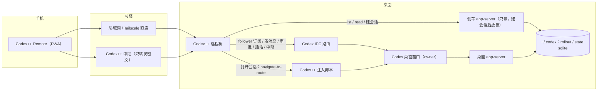

# 远程控制（手机操控 Codex 桌面）调研

- 日期：2026-11-15
- 对象：Codex 桌面 26.1106（本机运行中）/ 26.1111（官方最新，已解包），内置 CLI 0.167 / 0.169
- 方法：解包 `app.asar` 读主进程与页面代码；对 0.169 app-server 做隔离实测；对本机运行中的 Codex IPC 做只读探测（只注册客户端、做 owner 发现，不发任何写操作）

---

## 0. 结论

1. **官方 Remote Control 改不成走我们的服务器。** app-server 里写死了：必须 ChatGPT 登录（`API key auth is not supported`），
   中继地址只认 `chatgpt.com` / `chatgpt-staging.com` / `localhost`，并且要和 `account_id` 绑定的 enrollment。
   手机端是官方 ChatGPT App，我们也换不掉。纯 API / 网关用户用不了。
2. **自己做一套是可行的，P0 已在隔离的 Codex 26.1111 上端到端跑通（12/12，见第 10 节）：**
   - 桌面主进程有一个本地 IPC 路由（`~/.codex/ipc/ipc.sock`，Windows 是 `\\.\pipe\codex-ipc`），
     提供完整的 **follower 协议**：跟随者可以订阅会话的实时状态，并让桌面代为发消息、插话、中断、
     **审批命令**、回答提问。这是官方给 VS Code 插件、CLI 和多窗口协同用的。
   - 没打开的会话：Codex++ 的注入脚本向页面发 `navigate-to-route`，桌面打开后即成为 owner，再走 follower。
   - ~~`codex://threads/wake/<id>` 让桌面在后台接手~~：**实测不可用**——wake 在主进程里无头执行，
     审批请求直接失败（`approval request failed`），命令被拒；会话也不出现在侧栏，无法跟随。
3. **推荐架构：** Codex++ 起一个「远程桥」，对内接 Codex 的 IPC + 一个只读的侧车 app-server，
   对外给手机一个 PWA。网络上先做局域网 / Tailscale 直连，再做我们自己的中继（端到端加密）。
   所有真正的执行都发生在桌面窗口持有的会话里，桌面界面实时同步，审批可以在手机和桌面任一端完成。

---

## 1. 官方 Remote Control 为什么借不了

二进制里的约束（0.169）：

| 约束 | 原文 |
|---|---|
| 必须 ChatGPT 登录 | `remote control requires ChatGPT authentication; API key auth is not supported` |
| 必须有账号 ID | `remote control enrollment is waiting for a ChatGPT account id` |
| 中继地址白名单 | `expected HTTPS URL for chatgpt.com or chatgpt-staging.com, or HTTP/HTTPS URL for localhost` |
| enrollment 绑定账号 | `enrollment account_id does not match expected account_id` |
| 配对码由服务端发 | `remoteControl/pairing/start` → `pairingCode / manualPairingCode / expiresAt` |

`localhost` 虽然放行，但要在本机伪造一整套 enrollment / 配对 / 分段信封协议，还得过 `account_id` 校验，
而手机端仍然只能是官方 App——投入大、随时被官方改协议打断，不值得。

**定位**：有 ChatGPT 账号且能直连官方的用户，继续用官方 Remote Control；我们的远程控制面向纯 API / 网关 / 国内用户。

---

## 2. 关键发现：Codex 桌面的 IPC follower 协议

### 2.1 传输

- 路径：macOS / Linux 为 `<CODEX_HOME>/ipc/ipc.sock`（过长时落到 `/tmp/codex-ipc-*` 的符号链接），
  权限 0600 且校验 uid；Windows 为命名管道 `\\.\pipe\codex-ipc`。
- 帧：`[u32 LE 长度][UTF-8 JSON]`，单帧上限 256 MiB。
- 消息类型：`request` / `response` / `broadcast` / `client-discovery-request` / `client-discovery-response`。
- 握手：`{type:"request", method:"initialize", sourceClientId:"initializing-client", params:{clientType}}`
  → `{result:{clientId}}`。**已在本机实测通过。**
- 路由：request 可指定 `targetClientId`，否则路由器向所有客户端发 discovery，第一个回 `canHandle:true` 的接手。
- 版本：每个方法带版本号，不一致返回 `request-version-mismatch`。

### 2.2 方法与版本（26.1106 → 26.1111）

| 方法 | 26.1106 | 26.1111 | 用途 |
|---|---|---|---|
| `thread-stream-state-changed`（广播） | 11 | **13** | owner 推送会话快照 / 增量补丁 |
| `thread-stream-following-changed`（广播） | 1 | 1 | 声明开始 / 停止跟随某个会话 |
| `thread-owner-discovery` | 1 | 1 | 查谁持有这个会话 |
| `thread-follower-start-turn` | 2 | 2 | 发起一轮 |
| `thread-follower-steer-turn` | 1 | 1 | 运行中插话 |
| `thread-follower-interrupt-turn` | 4 | 4 | 中断 |
| `thread-follower-command-approval-decision` | 1 | 1 | 审批命令 |
| `thread-follower-file-approval-decision` | 1 | 1 | 审批文件改动 |
| `thread-follower-permissions-request-approval-response` | 1 | 1 | 审批权限请求 |
| `thread-follower-submit-user-input` | 1 | 1 | 回答模型提问 |
| `thread-follower-submit-mcp-server-elicitation-response` | 1 | 1 | 回答 MCP 表单 |
| `thread-follower-edit-last-user-turn` | 2 | 2 | 改最后一条消息 |
| `thread-follower-compact-thread` | 1 | 1 | 压缩 |
| `thread-follower-update-thread-settings` | 2 | 2 | 改模型 / 推理档位 / 权限 |
| `thread-follower-read-model-settings` | 1 | 1 | 读模型设置 |
| `thread-follower-load-complete-history` | 1 | 1 | 拉完整历史（触发快照） |
| `thread-follower-set-queued-follow-ups-state` / `remove-queued-message` / `clear-queued-messages` | 3/1/1 | 3/1/1 | 管理排队 |
| `thread-queued-followups-changed`（广播） | 3 | 3 | 排队变化 |
| `thread-read-state-changed` / `thread-archived` / `thread-unarchived`（广播） | 3/2/1 | 3/2/1 | 已读、归档 |

**版本漂移很小**：两个版本之间只有快照广播变了。版本表是 bundle 里的一个字面量对象，
桥可以在启动时从已安装 app 的 asar 里抽出来（我们已经有解析 asar 的代码），不用写死。

### 2.3 状态推送

- `change: { type: "snapshot", revision, conversationState }`：完整会话状态，含轮次、条目、
  `requests`（待审批请求，带 `id` / `method` / 参数）、`threadGoal`、设置等。
- `change: { type: "patches", baseRevision, revision, patches, acceptedTextChanges }`：增量。
- 手机端拿快照即可渲染会话、看到待审批项，再用 follower 请求回复。

### 2.4 前提：会话必须有 owner

实测本机最近 25 个会话全部 `no-client-found`——当时 Codex 停在首页，没有任何会话被加载。
**只有桌面已经加载的会话才有 owner**。没有 owner 时要先让桌面打开它（见 10.3 的 `navigate-to-route`）；
P0 里打开过、又切到别的会话后，原会话仍保有 owner。

---

## 3. 关键发现：跨进程排队 + 唤醒

### 3.1 队列持久化

`~/.codex/queue_1.sqlite`：

```sql
queued_items(id, thread_id, payload_json, queue_order, created_at_ms, updated_at_ms)
queued_thread_revisions(revision, thread_id)  -- 插入 / 更新 / 删除触发器维护
```

### 3.2 实测（两个隔离的 0.169 app-server，共享同一 CODEX_HOME）

| 步骤 | 结果 |
|---|---|
| A 新建会话、未落盘 | B `thread/queue/add` 报 `no rollout found` |
| A `thread/inject_items` 落盘后，B `thread/queue/add` | 成功 |
| A 是否收到 `thread/queue/changed` 推送 | **没有** |
| A 主动 `thread/queue/list` | **能看到 B 加的消息** |

注意：`thread/queue/*` 需要 `initialize` 时声明 `capabilities.experimentalApi = true`（桌面自己就这么做）。

### 3.3 唤醒

主进程对 `codex://threads/wake/<uuid>` 的处理：

```js
wakeQueuedThread: async (threadId) => {
  const host = getLocalHost();
  await host.connect();
  if (supports(host.appServerVersion, "threadQueue")
      && (await host.sendAppServerRequest("thread/queue/list", { threadId, limit: 1 })).data.length !== 0)
    await host.resumeThread(threadId);
}
```

- 不导航窗口（只有 `codex://threads/<id>` 才会切到会话）；
- 失败最多重试 3 次；
- 桌面没开时，系统打开 URL 会先启动 Codex。

> **P0 实测推翻了这一节最初的设想（见 10.4）**：wake 由主进程直接 `resumeThread`，不经过任何窗口——
> 会话不出现在侧栏、没有 owner、无法跟随；排队消息触发审批时没有人能批，app-server 直接返回
> `approval request failed`，命令被拒。**远程控制不用 wake。**

其他 deep link：`codex://threads/<id>`（打开会话）、`codex://threads/new?prompt=…`（新会话，会切窗口）。
在 macOS 上 deep link 走系统 `open-url`，只会交给默认的 Codex；正式实现改由注入脚本向页面发
`{ type: "navigate-to-route", path: "/local/<id>" }`（见 10.3）。

---

## 4. 推荐架构



### 4.1 每个手机操作怎么落地（P0 后修订）

| 手机操作 | 实现 | P0 |
|---|---|---|
| 会话列表 / 搜索 | 侧车 `thread/list` / `thread/search` | — |
| 看历史（没打开的会话） | 侧车 `thread/read` + `thread/turns/list`（不占写锁） | ✓ |
| 打开会话 | 注入脚本发 `navigate-to-route` → 桌面 resume → 成为 owner | ✓ |
| 实时输出 | IPC 跟随：快照 + immer 补丁 | ✓ |
| 发消息 | IPC `thread-follower-start-turn` | ✓ |
| 运行中插话 | IPC `thread-follower-steer-turn` | ✓ |
| 停止 | IPC `thread-follower-interrupt-turn` | ✓ |
| 审批命令 | IPC `thread-follower-command-approval-decision` | ✓ 同意 / 拒绝 |
| 回答模型提问 | IPC `thread-follower-submit-user-input` | ✓ |
| 审批文件改动 / 权限、MCP 表单 | IPC 对应 follower 方法 | 协议已确认，未触发 |
| 新会话 | 侧车 `thread/start` + `thread/name/set` + 放锁 → 打开 → 发消息 | ✓ |
| 排队、目标 | 侧车 `thread/queue/*` / `thread/goal/*`，或 IPC 排队方法 | 侧车已验证，IPC 未验证 |
| 切模型 / 档位 | IPC `thread-follower-update-thread-settings` | 未验证 |

**原则：执行只发生在桌面窗口持有的会话里。** 侧车只读和建会话，建完立刻放掉写锁。

### 4.2 为什么不用其他路

| 路线 | 问题 |
|---|---|
| 侧车 app-server 直接跑轮次（微信连接现在就这么做） | 桌面看不到实时输出；同一会话两个进程同时写 rollout 有损坏风险；审批落在侧车上，桌面不知道 |
| CDP / 注入脚本驱动桌面页面（点按钮、填输入框） | 依赖页面结构，脆；每次 Codex 改版都要追。只用注入发一条 `navigate-to-route` 页面消息，其余全走 IPC |
| `codex://threads/wake/<id>` 排队唤醒 | 无头执行、无 owner、审批直接失败（P0 实测） |
| `codex app-server --listen ws://` 单独起服务 | 同侧车，且等于把一个可执行任意命令的接口暴露到网络上 |
| 官方 Remote Control | 见第 1 节 |

---

## 5. 网络层

### 阶段 A：局域网 / Tailscale 直连（先做）

- 桥默认只监听 `127.0.0.1`；用户在 Codex++ 里打开「远程控制」后，才额外监听局域网 / Tailscale 地址。
- TLS：桥自签证书，配对二维码里带证书指纹，手机端校验指纹（不依赖公共 CA）。走 Tailscale 时可直接用它的加密。
- 手机打开二维码里的地址即可，「添加到主屏幕」成为 PWA。

### 阶段 B：Codex++ 中继（外网、无 VPN 时）

- 桌面主动向中继建立 WSS 长连接，不需要公网 IP、不需要端口映射。
- 中继只按 `deviceId` 转发，**内容端到端加密**：配对时双方用 X25519 协商，之后 AES-GCM / ChaCha20-Poly1305；
  中继看不到会话内容、命令和审批。
- 实现可以放在 Cloudflare Worker + Durable Object（WebSocket hibernation，我们已经有 `services/share-site` 的 Worker 部署经验），
  也可以给用户自建版。
- 通知：Web Push（iOS 需添加到主屏幕，16.4+）；或复用现有微信连接 / Telegram / Bark。

---

## 6. 安全模型（必须先定）

手机能审批命令 = 能在这台电脑上执行任意代码。因此：

1. **默认关闭**，显式开启；关闭时立刻断开所有设备。
2. **配对**：桌面显示一次性配对码 / 二维码（5 分钟过期），手机扫码后桌面再确认一次设备名。
3. **设备凭据**：每台设备独立密钥对，可在 Codex++ 里查看、改名、吊销；吊销立即生效。
4. **权限分级**：只读 / 可发消息 / 可审批，按设备设置；审批权限默认关。
5. **高危审批二次确认**：命令审批在手机上展示完整命令、cwd、沙箱级别，`rm`、`git push --force` 等再确认一次。
6. **审计日志**：每个远程操作（设备、时间、会话、操作、结果）写入本地日志，可导出。
7. **速率限制与锁定**：配对码与连接失败次数限制。
8. **中继零知识**：中继不持有任何会话密钥；中继被攻破只能断服务，不能读或伪造指令。

---

## 7. 手机端（PWA）

- 会话列表（按项目分组、未读、运行中、等待审批）
- 会话页：流式输出、工具调用折叠、diff 预览、图片
- 输入框：发送 / 插话 / 排队切换，图片上传
- 审批卡片：命令、文件改动、权限、提问
- 队列面板、目标面板（进度、预算、暂停 / 继续）
- 模型 / 推理档位切换
- 通知：需要审批、回合完成、目标暂停 / 完成、出错

技术上直接复用 Codex++ 管理器的前端栈（React + TS），由桥提供静态资源。

---

## 8. 边界与风险

| 项 | 说明 | 应对 |
|---|---|---|
| 桌面必须在运行 | 所有执行都在桌面窗口里；电脑休眠就无能为力 | 远程控制开启时提示保持唤醒；可选 `prevent_idle_sleep`；Codex 没开时由 Codex++ 启动器拉起 |
| 会话需要 owner | 没打开的会话只能读 | 注入脚本发 `navigate-to-route` 打开，0.5–3 秒成为 owner；桌面窗口会切到这个会话 |
| 一个窗口同一时刻只显示一个会话 | 手机打开别的会话会切走桌面当前视图 | 已打开过的会话切走后仍保有 owner（P0 实测），可继续跟随；要不打扰桌面需研究多窗口 |
| 协议版本漂移 | IPC 方法版本、快照结构随 Codex 版本变 | 启动时用 `ipc-versions.mjs` 的方法从已装 app 抽版本表；Codex 升级后跑 `run-p0.mjs` 回归；不兼容时降级为只读 |
| 写锁 | 一个会话只能有一个 app-server 写；侧车占着时桌面打不开（`already has an active writer`） | 侧车 `thread_unload_delay_secs=0`，建完会话立刻 unsubscribe 并等它卸载；只读请求不占锁（P0 实测） |
| iOS 后台 | PWA 切到后台 WebSocket 会断 | 依赖推送通知；回到前台时用 revision 增量补齐 |
| Windows 多开 | 命名管道名固定，多个实例共用一个路由 | 按 owner 的 clientId 定位实例；按实例的 CODEX_HOME 区分侧车 |
| 安全 | 远程审批等于远程执行 | 第 6 节 |

---

## 9. 分阶段计划

| 阶段 | 内容 | 验收 |
|---|---|---|
| P0 协议验证 ✅ | 用隔离的 Codex 实例打开一个会话，确认快照字段、`requests` 结构、审批 / 插话 / 中断请求的参数与返回 | `tools/remote-control-p0/run-p0.mjs` 12/12 通过（第 10 节） |
| P1 远程桥 ✅ | Rust：IPC 客户端（含版本表抽取）、follower 状态机、侧车 app-server、经 CDP 打开会话、会话 / 审批 API、WebSocket 推送、令牌鉴权；管理器「工具 → 远程控制」页 | 本机浏览器能完成：看会话 → 打开 → 发消息 → 实时输出 → 审批（`run-p1.mjs` 18/18，真实浏览器手动走通，第 11 节） |
| P2 手机 PWA + 局域网 | 前端；局域网 / Tailscale 监听；证书指纹配对；审计日志 | 手机在同一 Wi-Fi 下完成整套操作；吊销设备立即断开 |
| P3 中继 | 中继服务、端到端加密、推送通知 | 手机在 4G 下能用；中继日志里看不到明文 |
| P4 打磨 | 多设备、权限分级、附件、目标 / 队列面板、Windows 验证 | Windows / macOS 双平台通过 |

### P0 之后仍待验证

1. 文件改动审批、权限请求审批、MCP 表单回答：协议方法已确认，需要能触发它们的场景。
2. `thread-follower-update-thread-settings`（手机切模型 / 推理档位）。
3. IPC 排队方法（`thread-follower-set-queued-follow-ups-state` 等）的参数结构。
4. Windows：命名管道 `\\.\pipe\codex-ipc`、多开时多个实例共用路由的行为。
5. 用户在桌面上手动关掉 / 切走会话后，owner 何时失效（P0 里切走后仍保有 owner）。

---

## 10. P0 实测结果（2026-11-15）

环境：从官方 zip 解包的 Codex 26.1111（build 27194，CLI 0.169.0-alpha.11.1），独立 `CODEX_HOME`、独立
`--user-data-dir`；模型是本机的假 Responses 上游（`tools/remote-control-p0/mock-responses.mjs`），
用标记触发命令审批、模型提问、慢速输出。全程没有连接用户自己的 `~/.codex` 和正在使用的 Codex。
参考实现与回归脚本：[tools/remote-control-p0/](../../tools/remote-control-p0/README.md)，连续两次 12/12 通过。

### 10.1 已跑通的链路

| 链路 | 方法 | 结果 |
|---|---|---|
| 握手 | `initialize { clientType }` | 返回 `clientId` |
| 找 owner | `thread-owner-discovery` | 返回 owner 的 `clientId` 与 `{ supportsUntrustedAppInput: true }` |
| 跟随 | 广播 `thread-stream-following-changed { following: true }` + `thread-follower-load-complete-history` | 立即收到快照，之后持续收到补丁 |
| 发消息 | `thread-follower-start-turn` | 桌面界面同步显示消息与流式回复 |
| 同意命令 | `thread-follower-command-approval-decision { decision: "accept" }` | 命令在桌面执行，文件被创建 |
| 拒绝命令 | 同上 `decision: "decline"` | 条目状态 `declined`，文件未创建 |
| 插话 | `thread-follower-steer-turn` | 轮次里出现 `steeringUserMessage` / `steered`，模型收到插话 |
| 中断 | `thread-follower-interrupt-turn { mode: "user-stop" }` | 轮次状态 `interrupted` |
| 回答提问 | `thread-follower-submit-user-input` | 轮次里出现 `userInputResponse`，模型收到答案 |
| 新建会话 | 侧车 `thread/start` + `thread/name/set` + 放锁 → 页面 `navigate-to-route` | 0.5–3.2 秒内成为 owner |

### 10.2 参数要点

```js
// 发消息：context 给空对象即可
{ conversationId, turnStart: {
    request: { threadId, input: [{ type: "text", text, text_elements: [] }], clientUserMessageId },
    context: {} } }

// 插话：restoreMessage 不能为 null（owner 会读 cwd 和 context.commentAttachments）
{ conversationId, input, clientUserMessageId, attachments: [], serviceTier: null,
  restoreMessage: { id, text, cwd, context: { workspaceRoots: [cwd], commentAttachments: [], fileAttachments: [], collaborationMode: null } } }

// 中断
{ conversationId, mode: "user-stop", expectedTurnId }

// 命令审批：decision 取自请求里的 availableDecisions
//   "accept" | "decline" | "cancel" | { acceptWithExecpolicyAmendment: { execpolicy_amendment: [...] } }
{ conversationId, requestId, decision }

// 回答提问
{ conversationId, requestId, response: { answers: { [questionId]: { answers: ["蓝色"] } } } }
```

待审批项在会话状态的 `requests` 数组里：

```json
{ "method": "item/commandExecution/requestApproval", "id": 0,
  "params": { "threadId": "…", "turnId": "…", "itemId": "call_4", "reason": "…",
              "command": "/bin/zsh -lc '…'", "cwd": "/tmp/codex-p0/work",
              "commandActions": [{ "type": "unknown", "command": "…" }],
              "proposedExecpolicyAmendment": ["touch", "…"],
              "availableDecisions": ["accept", { "acceptWithExecpolicyAmendment": { "execpolicy_amendment": ["touch", "…"] } }, "cancel"] } }

{ "method": "item/tool/requestUserInput", "id": 1,
  "params": { "questions": [{ "id": "color", "header": "颜色", "question": "你喜欢哪个颜色？",
              "isOther": true, "isSecret": false, "options": [{ "label": "红色", "description": "热情" }] }],
              "isBlocking": false, "autoResolutionMs": null } }
```

### 10.3 状态同步

- 快照：`{ type: "snapshot", revision, conversationState }`。历史在
  `conversationState.turnHistory.history`（`islands[].entries[].value` → `entitiesByKey`），快照里的 `turns` 通常为空。
- 补丁：`{ type: "patches", baseRevision, revision, patches }`，`patches` 是 immer 格式
  `{ op: "add" | "replace" | "remove", path: [...], value }`，路径用数组。流式文字是对
  `items[n].text` 的 `replace`。`baseRevision` 对不上时重新要一次快照。
- 打开会话：页面接收 `window` 上的 `message` 事件
  `{ type: "navigate-to-route", path: "/local/<threadId>" }`（主进程就是用它导航的）。

### 10.4 踩到的坑

| 现象 | 原因 | 处理 |
|---|---|---|
| 侧车新建的会话，桌面打开后一直没有 owner | 侧车 `thread/start` 后持有写锁，桌面 `thread/resume` 报 `thread … already has an active writer` | 侧车以 `-c thread_unload_delay_secs=0` 启动，建完会话 `thread/unsubscribe` 并等它卸载（约 200 ms）；默认延迟下 unsubscribe 3 秒内都不会卸载 |
| 新会话别的进程读不到 | `thread/start` 后没有 rollout 文件 | `thread/name/set` 会落盘，且不往历史塞假消息 |
| wake 后会话不在侧栏、没有 owner | 主进程直接 `resumeThread`，不经窗口 | 不用 wake |
| wake 执行的轮次里命令被拒 | 无头执行时没有人接审批：`approval request failed` | 不用 wake |
| 插话报 `Cannot read properties of null (reading 'cwd')` | `restoreMessage` 传了 null | 按 10.2 构造 |
| 模型提问报 `request_user_input is unavailable in Default mode` | 默认模式下这个工具要开 `features.default_mode_request_user_input`（设置里的「Request user input」实验项）或用 Plan 模式 | 正式实现里提示用户 |
| `thread-owner-discovery` 偶尔要等 5–10 秒才失败 | 路由器向所有客户端发 discovery，有客户端不回时等满 10 秒 | 本地超时设短；会话列表里优先查自己记录的 owner |
| 用 `codex://` 测试 | macOS 交给默认的 Codex（用户正在用的那个） | 测试与正式实现都不用 deep link，改用页面消息 |

---

## 附录：本次实测记录

- IPC：`initialize` 成功，返回 `clientId`；对 25 个最近会话做 `thread-owner-discovery`，当时均为 `no-client-found`（Codex 停在首页）。
- app-server 0.169：`thread/goal/set|get|clear`、`thread/queue/add|list|update|delete` 全部可用（需 `experimentalApi`）；
  `thread/goal/set` 支持 `tokenBudget`。
- 跨进程队列：落盘后可互相看到，无推送通知。
- 调研阶段的一次性探测脚本放在本机 `/tmp/codexapp-tools/`，未进仓库；P0 的参考实现与回归在 `tools/remote-control-p0/`。
- 期间本机已安装的 Codex 由 Sparkle 自动升级到 26.1111；两个版本的 IPC 方法表只差 `thread-stream-state-changed`（11 → 13）。

---

## 11. P1 实现（2026-11-15）

代码：`crates/codex-plus-core/src/remote_control/`

| 文件 | 内容 |
|---|---|
| `ipc.rs` | IPC 客户端：Unix socket / Windows 命名管道、帧、握手、请求 / 回复配对、广播订阅、discovery 一律回 `canHandle:false` |
| `versions.rs` | 从已安装 Codex 的 `app.asar` 读 IPC 方法版本表，读不到用内置的 26.1111 表 |
| `patch.rs` | immer 补丁应用（含数组 `length` 截断） |
| `follower.rs` | 跟随状态机（快照 + 补丁、断档重新要快照、Lagged 重同步）、follower 操作、给网页的精简视图 |
| `sidecar.rs` | 侧车 app-server（`thread_unload_delay_secs=0`，建会话后放锁），找桌面版自带的 CLI |
| `service.rs` | 连接 / 侧车 / 跟随的生命周期；经 CDP 发 `navigate-to-route` 打开会话；运行中发消息自动变插话 |
| `server.rs` | HTTP + WebSocket（手写握手）；令牌、Host、Origin 检查；推送 80 ms 合并 |
| `mod.rs` | 开关 / 端口 / 令牌持久化（`<state>/remote-control.json`，0600），独立线程运行时启停 |

管理器：侧栏「工具 → 远程控制」（`RemoteControlPage.tsx`），一条命令 `remote_control_request` 按 action 分发；
管理器启动时按保存的开关拉起，退出时停掉（连同侧车进程）。默认关闭。

接口（都要 `Authorization: Bearer <令牌>`，WebSocket 用 `?token=`）：

| 方法 | 路径 | 作用 |
|---|---|---|
| GET | `/api/status` | IPC 是否连上、版本表来源、CLI、调试端口 |
| GET | `/api/threads` | 会话列表（侧车） |
| POST | `/api/threads` | 新建会话 `{ cwd, name?, text? }`：侧车建 → 放锁 → 桌面打开 |
| GET | `/api/threads/{id}` | 已在桌面打开时给实时视图，否则给侧车读到的历史 |
| POST | `/api/threads/{id}/open` | 让桌面打开并跟随 |
| POST | `/api/threads/{id}/messages` | `{ text }`，没打开先打开；运行中自动改插话 |
| POST | `/api/threads/{id}/interrupt` | 停止当前一轮 |
| POST | `/api/threads/{id}/requests/{requestId}` | 审批 `{ decision }` / 提问 `{ answers }` / 权限与 MCP `{ response }` |
| WS | `/api/threads/{id}/stream` | 推送 `{ type: "view", view }`，会话失去 owner 时推 `{ type: "closed" }` |

安全：只监听 127.0.0.1；Host 只认回环（防 DNS 重绑定）；带 Origin 必须同源；令牌 64 位十六进制、常量时间比较；
网页本身不含数据，令牌放在 URL 片段里不随请求发出；CSP 禁止外部资源与被嵌入；所有 POST 记入诊断日志
`remote_control.action`。

验证：`cargo test -p codex-plus-core --test all remote_control::`（14 项，含假 IPC 路由器与服务启停）、
`node --test src/remote-control-page.test.ts`（4 项）、`run-p1.mjs` 18/18、`run-p0.mjs` 12/12，
以及在隔离 Codex 上用真实浏览器走通「选未打开的会话 → 发需要审批的消息 → 桌面自动打开 → 网页弹审批卡 → 同意 → 命令执行」。

会话设置（同日补上）：`GET /api/threads/{id}/options`、`POST /api/threads/{id}/settings`
`{ model?, effort?, permissionMode?, collaborationMode? }`，经 `thread-follower-update-thread-settings` 下发，
等到会话状态里反映出来再返回；权限四档与桌面预设一致（只读 / 默认 / 自动审批 / 完全访问），计划模式随下一轮请求带上。

## 12. P2 实现：手机经局域网 / Tailscale 访问（2026-11-15）

两个入口共用一个服务：

| 入口 | 监听 | 认谁 | Host |
|---|---|---|---|
| 本机 | `127.0.0.1:57360`，HTTP | 主令牌、设备令牌 | 只认回环 |
| 局域网 | `0.0.0.0:57361`，自签 HTTPS，默认关 | 只认设备令牌 | IP 字面量、`*.local`、`*.ts.net` |

- **证书**（`tls.rs`）：rcgen 自签，存 `<state>/remote-control-tls.json`（0600）。有效期 800 天（iOS 拒收超过 825 天的服务器证书），
  带 `serverAuth` EKU。快到期或出现没覆盖的新地址时重签，重签保留旧地址，免得家里 / 公司来回换。
  管理器显示 SHA-256 指纹，手机第一次打开时可在证书详情里核对。
- **地址**：用 UDP connect 问路由表拿主网卡地址；对 `100.100.100.100` 再问一次拿 Tailscale 地址（100.64/10）。
  不在同一网络时装 Tailscale 即可，不经第三方服务器。
- **配对**（`devices.rs`）：管理器生成 8 位一次性配对码（去掉易混字符），5 分钟过期、用一次即作废、错 5 次作废；
  二维码内容是 `https://<地址>:57361/#pair=<码>`，码在 URL 片段里不随请求发出。手机打开后确认设备名，
  `POST /api/pair { code, name }` 领 64 位设备令牌，存 localStorage。状态文件只存令牌的 SHA-256。
- **权限分级**：只能查看（GET 全部、订阅推送）< 可发消息（新建、发消息 / 插话、停止、在桌面打开）
  < 完全控制（审批、回答提问、改模型与权限）。服务端按接口判断（`server::required_role`），网页按 `/api/me` 隐藏或置灰。
- **吊销**：从管理器移除设备即时生效；已建立的推送连接每 3 秒复查一次，被吊销就推 `{ type: "revoked" }` 并断开，网页回到配对页。
  改权限下一次请求就生效。最近活动时间与来源地址在内存里实时更新，落盘最多每分钟一次。
- **网页**：wss 连不上（部分手机浏览器对自签证书的 WebSocket 不放行）时自动改 1.5 秒轮询；
  手机布局（安全区、16px 输入框防 iOS 放大）、manifest 可加到主屏幕。
- **提醒**：页面在后台时，新的审批 / 提问、一轮跑完会改标题、振动、发系统通知（用户允许过才发）。
  页面关掉后收不到：Web Push 要 Service Worker，自签证书下浏览器不让注册。要做离线推送得走阶段 B 的中继（有正式证书）。
- **管理器**：「远程控制 → 手机与其它设备」：局域网开关、访问地址、证书指纹、添加设备（选权限 → 二维码 + 配对码 + 倒计时，
  配上后自动出现在列表）、已配对设备（最近活动、改权限、移除）。

验证：`cargo test -p codex-plus-core --test all remote_control::`（23 项，新增配对 / 吊销 / 证书 / 权限 / 局域网 HTTPS 端到端）、
`node --test src/remote-control-page.test.ts`（5 项）、`run-p2.mjs` 28/28（真实局域网 IP）、`run-p1.mjs` 25/25、
以及手机尺寸浏览器里走通「打开配对链接 → 配对 → 会话列表 → 权限不足的控件置灰、审批卡只读 → 被移除后回到配对页」。

仍待做：Windows 实测（命名管道、防火墙首次放行提示）；阶段 B 中继与离线推送。

## 13. 入口放进 Codex，网页支持两种对话样式（2026-11-15）

**入口搬到 Codex 左侧图标栏**，不再需要在 Codex++ 与管理器之间来回切：

- 新分片 `45-remote-control-page.js`：「远程控制」页，紧跟在「供应商」后面。开关、本机链接、局域网地址、
  证书指纹、添加设备（权限 + 二维码 + 配对码 + 倒计时）、已配对设备（最近活动 / 改权限 / 移除）都在这里。
- 后端：bridge 路由 `/remote-control` `{ action, ...args }`（`routes.rs`），与管理器命令共用
  `remote_control::dispatch`，两边看到同一份状态；启停放阻塞线程池，等监听线程就绪。
  路由不在拓展白名单里（能开关服务、发配对码、移除设备）。页面按 2.5 秒轮询状态，手机配上自动出现在列表。
- 服务只在管理器进程里托管：管理器启动时 `mark_hosted_by_this_process()`；bridge 若跑在别的进程，
  路由返回「Codex++ 管理器未运行」，避免两边各起一份抢端口。
- 既有约束照做：rail 入口 id 登记进全部写死内置 id 的地方（点击监听 ×2、选中态、清理、扫描调度、拓展排位），
  否则点入口会把刚开的页面关掉或触发自喂扫描。

**网页两种对话样式**（`index.html`，同一份 DOM，只切根节点 `data-style`）：

- `codex`：原桌面形态（长列表、左白右灰气泡、命令块可折叠）。
- `chat`：按微信对话页做——浅灰底、左侧白气泡带方角头像、右侧绿气泡、运行中显示「正在处理…」、
  会话列表带头像与右侧时间、标题栏居中、模型 / 权限收进「⋯」。
- 手机（≤720px）没选过时默认 `chat`，选过按设备记在 `localStorage`（`codexPlusRemoteStyle`）。
  两种样式共用渲染数据，以后做 iOS / 安卓原生壳时按同一份 `view` 输出即可。

验证：core 25 项、管理器 2120 项、注入 100 项、`run-p1.mjs` 25/25、`run-p2.mjs` 28/28；
隔离 Codex 里经 CDP 实测 rail 顺序（Codex++ / 供应商 / 远程控制 / 拓展 / 推荐内容）、页面四个分区与二维码正常；
手机尺寸浏览器里两种样式互切，刷新后记住选择。


## 14. 后台执行：发消息不再让桌面跳过去（2026-11-16）

**问题**：原设计里只有桌面窗口能执行一轮。给没在桌面打开的会话发消息，要先经 CDP 让桌面打开它，
用户正在桌面看的会话就被切走了，没法一边在桌面干活、一边在手机上推进别的会话。

**做法**：没在桌面打开的会话改由侧车 app-server 在后台执行（`remote_control/headless.rs`），桌面窗口完全不动。

| 操作 | 桌面已持有（跟随桌面） | 没在桌面打开（后台执行） |
|---|---|---|
| 发消息 | IPC `thread-follower-start-turn` | 侧车 `thread/resume` 拿锁 + `turn/start` |
| 插话 | `thread-follower-steer-turn` | `turn/steer { expectedTurnId }` |
| 中断 | `thread-follower-interrupt-turn` | `turn/interrupt { turnId }` |
| 审批 / 提问 | follower 回包 `{ requestId, decision }` | 服务端请求的 JSON-RPC 回包 `{ decision }` / `{ answers }` / 权限授予 |
| 改模型 / 推理 / 权限 | `thread-follower-update-thread-settings` | 记在后台会话上，随下一次 `turn/start` 发出（app-server 沿用到后续轮次） |
| 计划模式 | 支持 | `turn/start` 没有协作模式字段：网页确认后转到桌面打开 |
| 实时推送 | 桌面的状态快照 + 补丁 | 侧车通知 `turn/*`、`item/*`、`item/agentMessage/delta` 拼成同样的视图（`headless: true`） |

- **写锁只在跑的时候持有**：开一轮前 `thread/resume`，这一轮结束（没有待回答的请求）800 ms 后 `thread/unsubscribe` 放锁；
  放锁和开新一轮由同一把锁串行，避免放锁撞上刚开的一轮。跑完之后桌面随时能打开它，看到完整历史。
- **桌面正占用**（桌面 app-server 还持有该会话但窗口没打开）时 `thread/resume` 会报 active writer，网页提示稍后再试或在桌面打开。
- 新建会话也不再让桌面打开；「在桌面打开」只在用户主动点时发生，后台正在跑时会拒绝（等它跑完）。
- 推送来源变化（后台会话转到桌面）时推 `{ type: "closed", reconnect: true }`，网页重连一次接到新来源。
- 侧车收到的服务端请求按 `threadId` 分给对应的后台会话；没人认领的回 JSON-RPC 错误，免得那一轮挂住。

协议实测：`tools/remote-control-p0/poc-headless-turn.mjs`（新建 + 一轮 + 审批）、`poc-headless-resume.mjs`（接管已有会话、插话、中断、放锁）、
`poc-headless-dump.mjs`（通知结构）。

验证：`run-p3.mjs` 18/18（桌面当前页面全程不变、会话没有桌面 owner；审批、插话、中断、改设置都在后台完成，
上游请求核对到新模型 / 推理强度 / 完全访问沙箱；切计划模式时才转到桌面，桌面看到后台跑过的全部 5 轮）、
`run-p1.mjs` 26/26、`run-p2.mjs` 28/28，core 全部 1959 项。

## 15. 手机界面重做：照微信与 Codex 手机端（2026-11-16）

「聊天样式」不再改桌面布局，而是一套独立的手机界面（`index.html` 里的 `.m`），与 Codex 样式共用 state、接口和推送。
以后做 iOS / 安卓 app 照这套结构即可。

| 屏 | 内容 |
|---|---|
| 列表 | 顶栏：筛选（全部 / 运行中 / 未读）、在线点 + 电脑名（`/api/me` 的 `host`，macOS 取「电脑名称」）、⊕ 新建；搜索；项目行：九宫格头像（每格是会话标题首字，按微信群头像排法 1–9 格）、「项目名（会话数）」、「N 个运行中 · 最新会话」、微信式时间（今天时:分 / 昨天 / 周几 / 几月几日）、未读角标；只有一个会话的项目直接进对话 |
| 项目 | 返回（带其它项目未读数）、项目名（数量）、⊕ 在该项目新建；会话行：单字头像、标题、首条消息、时间、未读点 |
| 对话 | 居中标题 + 状态小字（后台运行中 / 桌面已打开）、···；时间分隔（隔 5 分钟以上）、左右带尾巴气泡与方角头像、代码块、命令 / 改文件卡片（点开看输出）、审批 / 提问卡片（推送重绘时复用节点，不丢已选答案）、正在输入；输入区：胶囊输入框（+ 更多操作、有字时绿色发送、运行中空着时停止）、下方芯片：∞ Agent / 计划、权限（完全访问黄色）、模型 · 推理强度、上下文圈（`tokenUsage`：最近一次请求 token / 上下文窗口） |
| 设置 | 电脑、这台设备、权限；对话样式（聊天 / Codex）；系统通知；退出配对 |

- 未读：本机记每个会话上次看到时的 `updatedAt`（`codexPlusRemoteSeen`）；第一次打开全部算已读。列表页每 8 秒刷新一次，从对话返回立即刷新。
- 进项目、进对话各压一层 `history`，安卓返回键 / iOS 侧滑能逐级返回。
- 浅色 / 深色跟随系统：浅色是微信的灰底白气泡绿气泡，深色对应 Codex 手机端。
- 视图新增 `turns[].startedAtMs`（桌面 `turnStartedAtMs`、app-server `startedAt`）和 `tokenUsage`（桌面 `latestTokenUsageInfo`、后台 `thread/tokenUsage/updated`）。

验证：手机尺寸浏览器里深浅两色走通「列表 → 项目 → 对话 → ⊕ 新建（带第一条消息）→ 后台运行 → 审批卡片同意 → 改模型 / 推理 → 权限菜单 → 返回列表刷新 → 别处来消息出现未读角标 → 设置页」；
core 29 项、`run-p1` 26/26、`run-p2` 28/28、`run-p3` 18/18。

## 16. 发图片 / 文件、新建会话选文件夹（2026-11-16）

**加号 → 照片 / 拍照 / 文件**：
- 手机上传（`POST /api/uploads`，请求体是文件本身，`X-File-Name` 带文件名）存到状态目录旁的 `remote-uploads/<日期>/`，不往用户项目里写。
  大于 1.5 MB 的照片先在手机上缩到长边 2048、转 JPEG。上限 30 MB；请求体在认证通过之后才读，没配对的人不能让我们收大文件。
- 发消息 `{ text, attachments: [{ path, name, kind }] }`：图片作为 `localImage { path }`（模型直接看图）；
  文件照桌面拖入文件的写法，在文字前加 `# Files mentioned by the user:` / `## <名字>: <路径>` / `## My request for Codex:`，模型自己去读。
  实测 `mention` 输入项进到上游时 content 为空，模型看不到文件，不能用。
- 只认上传目录里的路径（规范化后比较）；网页取原图 `GET /api/uploads/raw?path=` 同样只认上传目录。
- 视图里用户消息带 `attachments`（图片缩略图、文件卡片），文件段落从文字里拆出来，只显示用户原话；点图片全屏看。

**新建会话**：
- 列表上的 ⊕：选已有项目，或「选择其他文件夹…」浏览这台电脑上的目录（`GET /api/fs/dirs?path=`，只列文件夹、不列隐藏的、标出 git 仓库，
  需要「可发消息」权限）；切到文件夹浏览再回来，已填的名称和第一条消息不丢。路径保留用户走过来的写法（不把 /tmp 解析成 /private/tmp），
  选到已有项目的目录时自动归进那个项目。
- 项目里的 ⊕、对话里 ···「在这个项目新建会话」：直接用该项目目录，不出现目录选择。

验证：`run-p4.mjs` 18/18（上游请求里核对到 1 张 input_image 和文件路径引用）；手机尺寸浏览器里走通「⊕ → 选择其他文件夹 → 主目录 → 进子目录 → 用这个文件夹」
「项目内 ⊕ 直接创建」「+ → 选图和日志 → 输入框上方缩略图 → 发送 → 对话里显示图片与文件卡片」；core 1968 项、P1–P3 全过。

## 17. 桌面镜像：把 Codex 桌面窗口直接投到网页（2026-11-16）

第三种样式「桌面镜像」：自绘界面（Codex 样式 / 聊天样式）之外，直接看并操作桌面上那个 Codex 窗口。入口：Codex 样式左上「桌面镜像」、手机设置页「对话样式」。

- 画面：服务端连本机 CDP（`Page.startScreencast`，JPEG 70%，按网页画布大小要，长边 ≤ 2560），二进制帧推给网页，
  尺寸元数据变化时另推 JSON；每帧发完才回 `screencastFrameAck`，网络慢时自然降帧。窗口最小化时推 `visibility: false`。
- 输入：网页 `/api/mirror` WebSocket 发 `mouse / wheel / key / text`，服务端校验后转成 `Input.dispatchMouseEvent / dispatchKeyEvent / insertText`：
  事件类型、按键字段长度、坐标范围、文字长度（≤ 2 万字）都有限制，macOS 编辑命令（`commands`）只放全选、撤销、按词移动等白名单。
- 输入法：网页里藏一个输入框收字，用的是网页那一端设备的输入法；拼字过程在画面底部浮条显示，选定后整段 `insertText` 写进 Codex，
  不经过 Mac 的输入法，中文 / 语音 / emoji 都能用。输入框常驻一个零宽字符，兜住安卓键盘在空输入框上按退格不发事件的问题；
  回车、退格、方向键、Tab、Esc 和 Cmd/Ctrl 组合键单独作为按键发；粘贴用本机剪贴板。复制不会回到本机剪贴板。
- 触摸：轻点 = 单击，拖动 = 滚动；「键盘」按钮弹出手机键盘。鼠标：按下 / 移动（每帧一次）/ 抬起 / 双击 / 滚轮 / 右键。
- 权限：镜像能操作 Codex 的一切（设置、审批……），只给「完全控制」；调试端口不对外，只经已认证的服务转发。
- 它就是桌面那个窗口：网页上的操作桌面同步可见，不适合「一边桌面干活一边远程推进别的会话」，那种场景用自绘界面。
  需要 Codex 由 Codex++ 启动（调试端口），窗口不能最小化。

同时修了一个问题：桌面 Codex 没开（连不上 IPC）时，查看会话、发消息直接报错。现在当作没有桌面持有：查看读历史，发消息走后台执行。

验证：`run-p5.mjs` 12/12（隔离桌面上核对点击聚焦、中文整段写进 ProseMirror、退格、Cmd+A + 退格清空、Shift+Enter 换行、非法输入被拒、
没令牌 / 只读设备被拒、局域网 wss 收到画面）；浏览器里点镜像画面打开会话、在镜像里打字，模拟输入法组字事件确认浮条显示、选定后只发一次、
安卓式退格变成退格键；core remote_control 35 项，P1–P4 全过。
