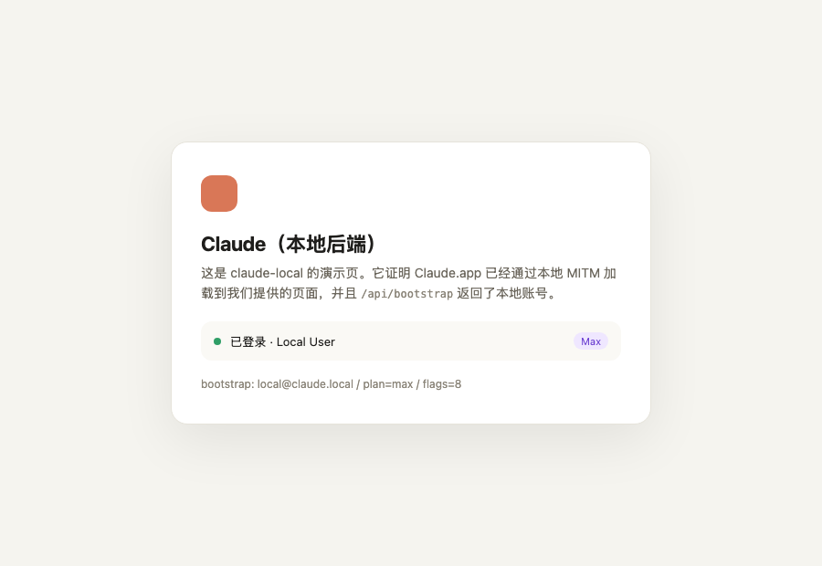
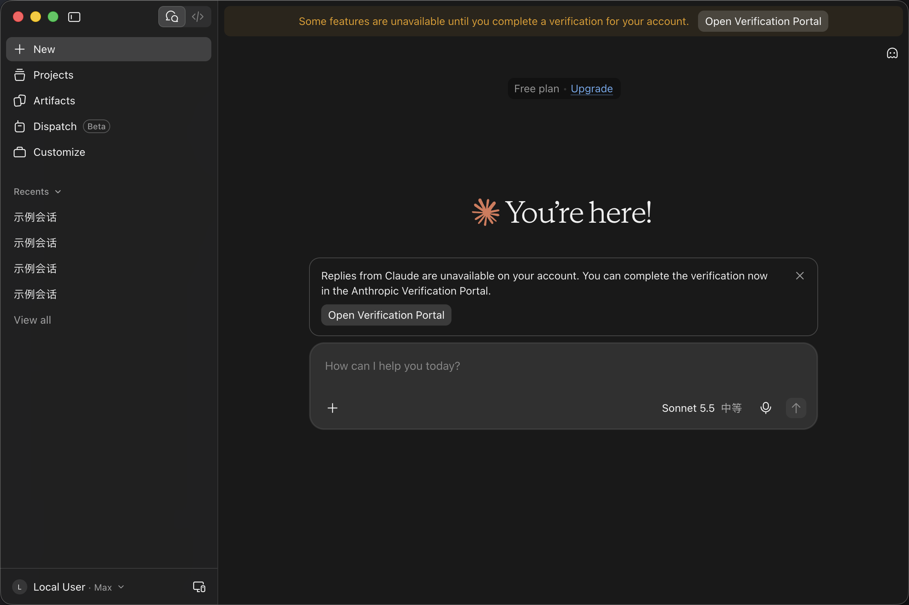

# claude-local：Claude Desktop 本地兼容后端（PoC）

## Codex++ 受管运行

受管模式使用原版 Claude Desktop，通过 `--proxy-server` 连接本地服务，不制作或改写
Claude 安装包。代理、证书、缓存和会话数据由 Codex++ 放在独立状态目录管理；
原版普通启动不会自动获得这条代理连接。

`CLAUDE_LOCAL_MANAGED=1` 启用受管协议。运行时只需要已跟踪的 Node 模块和中文词表，
不读取仓库中的 `mock/`、本机录制 bootstrap、录制词表或 `vendor/`。网页静态资源仍需
由原版客户端及可访问的上游提供；合成接口数据不包含动态资源的私有访问值。
受管模式从当前安装包只读提供官方 SPA；启用本地化时，仅在代理返回的 HTML 中、首个
官方脚本执行前加载同源 `page-shim.js`，引导官方前端采用中文词表，不改写 Claude.app。

| 环境变量 | 用途 |
| --- | --- |
| `CLAUDE_LOCAL_GATEWAY_URL` / `_KEY` / `_MODEL` | Codex++ 网关根地址、本地凭据和默认模型，受管模式必填 |
| `CLAUDE_LOCAL_GATEWAY_MODELS` | JSON 字符串数组，列出可选的供应商/模型 ID |
| `CLAUDE_LOCAL_GATEWAY_SMALL_MODEL` | 轻量任务模型，未配置时使用默认模型 |
| `CLAUDE_LOCAL_GATEWAY_MODEL_WINDOWS` | JSON 对象，逐模型的上下文窗口（`{"provider/model": 1100000}`）；键也接受裸模型名 |
| `CLAUDE_LOCAL_GATEWAY_DEFAULT_WINDOW` | 选中模型没有逐模型声明时界面显示/CLI 使用的窗口；不配则沿用 Claude 自己的 200k 假定值 |
| `CLAUDE_LOCAL_WEB_I18N_DIR` | 随应用打包的完整中文词表 |
| `CLAUDE_LOCAL_CACHE_DIR` | 本地代理缓存，听写补丁也写入此目录 |
| `CLAUDE_LOCAL_STATE_FILE` | 会话和通知设置文件；原子写入、权限为 `0600` |
| `CLAUDE_LOCAL_READY_FILE` / `_INSTANCE_ID` | 本次启动的就绪回执和实例标识 |
| `CLAUDE_LOCAL_LOCALIZATION` / `_VOICE_INPUT` / `_COMPUTER_USE` / `_BACKGROUND_MODE` | 各能力的独立开关，`0` 关闭、`1` 开启 |

受管启动支持 `--port 0`，监听后写入
`{instanceId,pid,port,mode,lastClientAt}` 回执，不包含网关凭据。
`GET /__codex_claude_local/health` 返回同一身份及最近客户端连接时间；
健康轮询自身不更新该时间。直接 HTTP 模型请求需要本地网关凭据，并拒绝浏览器
`Origin` 请求；HTTPS 的原版客户端链路仍由本地接口处理。

模型选择器的合成配置来自可用模型列表，RPC 的 `SendMessage.model` 和
`SetConversationModel` 会保留实际选择；多轮聊天将已完成历史一起发给网关。
未知的原生默认模型使用配置的默认模型，固定 Haiku 轻量模型使用轻量任务配置。
代理重启后恢复会话和通知偏好，中断的回复标记为结束，不自动重发。
受管进程收到标准输入 EOF 或 `SIGTERM` 时保存状态并关闭监听。

受管契约测试：

```bash
node --test tools/claude-local/managed.test.mjs
```

目标：**不要账号，模型走自己的 API，但客户端功能完整。**

做法不是伪造会话，而是**自己当服务端**：

```
Claude.app ──► 本地 CA + MITM(8899) ──► 静态资源直通 claude.ai（真 UI）
                                        ├─ /api/*、/edge-api/* 由本地 mock 接管
                                        └─ /claudeai-rpc/* ConversationService
                                             └─ PerformAction(send_message) → 记录会话
                                                StreamTimeline → update/append 帧
                                                └─ 回复文本 ← 本地模型网关 SSE
```



> 上面这张图是 Chromium（和 Electron 同一引擎）经本地代理打开 `https://claude.ai/` 的渲染结果：
> CONNECT → TLS 终止 → `/api/bootstrap` 返回本地账号 → 页面显示「已登录 · Max」。

## 现状（实测）

| 能力 | 状态 | 验证方式 |
| --- | --- | --- |
| 本地 CA + 服务端证书 | ✅ | `scripts/gen-ca.sh` |
| CONNECT + TLS 终止（SNI） | ✅ | `scripts/test.sh` |
| `/api/bootstrap` 假账号（plan=max） | ✅ | `curl --proxy + --cacert` 返回 JSON |
| `/api/organizations`、会话列表/创建 | ✅ | 同上 |
| 真实 Claude.app 显示 Local User · Max | ✅ | 实测界面 + `demo/app-loggedin.png` |
| `PerformAction` send_message → MutationAck | ✅ | 实测无重试、消息上屏 |
| `StreamTimeline` update→append→complete | ✅ | 实测回复流式渲染（markdown） |
| 回复接本地网关（Anthropic Messages SSE） | ✅ | magpie @127.0.0.1:3425 实测 |
| 新会话 / 旧会话追问 | ✅ | 实测两条路径都通 |
| demo 页面（验证 Claude 能加载我们的页面） | ✅ | `/` 返回演示页 |
| 安装 CA 到钥匙串 | ⚠️ 需要手动点一次授权 | `scripts/install-ca.sh` |

### 当前网络到不了 claude.ai

```
直连 claude.ai            → 302 /app-unavailable-in-region（地区限制）
走 Clash(7897) claude.ai  → 403 Cloudflare challenge
真 Chrome 打开 claude.ai  → Cloudflare 人机验证页
```

所以 `mock` 模式拿不到真实前端资源（Claude 自己在这台机器上也是这个状态）。**在一台能正常打开 claude.ai 的机器上，把 `--mode mock` 跑起来即可得到"真 UI + 本地账号"。**

## 快速开始

```bash
cd tools/claude-local

# 1) 生成本地 CA
sh scripts/gen-ca.sh

# 2) 装进钥匙串（会弹一次系统授权，点允许）
sh scripts/install-ca.sh

# 3) 自检（不需要 Claude，也不要外网）
sh scripts/test.sh

# 4) 跑演示：Claude 会加载本地演示页，显示 Max
sh scripts/run.sh demo

# 5) 在能访问 claude.ai 的网络里，跑真 UI + 假 /api
sh scripts/run.sh mock
```

Claude 启动参数：`--proxy-server=http://127.0.0.1:8899`。

## 目录

```
ca/                 本地 CA 与服务端证书（不要提交）
mock/bootstrap.json 本机录制的账号模板（不要提交，可能含资源凭据）
mock/api/conversations.json  本机录制的历史模板（不要提交）
demo/index.html     演示页（证明链路）
proxy.mjs           CONNECT + TLS + mock + 上游转发 + 路由分发
rpc.mjs             protobuf wire / Connect 帧 / 消息构造器
conversation-service.mjs  ConversationService：StreamTimeline / PerformAction / 兜底
scripts/gen-ca.sh   生成证书
scripts/install-ca.sh / uninstall-ca.sh
scripts/run.sh      起代理 + 启动 Claude
scripts/test.sh     端到端自检
.cache/             上游静态资源缓存（直通时写入）
```

mock 模式启动时会从 Claude 的本地 Electron 缓存读取固定版本的听写客户端，并将本地副本的普通听写 drain 基准延长到 125 秒；`thinkAloud` 分支仍为 60 秒。补丁只写入本目录 `.cache/`，不修改 Claude 应用缓存；源版本不匹配时会停止启动。恢复本地副本：

```bash
node scripts/patch-dictation-drain.mjs --restore
node scripts/patch-dictation-start.mjs --restore
```

同一固定版本的听写启动补丁将动态模块加载限制为 15 秒、原生启动限制为 20 秒、`AudioContext.resume()` 限制为 5 秒。超时会取消当前启动并释放音频上下文；迟到的麦克风流沿原生 generation 检查释放，界面回到可重试状态。补丁只在 mock 模式从本地代理提供，不改安装包或系统麦克风权限。开发者控制台中的 `[Claude Local Dictation]` 与 `window.__codexPlusLocalDictationStatus` 只记录 pending / connecting / recording / finishing / idle / error 阶段及状态布尔值，不包含转写、音频或会话标识。

本地 WebSocket 听写会在含语音的当前分段累计 4 秒音频后启动一次真实临时转写，继续说话时每累计 4 秒更新；检测到 600 毫秒停顿或当前分段达到 12 秒时提交该段文字。`CloseStream` 会排空已接收的音频，纯静音不会触发识别或生成文字。每次 WebSocket 会话上限为 16 分钟或累计 25 MiB 音频，达到任一上限即停止。

通用 HTTP 转写接口的默认请求超时仍为 120 秒，这不代表 WebSocket 听写需要录制结束才开始识别。HTTP 请求自身超时会先返回错误，客户端 drain 等待不会延长或重试该请求。mock 模式启动使用 `--disable-http-cache`，确保客户端从本地代理读取该副本；passthrough 与 demo 不应用此补丁。启动脚本把 `CODEX_PLUS_STATE_DIR` 对齐到当前管理器实例：显式环境变量优先，其次是仓库内 `dist/local-build/Codex++.app` 对应的 `dist/local-build/state`，最后回退到 `$HOME/.codex-session-delete`。

源码不包含本机录制的账号、会话模板和静态缓存；缺少录制时代理会使用内置占位数据。
本文的真实界面验证基于本机已有录制，完整 UI 兼容性仍取决于本地接口数据与静态资源。

## mock 了哪些接口

```
GET  /api/bootstrap
GET  /api/account
GET  /api/organizations
GET  /api/organizations/:org
GET/POST /api/organizations/:org/chat_conversations
GET  /api/organizations/:org/chat_conversations_v2   (静态模板 + 运行期会话合并)
GET  /api/organizations/:org/chat_conversations/:uuid
POST /api/organizations/:org/chat_conversations/:uuid/completion   (SSE，旧路径，桌面端已不走)
GET  .../usage | /limits
POST /claudeai-rpc/anthropic.bard.api.v1alpha.ConversationService/*  (Connect RPC，主路径)
```

字段是按公开前端代码的形状写的占位值。**在能访问 claude.ai 的机器上，用 `--mode passthrough` 先抓一遍真实响应**，再逐项对齐（和 Codex 那边用 `capture-account.mjs` 校准 stub 是同一个套路）。

## 回滚

```bash
sh scripts/uninstall-ca.sh   # 移除 CA
# 退出 Claude，正常打开即可（不再带 --proxy-server）
```

## 边界

- 不做账号伪造：Claude 的身份在服务端，客户端没有可伪造的锚点。
- 不碰 Claude.app：只装 CA + 走代理，升级不受影响。
- `/completion` 需要把第三方模型的输出转成 claude.ai 的 SSE 事件序列（骨架已留，接网关是下一步）。
- 功能完整度取决于 mock 的覆盖面；Computer Use 需要前端 + 本地 bridge 的协议验证，暂未覆盖。

## 下一步

1. 会话持久化：CONV_STATE 落盘（JSON），重启不丢历史；
2. 多模态/工具调用：attachments、client_tools、elicitation 的 schema 已在 descriptor 里，按需补；
3. 网关侧上下文：目前每轮只发最新一条 prompt，后续可把 conv.turns 拼成 messages 历史；
4. Computer Use / Cowork 链路单独验证。

---

## 2026-11-07 实测修正（重要）

用 `--proxy-server` 启动本机 Claude 4.16336.0 后，实际观察到：

- 窗口仍然是**本地渲染**的 Cowork / Code 界面，没有 `GET /` 请求；
- 只有 `POST /api/event_logging/v2/batch`、`POST /api/v2/rum` 这类接口打到代理；
- 也就是说：**这个版本的 Claude 桌面端主界面不是 claude.ai 网页**，`claude.ai` 只承担部分 API 与遥测。

结论修正：

| 之前的假设 | 实测 |
| --- | --- |
| 桌面端主界面 = claude.ai 远端网页 | ❌ 本地渲染 |
| 需要镜像真 UI 才能用 | ❌ 不需要 |
| 假 `/api/bootstrap` 能让界面显示 Max | ❌ 本地界面不从 bootstrap 取账号 |

因此本工具的价值范围收窄为：

- ✅ 证明「本地 CA + MITM + 假 API」这套管道可用（已验证）；
- ✅ 如果将来要用网页版 claude.ai 表面，可以直接复用；
- ❌ 不能解锁本地 UI 里由服务端裁决的账号级功能（Computer Use、Cowork 等）。

本地 UI 的账号态要看 app 自己的存储（`~/Library/Application Support/Claude-3p/`）与服务端接口，而不是 claude.ai 的 HTML。

---

## 2026-11-07 里程碑：真实 Claude.app 已"以为"自己登录了



配置：
- `~/Library/Application Support/Claude-3p/claude_desktop_config.json` → `deploymentMode: "1p"`
- 移走 `configLibrary/`（否则 app 会走网关 onboarding）
- 启动：`open -a Claude --args --proxy-server=http://127.0.0.1:8899`
- 代理：`node proxy.mjs --mode mock`

结果：真实 Claude 桌面端渲染出完整聊天界面，左下角显示 **Local User · Max**，Projects / Artifacts / Dispatch / Customize 全部出现。

数据来源：
- 外壳 HTML：`capture.mjs` 从真浏览器录制
- 账号结构：登录真实账号后抓一份 `/edge-api/bootstrap`，脱敏成 `mock/bootstrap.json`
- 接口形状：`mock/api/*.json`（conversations / account_profile / skills / experiences 等）

### 还原网关模式

```bash
cd ~/Library/Application\ Support/Claude-3p
python3 - <<'PY'
import json; p='claude_desktop_config.json'; d=json.load(open(p)); d['deploymentMode']='3p'; json.dump(d,open(p,'w'),ensure_ascii=False,indent=2)
PY
mv /tmp/claude-configLibrary-live2 configLibrary   # 如果之前移走了
```

---

## 聊天回复：Connect + protobuf（已打通）

实测客户端的回复不走 JSON `/completion`，而是 Connect RPC over HTTP/1.1 chunked：

```
POST /claudeai-rpc/anthropic.bard.api.v1alpha.ConversationService/<Method>
Content-Type: application/connect+proto   (server-streaming)
Content-Type: application/proto           (unary)
```

帧格式：`[1B flag][4B 大端长度][protobuf]`，flag 0x02 = 结束帧（payload 是 JSON trailers）。

实现分两层：

- `rpc.mjs` — 手写 protobuf wire 编解码（不引运行时）+ Connect 帧 + 全部用到的消息构造器
- `conversation-service.mjs` — `ConversationService` 分发：`StreamTimeline`（长连接）、
  `PerformAction`（send_message / stop_generation）、`SendAndSettle`、`ReadConversation`、
  `ListConversations`、`StreamConversationList`、`GetNewConversationDefaults` 等兜底

### 回复管线

```
PerformAction(send_message)                StreamTimeline（长连接）
  ├─ 解析 ActionHeader.mutation_id            ├─ 首帧：ConversationUpdate（running 全量快照）
  ├─ 解析 SendMessage{message_id,             ├─ ContentBlockAppend 帧 × N（网关 SSE 逐 delta）
  │   assistant_message_id, text, ...}        └─ 尾帧：ConversationUpdate（complete + TurnDisposition=FINISHED）
  ├─ recordSend → conv.turns[]（幂等，按 humanId 去重）
  ├─ ensureReply → anthropicStream(prompt) → 网关 /v1/messages SSE
  └─ PerformActionResponse{ack=1: MutationAck{high_water_mark, applied}}
```

### 踩过的坑（实测修正）

- `PerformActionResponse.ack` 是 **field 1** 不是 4（4 是 corbel_edit_accepted）。
  写错字段客户端收不到 ack → mutation 队列反复重试（同一 send_message 打 6 次）。
- 服务端证书必须由 `ca.pem` 签发且 subject ≠ issuer（同名会被当 self-signed 拒绝）。
- `recordSend` 必须按 `message_id` 幂等，否则客户端重试会产生重复 turn。
- `ContentBlockAppend` 只带 `text_delta`，完整文本靠最后的 `ConversationUpdate` 里
  `ContentBlock.text` 兜底（客户端 merge 两者）。
- **列表接口不能回 `{}`**：客户端 `flatMap(p => p.items)` 会产出 `[undefined]` 元素
  → render 时 `Cannot read properties of undefined (reading 'skill')`
  → fatal boundary（"This page ran into a problem" 0NV6PUA）。
  分页接口需要对应的空列表结构，例如 `{items:[],data:[],next_cursor:null,has_more:false}`。
  `/oauth_tokens` 要求顶层数组，`/cowork_plugin_metadata` 要求对象字典，不能套用分页结构；
  详见下方 2026-11-08 的修正与回归验证。
- `/i18n/*.json` 上游 302 回 HTML → 客户端 parse 报错；改用完整本地词表，
  `/s/` 短 ID 和 `dynamic` 词表分别处理（见下方 2026-11-08 修正）。
- **`activeOrganization` 决定套餐显示**：bootstrap 里为 null → 界面显示 "Free plan"、
  Pro/Max 模型全部锁「升级」、Code tab 提示 "isn't included in your plan"。
  需要把它设为 org 副本（含 `rate_limit_tier`/`billing_type`/`subscription_management`）。
- `org.capabilities=["chat"]` → Code/Cowork 等功能入口被禁用；补 `claude_code`、
  `cowork`、`artifacts`、`projects`、`computer_use`、`connectors`。

### 网关配置（环境变量）

```
CLAUDE_LOCAL_GATEWAY_URL   默认 http://127.0.0.1:3425   （magpie：Anthropic Messages 兼容）
CLAUDE_LOCAL_GATEWAY_MODEL 默认 claude-sonnet-4-6
CLAUDE_LOCAL_GATEWAY_KEY   默认 magpie                  （x-api-key / Bearer）
CLAUDE_LOCAL_DEBUG=1       打印 PerformAction 请求字段（调试用）
```

会话状态在内存里（`CONV_STATE`），代理重启即清空——PoC 可接受；
`/api/*/chat_conversations_v2` 列表会把运行期会话合并进静态模板。

## 组织解析 / Join 流程根因（已修复）

Claude 客户端启动时通过 `Mo()`（bundle `shared-l-p-m-w-4`）解析当前组织：
`preferredOrgUuid → existingOrgCookie → Zu()`。`existingOrgCookie` 读取
`lastActiveOrg` cookie（`M_(applicationType)` 返回的按 surface 区分的 cookie 名）。

若 cookie 里的 org uuid 与 bootstrap memberships 中的 org uuid 不一致，
`/api/bootstrap/<uuid>/app_start` 响应无法匹配 → `activeOrganization` 为空 →
路由守卫重定向 `/org-discovery` → "Join your team" → join → "Sent to admin"。

membership 过滤条件（`shared-l-p-m-w-1`）：
- `Ivo`: `organization.visibility_status` ∈ {active, pending, null}
- `Oi`: org `capabilities` 必须含 `iS(applicationType)`，claude-dot → `"chat"`
- `Jl`: desktop UA 走 `preferNonHybrid`，滤掉 `taint:hybrid_3p` 组织

修复：删除 `Application Support/Claude/Cookies` 中 `.claude.ai` 的
`lastActiveOrg` cookie、`claude_desktop_config.json` 里的旧 org scope 键、
Local/Session Storage leveldb 日志。

## Code 模式链路（已修通）

- `lastActiveOrg` cookie（M_() 按 surface 返回 cookie 名）存旧 org uuid → Mo()
  组织解析失败 → /org-discovery join 流。删除即可。
- OAuth 换票：`GET/POST {apiHost}/v1/oauth/{org}/authorize` + `POST /v1/oauth/token`，
  sessionKey cookie 必须带 `Secure`（否则判 "lacks httpOnly or Secure"）。
  authorize POST body 含 redirect_uri/state，响应回 `{redirect_uri: "<rt>?code=...&state=..."}`。
- `downloads.claude.ai` 区域封锁 → 同版本已验证安装可从其他 profile
  （如 Claude-3p/claude-code/<ver>/<bundle.checksum 前 12 位>/）复制，
  bundle.checksum 与 app.asar 内嵌 manifest 一致即可通过校验。
- 桌面 CLI 会多发 `diagnostics` 字段，严格 schema 的上游网关（ccbobi 等）会 400。
  代理 8899 端口同时接受普通 HTTP，剥掉 diagnostics/metadata.diagnostics 再转 magpie；
  `ANTHROPIC_BASE_URL` 指向 8899 即可。settings.json 备份为 .bak-claude-local。
- 托管设置：`GET /api/claude_code/settings` → `{uuid,settings:{},checksum:"local-1"}`+ETag；
  `policy_limits` → `{restrictions:[],compliance_taints:[],defaults:{},artifact_create_notice:null}`
  （schema 来自 index.chunk-BMmeHQk-/BymwSUZ2）。claude.ai 与 8899 直连两条路径都需 mock。
- `count_tokens` 本地估算；`/v1/models` mock；`/v1/messages` 转本地 gateway。

## 2026-11-08：Code 托管设置警告的根因与验证

`Remote managed settings failed to load (server response could not be parsed)` 来自
内嵌 Claude Code 2.1.317，而非 Desktop 自己的设置获取器。CLI 的响应校验要求
`{uuid:string, checksum:string, settings:record}`，之前的 mock 缺少 `uuid`；
Desktop 只读取 `settings`，所以它记录 `fetched (0 keys)` 时，CLI 仍会解析失败。
HTTP、claude.ai 和 api.anthropic.com 三条路径现均返回稳定的本地 `uuid`，
并保留 Desktop 其他接口需要的 `content.entries`。

验证结果：

- 实际 CLI 二进制对照：旧响应报 `path:["uuid"]`、`parse_error` 并生成原警告；
  仅补 `uuid` 后记录 `Remote settings: Fetched successfully`，警告消失。
- Claude.app 新建 Code 会话，收到“连接正常。”，没有托管设置警告。
- 未修改全局 `HTTPS_PROXY` 或关闭 TLS 校验。

同时修正 `/v1/messages` 的前缀匹配：它曾抢先接走
`/v1/messages/count_tokens`，使本地计数分支不可达。

回归测试（需先生成本地 CA，所有测试请求均在本机处理）：

```bash
node --test tools/claude-local/proxy.test.mjs
```

覆盖三条设置路径的 CLI 契约、真实 CONNECT/TLS 校验、
Desktop `content.entries` 兼容、授权实例列表、插件元数据字典、
本地 token 计数和消息 diagnostics 清洗。

### Code 设置页崩溃 `1OFIM25`

堆栈中的 `(n ?? Ra).filter is not a function` 来自设置页的授权实例列表。
客户端直接对 `GET /api/oauth/organizations/:org/oauth_tokens` 的响应调用
`filter`，因此空结果必须是顶层 `[]`，不能返回通用 `{}` 或 `{data:[]}`。
已补精确 GET 路由；真实 Claude.app 重载原 `#settings/claude-code` 页面后，
完整设置和 “No connected Claude Code instances” 空状态均正常显示。

另一个实测 ZodError 来自 `/cowork_plugin_metadata`：它要求按插件 ID 索引的
对象字典，空结果应为 `{}`，而不是分页结构。已修正并用真实客户端校验器确认。

### 已选中文但主界面仍是英文

语言设置和 bootstrap 已是 `zh-Hans`，问题在词表：`/i18n/s/zh-Hans.json`
曾回退到 app.asar 的 825 项桌面壳词表，主界面的短 ID 无法匹配。
现复用仓库 `assets/claude-localization/catalogs/` 的完整词表，叠加本机录制与
本地覆盖；对 `/s/` 按客户端规则为唯一的 10 字符 ID 补 6 字符别名，保留长 ID
及已存在的短 ID。`/dynamic/` 独立读取动态词表，不再混入桌面壳词条。

真实 Claude.app 重载后，侧边栏、Code 工具栏、输入区与设置页均已显示中文。
品牌名称及词表尚未覆盖的新文案仍可能保留原文。

### 本地账号的身份验证提示

设置页收到 `/api/organizations/:org/kyc_status` 的空对象时，会把缺失的状态
判为未完成验证。本地 mock 现明确返回 `{status:"not_required",should_poll:false}`，
由原生组件隐藏提示。仅修改本地模拟接口，不提交身份材料、不修改真实账号的验证状态。

### 常规、账户、账单和 Artifacts 页崩溃

真实客户端日志分别指向以下响应契约，不能统一用 `{}` 兜底：

| 页面 | 接口 | 必需结构 |
| --- | --- | --- |
| 常规 | `/api/organizations/:org/notification/preferences` | `preferences.feature_preference`、`effective_preferences`、`push_reachability` |
| 账户 | `/api/account/deletion-allowed` | `deletable:false,reasons:[],display_message:null` |
| 账户 | `/api/auth/trusted_devices` | `devices:[]` |
| 账户 | `/api/auth/mfa` | `mfa_enrolled:false,methods:[]` |
| 账户 | `/api/auth/sessions/list-active` | `data:[],pagination:{has_more:false,total:0}` |
| 账单 | `/api/stripe/:org/invoices` | `invoices:[],next_page:null` |
| Artifacts | `/api/organizations/:org/user_artifacts` | `artifacts:[]` |
| Artifacts | `/api/organizations/:org/user_artifacts/count` | `count:0` |
| Artifacts | `/api/frame/frames`、`/api/frame/frames/external` | `frames:[]` |

通知偏好支持 GET/PATCH，按组织隔离并按功能、渠道合并，保留显式关闭的 `false`。
仅保存在代理进程内存，重启会重置，不会订阅真实通知。账户删除仍不开放，
MFA 仅提供本地模拟账号的 GET 状态，不修改真实账号的双重验证。
回归测试覆盖真实 CONNECT/TLS 请求、并发首次更新、非法请求输入及原型属性名。

### 计算机使用的原生功能入口

原生桌面的 `/api/desktop/features` 要求已经求值的 GrowthBook `features` 对象。
普通布尔 flags 会触发 `response body has no valid features object`，继而将计算机使用
判为 `not_enabled`。本地 mock 仅提供 `1291166712`（chicago_config）的
`value:{enabled:true,appScopedEnabled:true},on:true,off:false,source:"force"`，
不顺带打开其他实验功能。

此响应适用于本地代理的 1p 桌面链路；真正的 3p 模式会过滤该远端 flag。
客户端仍检查平台、合规限制、用户 `chicagoEnabled` 偏好，以及真实的 macOS
辅助功能和屏幕录制权限。没有修改部署模式、系统权限或客户端二进制，也不伪造
权限已授权。入口可用不等于已完成权限配置或工具执行的端到端验证。

离线复用当前客户端的原始解析、Zod 校验及 rollout 函数对照：旧响应为
`parse-error`，新响应为 `success` 且 rollout 开放；`chicagoEnabled=false` 时仍不
启用实际执行。字符串 `enabled:"true"` 仍被拒绝，过期配置仍失效。

后台模式另读同一配置中的 `appScopedEnabled`，仅有 `enabled:true` 时仍会显示
“您的账户尚未启用后台模式”。补齐后原生 `computerUseAppScoped` 可通过检查，
实际后台工具也由这个字段控制；客户端的系统版本及配置有效期检查保留不变。
不修改用户 `chicagoPreferredMode`，当前选中的“后台/完全控制”仍由用户决定。
真实 Claude.app 刷新后，后台选项由禁用恢复为可选，并显示已选中“后台”；
辅助功能和屏幕录制仍显示已授予。未通过此检查执行实际后台操作。
